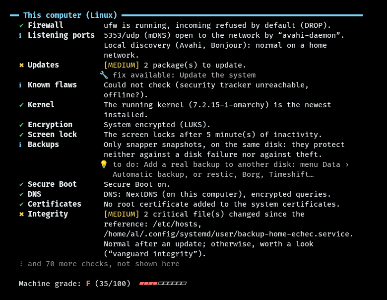
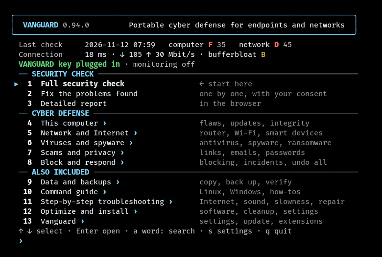
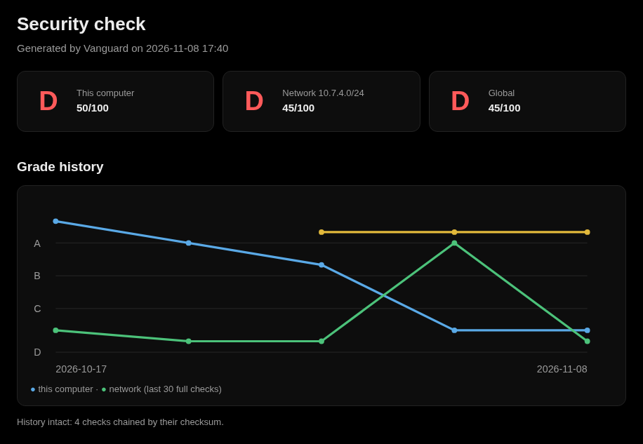
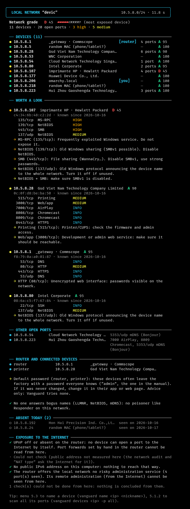
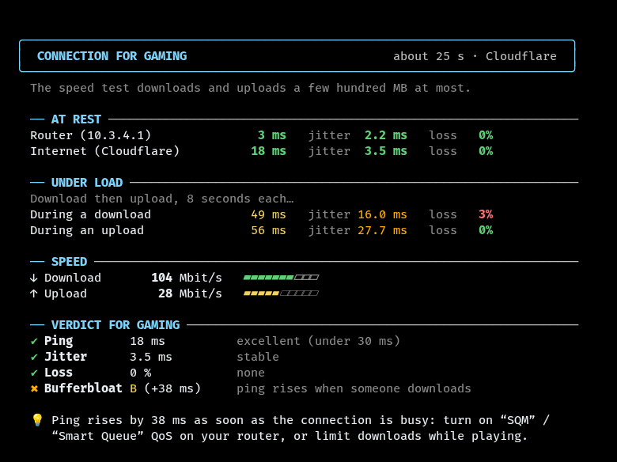

<h1 align="center"><picture><source media="(prefers-color-scheme: dark)" srcset="assets/banniere-blanche.png"></picture></h1>

<a href="README.md">Français</a> · <b>English</b>

  <b>Portable cyber defense for endpoints and networks, from a USB key.</b> 
  Written in Rust · one executable per system (static Linux x86_64, Windows x86_64), nothing to install 
  Runs with the account's rights: administrator rights are only asked for an accepted action (pkexec, run0 or sudo; UAC) 
  Reads and judges on the computer itself; over HTTPS, only reaches a closed list of 28 hosts 
  Linux, then Windows · English and French 
  It complements the system's antivirus (Microsoft Defender, ClamAV): it does not replace it.

<b>In active development · defensive only</b>

## Security of Vanguard itself

A defense tool that runs on computers to be protected must first be safe itself. What is in place in this version,
and how to check it:

| Area | What is done | How to check |
|---|---|---|
| **Signed versions** | The latest version is described by a manifest (version, size and SHA-256 of each system's program) signed with Ed25519 outside GitHub. Two public keys are built into the program: the main one, and a backup key kept offline that can revoke the main one (the revocation is kept in the sealed state, and the main key is never accepted again). Strict verification (`verify_strict`) under a signature domain (`vanguard-versions 1`, and `vanguard-historique 1` for the version history: a signature never counts for the other file). Refused: a badly signed manifest, a version no newer than the highest already seen (kept, sealed), a program whose size, fingerprint or built-in version is not the signed one. A manifest older than 45 days gives “not verified”, never “up to date”. Nothing is installed without consent. | `vanguard verifier-moi`: version, date of the last commit, SHA-256 fingerprint, compared with the signed version history; published programs kept apart, in [vanguard-update](https://github.com/d9v3/vanguard-update) |
| **The published program** | Its protections are read back from its headers before each release (`vanguard deploiement verifier-binaire`), and a program missing one is not released. Linux: static-pie ELF, full RELRO marking (BIND_NOW, applied by Vanguard itself at startup, since musl's startup does not do it), non-executable stack, no segment both writable and executable. Windows: ASLR (DYNAMIC_BASE, HIGH_ENTROPY_VA), DEP (NX_COMPAT), relocations present, DLLs imported from System32 only, `asInvoker` manifest. CFG and CET are shown, not required. Built with LTO and `overflow-checks = true`: a calculation that overflows on hostile data stops instead of wrapping around to zero. | `vanguard deploiement verifier-binaire <program>` |
| **The code** | `#![deny(unsafe_code)]` at the root; unsafe is only allowed module by module, each block with the `// SAFETY:` comment clippy requires, and it is refused with no way back (`forbid`) in 62 modules. Counted on each pass of `outils/verifier.sh` (in this version: 357 `unsafe` blocks, 57 `unsafe extern` blocks, 18 functions and 3 `impl`). Clippy in pedantic mode, warnings treated as errors; `unwrap`, `expect`, `panic!` and direct indexing refused outside tests. The code is reviewed against [ANSSI's Secure Rust Guidelines](CONFORMITE-ANSSI.en.md). | `outils/verifier.sh` (unsafe summary at the end of the pass) |
| **Readers of hostile data** | 35 fuzzing targets (.evtx logs and BinXML, PE headers, SQLite, zip, tar, zstd, gzip, DNS client, TLS reply, D-Bus, systemd journal, YARA rules, MIME email…): a few seconds per target on each `verifier.sh` pass, five minutes per target every night in CI. 6 Kani proofs on bounded readers (DNS, SQLite, zstd), compiled on each pass. | `fuzz/`, `outils/fuzz.sh`, `outils/preuves.sh` |
| **Detection regression** | 71 made-up, harmless cases (`tests/corpus-detection`): each case gives its rule's judgment made-up data and requires a finding of at least the expected severity; the same clean case requires it to stay silent. Each rule that cites an ATT&CK technique, and each tool that detects, has its case or a written reason for exemption. | `cargo test` (`src/modele/corpus.rs`) |
| **Dependencies** | cargo deny (known vulnerabilities, licenses, origin), cargo audit, cargo vet (each library reviewed by a third party, or exempted). Each program carries the list of its dependencies (cargo auditable). CycloneDX 1.5 software bill of materials (SBOM) with each version. GitHub workflows analyzed by zizmor, actions pinned by commit. | `cargo audit bin <program>`, [SECURITY.md](SECURITY.md) |
| **Reproducible build** | A single recipe (`outils/compiler-version.sh`): the toolchain of `rust-toolchain.toml`, Cargo.lock as is, the commit date, paths removed. CI rebuilds the same code and writes its fingerprints in its log. They are not yet the same as those of the release computer (musl-gcc and MinGW differ between Arch and Ubuntu): until then, a release goes through the `VANGUARD_PUBLIER_SANS_EMPREINTES_CI=1` override, stated in the release notes and in the signed history. | [CONTRIBUTING.md](CONTRIBUTING.md) (“Reproducible build”) |
| **Secrets** | No private key and no API key in the program: the only keys built in are the two public signing keys, and the private key never leaves the release computer. API keys are the person's own: abuse.ch, kept in the account's Vanguard folder, readable by that account only, never on the USB key, and the address that carries it appears in no message, log, report or JSON; Have I Been Pwned through `VANGUARD_HIBP_CLE`, sent in a header, never on another program's command line. | `src/mise_a_jour/github.rs`, `src/protection/abuse_ch.rs` |
| **What leaves the computer** | Over HTTPS, a closed list of 28 hosts (threat lists, password leaks, software versions, Vanguard's update, speed test); on GitHub, only the repositories Vanguard reads. A test compares this list, the network sockets opened by hand and each address written in the code with the [threat model](MODELE-DE-MENACE.en.md): a new destination not written there makes the check fail. For a link, only the domain leaves; for a password, 5 characters of its SHA-1 fingerprint (k-anonymity). The local record of self-improvement (aggregated counts, no secrets) stays on the computer: the relay's address does not exist in the code (`RELAIS = None`), and nothing leaves. `VANGUARD_ENVOI=0` even turns the record off. | [MODELE-DE-MENACE.en.md](MODELE-DE-MENACE.en.md) (“What leaves the computer”) |
| **Sealed state** | Vanguard's state (extension settings, downloaded lists, defenses turned on, tasks, changes made) is sealed: changed outside Vanguard, it grants nothing and turns nothing off, and says so. The event log is chained and sealed. | `vanguard evenements` |
| **Reporting a vulnerability** | Privately, through the repository's Security tab (GitHub security advisories). | [SECURITY.md](SECURITY.md) |

The programs carry no publisher code signature (Authenticode): their SHA-256 fingerprint, on each release page and in
the signed history, is the proof that they are genuine.

## Security functions, threat by threat

For each threat: what Vanguard **reads** (directly from the system, in Rust, without starting a program for each
reading), what it **judges**, and what it can **do**. Nothing is changed without consent; each action is shown
before it is taken, recorded with the previous state and can be undone, except those that turn a protection back
on; “Put everything back” undoes everything Vanguard changed. Vanguard never lowers a protection on its own: the
person can, in Windows or in the Defense options, where the lowering is shown, confirmed and recorded, and “Turn back
on” restores it ([Lowered by choice](MODELE-DE-MENACE.en.md#lowered-by-choice)).

| Threat | What it reads | What it judges | What it can do |
|---|---|---|---|
| **The check, graded from A to F** | Linux: sysctl, `sshd_config` in the order of its `Include`s, the OpenSSH version read without running it, the clock through `adjtimex`. Windows: registry, WMI and COM (Defender, BitLocker, Windows Update, disk), `NetUserEnum`, `NetShareEnum`; PowerShell as a fallback only | 138 rules with a stable identifier (`LNX-SSH-006`): 94 on Linux, 82 on Windows, shared ones included. Each cites its reference (CIS, Microsoft or ANSSI; ATT&CK, T… for what it detects, M… for what it hardens) and has its time limit. What could not be checked is said, never counted as healthy | Fix after consent, preceded by a restore point when the system has one (snapper or timeshift, Windows). On Windows, fourteen settings from a fixed allowlist applied by Vanguard itself, relaunched as administrator (one UAC prompt, a named pipe checked on both sides); the rest through a readable script. sshd fixes validated by `sshd -t` |
| **Exposure to the Internet** | The router through UPnP IGD (Rust client: SSDP, read-only SOAP), listening ports (netlink on Linux, `GetExtendedTcpTable` on Windows), public IPv6, the router's admin page | The network audit: 34 checks in six grades (exposure, Wi-Fi, device separation, DNS and certificates, connected devices, computers); after consent, the public address in four blocklists | Flags; nothing is attacked, no password is tried (one announced exception: an SNMP read request with the factory password “public”) |
| **Intruders on the Wi-Fi and the local network** | Wi-Fi through nl80211 (Linux) or the WLAN API (Windows), neighbors through netlink; TCP “connect” scan without root, mDNS, SSDP; random names asked over LLMNR, NBT-NS and mDNS | Encryption (WEP, WPA2, WPA3), WPS, fake access point copying the name, DHCP server that is not the router, ARP, a poisoner like Responder (which answers a name that does not exist), newcomers | Flags, and every hour with monitoring; public Wi-Fi mode closes the computer to the network and puts it back as it was |
| **Connected devices** | Manufacturer, open ports (TCP and UDP), mDNS and SSDP announcements | Router, cameras, printers, NAS, TVs, smart home; default password to change, hidden cameras | Flags, with what to change |
| **Infected computer** | Files (YARA engine written for Vanguard, 4 threads, 308 ReversingLabs rules, MalwareBazaar fingerprints); memory of programs on demand (`/proc/<pid>/mem`, `ReadProcessMemory`: never LSASS nor a protected process); each program's connections; startup, services, drivers; `/proc` (hidden PIDs, fileless programs, modules); Windows logs (in-house .evtx reader, EvtQuery) and systemd's | Log rules (`EVT-…`), botnet command servers (ThreatFox, Feodo Tracker), vulnerable drivers (LOLDrivers), encryption burst (ransomware watcher, Linux), decoy files; the certain kept apart from the doubtful | **Block**, with one click: program stopped and quarantined (reversible), connection closed at the firewall (ufw, or an nftables table `inet vanguard` written through netlink; Windows Firewall through INetFwPolicy2), startup entry removed. Before each action, the evidence is recorded (program, command line, fingerprint, connections) and linked to the action in the sealed event log. Active protection, turned on once, blocks the certain on its own. Evidence collected before any cleanup, with the timeline. On Windows and Linux, the most serious checkup findings (hidden account, service or startup entry added in secret, suspicious setuid program, WMI subscription, added root certificate…) are undone by a defense action, shown then confirmed; the Defense options set Defender, the ASR rules and the firewall (ufw, firewalld or nftables on Linux). **Refused on purpose**: Vanguard and what runs it, PIDs 0, 1 and 4 and critical processes (lsass, csrss, winlogon, svchost, MsMpEng, systemd…), a system program, a remote connection in use |
| **Hijacked DNS and certificates** | The DNS really in use (DNS cache through varlink on Linux), compared with two public resolvers on stable names; root certificates; proxy, hosts file, WPAD; browser extensions | Made-up answers, added root (HTTPS interception), forced proxy, extensions that read every site | Flags; WPAD is among the settings fixed on Windows |
| **Scams and remote control** | Remote control software installed or running; a link, without opening it; a downloaded file | Link: domain compared with URLhaus, Spamhaus DBL and SURBL, domain age through RDAP (only the domain leaves); password: Have I Been Pwned with k-anonymity; file: YARA and fingerprints | Flags; a sandbox for an unknown program |
| **Privacy and spyware** | Échap's public indicators compared with connections and the DNS cache; camera and microphone (Linux: `/dev/video*` and PipeWire or PulseAudio streams; Windows: the system's history); monitoring permissions; browser passwords; git history | Spyware planted by someone close, program reading the keyboard, program started from a temporary folder using the camera, secrets left in clear text | Flags; block like a threat |
| **AI agents** | Local AI servers (Ollama, LM Studio, ComfyUI, Gradio); settings of Claude Code, Claude Desktop, Cursor, VS Code, Windsurf and Gemini CLI (no secret value shown or kept) | Server open to the network without a password, agent set to do everything without asking, MCP server without a pinned version, reached over HTTP or with a key in clear text | Block the first two with one click; nothing is fixed on its own. Defense against emerging threats from AI agents is in development |

Vulnerability reports to a vendor (Microsoft, Google, Mozilla, Apple, GitHub advisory, CERT…) are prepared as
drafts, stripped of anything personal; the person reviews and sends them personally.

<b>The details, threat by threat</b>

#### The check, graded from A to F

**Security check** — a grade from A to F, then each problem with its fix.

- Firewall, open ports (TCP and UDP), updates and known vulnerabilities, disk encryption, Secure Boot, screen lock,
  accounts (and their lockout after wrong passwords, minimum length: Linux, Windows), automatic proxy discovery
  (WPAD: Windows), SSH (and its failed login attempts, from the Internet or from the local network, and a
  client that does not check servers; forwarded ports open to the network, forwarded X11 display, too many password
  attempts; broken algorithms, SHA-1, CBC, 3DES, MD5 or DSA, reopened in sshd, removed after `sshd -t` without
  cutting any connection), sudo, groups worth root (docker, lxd, libvirt, disk), command folders other accounts can
  change, kernel hardening (on Linux: ICMP redirects in IPv4 and IPv6, impossible source addresses, user namespaces
  open to all), badly protected secret files, backups, file shares open to everyone (Samba, NFS, Windows shares: the
  password-less access is closed after your consent, named accounts keep theirs).
- Clock set automatically; end of support: Windows 10 and the Windows 11 versions that no longer get fixes,
  programs abandoned by their publisher (Flash, Java 7, Office 2016…), browsers that no longer update; forgotten
  accounts (active but unused for six months); new administrators.
- Windows: WDigest (passwords in clear text in memory), Local Security Authority protection, PowerShell 2.0, Remote
  Assistance, automatic sign-in (and password in clear text in the registry), SmartScreen off, account control off
  for remote connections, memory integrity, paused updates, LM or NTLMv1 network authentication, share signing,
  PowerShell running any script, UAC that asks nothing, guest access to shares, accounts listed without a password,
  Secure Boot, suspended BitLocker, Defender cloud protection off, overly broad Defender exclusions, Office macros
  all allowed, passwords kept as LM hashes, Remote Registry, SMBv1 client, MSI installs with system rights, services
  with unquoted paths, exploit protection off, Windows Update turned off or paused, OpenSSH server (password sign-in,
  administrators_authorized_keys rights) and SSH keys without a passphrase or readable by others, Defender protections
  turned on by Vanguard and later turned off; Linux: automatic security updates, session that opens by itself without
  an encrypted disk.
- Software installed since the last check, reported for a week (an inventory kept sealed on the computer, never sent);
  outdated software on Windows (see below).
- Each rule cites at least one CIS, Microsoft or ANSSI reference (`vanguard rules`), and has its time limit: one that
  exceeds it is reported as not checked, the others go on.
- Health: disk space, SMART status of the disks (without root), battery, temperatures.
- What could not be checked is said, never counted as healthy.
- The check reads what it checks by itself, without starting a program for each reading: on Windows, the accounts, the
  Run keys and the Startup folder (Windows functions and the registry, PowerShell as a fallback). Faster, and fewer
  ways to fail.
- Fixes applied only after confirmation, with a restore point created automatically beforehand when the system
  allows one (snapper or timeshift configured on Linux, Windows restore point). On
  Windows, fourteen hardening settings from a fixed allowlist (WDigest, Remote Desktop NLA, NTLMv2 only, LLMNR, WPAD,
  UAC…) are applied by Vanguard itself, relaunched as administrator: Windows' prompt names it; only Enter or yes
  applies them. They are protections: Vanguard does not undo them, the person can change them in Windows. Threat blocking adds, the same way, Microsoft's
  vulnerable driver blocklist. The other fixes, or those chosen along with them, go through a readable script.
- Each fix first records the previous state of what it changes, noted and sealed: “What Vanguard changed” undoes it,
  then reads the state back. A fix whose previous state cannot be read is called “not undoable” before it is applied,
  and one that turns a protection back on (firewall, antivirus, BitLocker, UAC, SELinux, kernel hardening
  on Linux, Windows hardening and Defender protections) is never undone; undoing only puts back a noted value of the
  expected form, never a kernel key below its safe value nor a weakened sshd directive in its file (a forged note can
  still have that file, set by Vanguard, removed: sshd then goes back to its earlier settings).

**Outdated software** (`vanguard outdated-software`, Windows, and in the check) — the installed version of
browsers (Chrome, Edge, Firefox, Brave), Office, Acrobat and Reader, Java, 7-Zip, PuTTY and Slack, read in the file
itself, compared with the latest published. The lists from the publishers, endoflife.date and Homebrew are downloaded
in full, the same for everyone: the list of your software never leaves the computer (Settings › Software versions to
turn these downloads off). For Firefox and Edge, each exploited flaw in CISA's catalog is checked against the
installed version: a version older than the fix is critical. What has no reliable source is said not checked.
Read-only; on Linux, the package manager takes care of it.

**Post-quantum check** (in the check, read-only) — encrypted traffic recorded today can be kept and read once a
quantum computer exists. The check says where post-quantum key exchange is missing: SSH server and client (from the
OpenSSH version, read without running it, and the algorithms actually kept; the advice only names an algorithm that
version knows and goes through `sshd -t`), browsers (X25519MLKEM768 turned off by a preference or a policy, or a
version too old to offer it), WireGuard peers without a pre-shared key (counted without keeping any key). The network
audit adds the router administration that offers none, and a path to the Internet that would remove it. Nothing is
changed, and what could not be read is said not checked.

**Self-test** (`vanguard self-test`) — Vanguard checks its own readings on the computer where it works. Every check
rule runs under a guard and a time limit, read only and proven so: any state write is refused, and BLAKE3 fingerprints
of its folder, before and after, would name what changed. Its readings are compared with those of the system's tools:
ten on Linux (pacman, dpkg, systemd units, listening ports, sshd version, DNS…), four on Windows (firewall, Defender,
BitLocker, local accounts). Offline by default; `--json` holds no value from the computer; exit code 0 (sound), 1
(gap) or 2 (not checked). Each rule's duration is measured: a rule three times slower than usual, or close to its
time limit, is reported. The monitoring runs it again every week; a gap goes to the error log, without any value from
the computer, and a contradicted reading is stated next to its rules' sound findings.

#### Exposure to the Internet and the local network

**Network audit, domain by domain** (`vanguard network-audit`, menu Network and Internet › 2, and right after the
full check) — six grades: Internet exposure (the ports the router opens, asked of the router itself, a public IPv6
without a firewall), Wi-Fi (encryption, WPS, fake access point, read in the beacons), device separation (connected
devices on the computers' network, a DHCP server that is not the router, ARP integrity), DNS and certificates,
connected devices, computers. Nothing is attacked. What could not be checked is said and never counts as safe:
without enough checks, no grade.

**Local network** — every device, its manufacturer, its open ports (TCP, and UDP: SNMP, NetBIOS, UPnP, DNS, mDNS) and
its risks; newcomers flagged, one notebook per network (the owner's, each friend's), nicknames ("HP printer"); the
ports that devices opened to the Internet on the router through UPnP (read-only, by a UPnP client written in Rust; as
a fallback, miniupnpc on Linux, the Windows UPnP interface on Windows).
After your consent, the public Internet address is looked up in four blocklists (Spamhaus, SpamCop, DroneBL, PSBL):
listed for spam or attacks, a device is probably infected. During the scan, Vanguard also asks for a name that does
not exist (LLMNR, NetBIOS, mDNS): nobody legitimate answers, and the device that does is a poisoner like Responder,
which steals the network's Windows passwords; the hourly monitoring flags it too.

#### Intruders on the Wi-Fi

- Wi-Fi: the network's protection (WEP, WPA2, WPA3), and fake access points ("evil twin") that copy its name without
  a password to lure devices; on Linux, saved open networks that reconnect by themselves.
- Bluetooth: computer visible all the time, and devices paired less than a week ago (a keyboard paired by someone
  else types whatever it wants).
- Hourly monitoring: a notification if an unknown device shows up, if a port opens, if the machine's grade drops, if
  the router seems spoofed (shared or changed MAC address: ARP spoofing), or if a program or a disguised file lands
  in Downloads (to check before opening it; with active protection, one whose fingerprint is in MalwareBazaar is
  quarantined by itself). Its dashboard, a local page opened in the browser:
  its state, the alerts day by day (kept even when the night's notification is gone), the devices that showed up and
  the connections to botnet servers. Nothing is sent.

**Public Wi-Fi mode** (`vanguard public-wifi`, Network and Internet menu) — to turn on when arriving at a café, a
hotel or an airport, and off when leaving. The computer no longer accepts any connection from that network (an SSH
session already open stays), file sharing and the announcement of its name are off, and the DNS switches to the
Canadian Shield “Protected”, encrypted on Linux (a DNS that already protects you is kept). On Linux, a separate
nftables table, which also closes container ports; on Windows, the Public category, the firewall's Public profile
closed to incoming connections and NetBIOS off, in a single administrator prompt. Each change is shown with its
previous value, noted and sealed; turning off puts everything back in reverse order, even after a restart, and what
could not be closed is stated in the menu and the check. `vanguard public-wifi portal` reopens the network's sign-in
page. Nothing is sent to recognize a public network.

#### Connected devices

**Router and connected devices** — after the scan, or later from the last scan kept (`vanguard smart-devices`), what the router
says about itself (often its model and software version), an admin page over HTTP only, and the cameras, printers,
NAS, TVs, speakers, consoles and smart home devices, recognized by their manufacturer, name, ports and
announcements. For the router, cameras, printers and NAS, the advice to change the default password: nothing more is
probed and no password is tried. One exception, announced during the scan: a single SNMP “describe yourself”
request with the factory read password “public”, read-only, which gives the model of printers and NAS; a device that
answers it is reported, since anyone on the network can then read it.

**Hidden cameras** — in a rental or at someone's place, the devices on the network that look like cameras (maker,
video stream, ONVIF), without turning anything off or watching anything.

#### Infected computer

**Against ransomware and malware** — decoy files: a decoy text file and PDF in Documents, Pictures and Desktop,
which nobody has a reason to touch. Ransomware that encrypts or renames them triggers a critical alert, at each
check and hourly through monitoring, with what to do; placed and removed after your consent. And a YARA scan: over 300
ReversingLabs rules that recognize whole families (ransomware, password stealers, trojans, backdoors…), alongside
the antivirus, applied by Vanguard's own YARA engine: nothing to install. Each file read is also compared with
the SHA-256 fingerprints of known malware from MalwareBazaar (abuse.ch): there, it is that very
program, beyond doubt. The full list is downloaded once a week (about 43 MB), the last 48 hours once a day; offline,
the saved copy is used, and with no copy at all, it says so.

The MalwareBazaar, URLhaus and ThreatFox lists need a free abuse.ch key (account at https://auth.abuse.ch/, key given
in Settings): abuse.ch closed its public downloads on October 21, 2026. The key stays on the computer, never shown in
full; without it, these lists are reported as not checked. What the antivirus or YARA finds can go into a reversible quarantine: the file is made unusable and noted, then put back exactly in its place if it was a false
positive.

**Threat blocking** (Block and respond › Threat blocking menu, `vanguard blocking`) — each threat found offers
"Block": the action is shown, carried out after your consent, written down in "What Vanguard changed" and undone
exactly by `vanguard blocking undo`; only stopping a program cannot be undone. Depending on the threat: the program
stopped then quarantined, the connection closed at the firewall (ufw, nftables, Windows Firewall), a launch
removed from startup, Windows' vulnerable driver blocklist turned on, an AI server's port closed to the network, an
AI agent set back to asking before it acts. **Active protection**, once enabled, blocks clear-cut threats on its
own (a file whose fingerprint is in MalwareBazaar, a known attack tool running, a connection to a known command
server), during the check and in the hourly monitoring, then lets you know; what is doubtful stays an alert with its
button. Four categories (programs, connections, startup and drivers, AI agents), each off, one click or automatic
(programs and connections). Never Vanguard, a system program, a critical process, a remote session in progress, a
local address or a public DNS; an interpreter (python3, PowerShell) is never quarantined, at most the script it
runs. As administrator, nothing is blocked by itself: the blocking settings can be written by any program of the
account, and clear-cut threats are offered with one click there. Each threat also offers **Suspend** (the program
frozen, reversible with `vanguard blocking resume`, recalled at each check; only this process is frozen, not the
programs it already started; on Linux, any process of the same account can resume it: the check suspends it again if
this account has the rights, otherwise it says so), **Cut its network** (the program runs but talks to no one,
reversible with `vanguard blocking restore-network`; on Linux, this process only, until restart, its connections
already open cut in the same step; on Windows, two firewall rules on its file: all processes of this file, connections
already open not cut, until given back even after a restart; never Vanguard nor what carries a remote session),
**Watch more closely** (Linux: an alert when it starts, at most one
per hour, for 7 days), **Trust** (a certain file: a typed word, tied to its fingerprint, 90 days) and Ignore; an
action refused by a safeguard stays visible, greyed, with its reason. A notified alert is taken up again with
`vanguard alert <id>`: read again from the sealed log, the threat judged again.

**Evidence before the action** — before stopping a program, quarantining a file or blocking an address, including on
its own at night, Vanguard records what the action will erase: the program, its command line, its parent, its account,
the file's SHA-256 fingerprint, the current connections; what cannot be read is noted “not possible (reason)”, and the
block happens anyway. The evidence is kept with the block, and the antivirus and YARA quarantine goes the same way,
undone with `vanguard blocking undo`. **The event log** (`vanguard events`) links the alerts, this evidence, blocks,
quarantines and fixes, their undoing, alerts declared normal and version changes, on this computer only: append-only,
each line carries the fingerprint of the previous one and the head is sealed; a removed, changed or added line shows,
and a broken chain is reported by the check. `--incident <id>` follows an incident's thread, from the alert to the
undo.

**Defense options** (`vanguard defense-options`, tool 4.10 on Windows, 4.9 on Linux) — what defends the computer, on one screen, each option
read with what enforces it and adjustable from here. On Windows: Microsoft Defender's settings (real-time, cloud,
samples, unwanted apps, network protection against dangerous sites, controlled folder access against ransomware,
behavior, downloads, scripts, block at first sight), its exclusions and allowed apps; the 19 attack surface reduction
(ASR) rules, each one blocked, in audit or off; Windows Firewall for each profile (on, inbound, outbound, block all)
and its existing rules; the policies (GPO, Intune) that enforce a value, a third-party antivirus, a managed PC. On
Linux: the firewall (ufw, firewalld or nftables), its state, turning it off or back on. Strengthening is done after
consent. Lowering is the person's choice, never Vanguard's: the lowering goes alone, shown by the administrator
process (root on Linux), confirmed by a typed “y” (Enter alone means no), its previous value noted first; the check
calls it “your choice” and “Turn back on” restores it. The details, and what Vanguard refuses no matter what:
[Lowered by choice](MODELE-DE-MENACE.en.md#lowered-by-choice). An exclusion added outside Vanguard is flagged, and
“It was me” notes a lowering made elsewhere. Vanguard never gets around tamper protection: it opens the Windows page
where it is turned off. It does not offer to stop Defender's service or the firewall's. During a remote session, the
firewall does not close on the current network; on Linux, turning the firewall off warns when an SSH session may
depend on it, and iptables-nft tables (Docker, libvirt, fail2ban…) are never removed. On top of its own blocking,
Vanguard also turns on, after your consent, the ASR rules that protect best (password theft from memory, vulnerable
drivers, booby-trapped Office documents and attachments), each one named before you agree; those that would block
Vanguard on its USB drive or troubleshooting are never turned on unasked, and nothing is offered when another
antivirus replaces Defender.

**Confirmed defense actions** — much of what the check and the threat hunt find no longer stays a “do it by hand”
tip: Vanguard undoes it itself, as administrator (root on Linux), after judging again what it sees, showing the action and
getting a yes. The previous value is noted and “What Vanguard changed” undoes it; an action that cannot be undone is
called “not undoable” before the question.
- Windows: SmartScreen, memory integrity (HVCI), LSA protection and Credential Guard turned back on without a
  firmware lock; updates resumed; remote assistance and automatic sign-in turned off (the plain-text password
  removed); share signing required; weakening policies (Office macros, guest, PowerShell, browsers) removed on a PC
  outside any domain or management; Defender exclusions removed; local account disabled (never enabled); password set
  on an account that has none, typed in the administrator window only; an account's access removed from a share;
  service path put in quotes; debugger hidden on a program removed; sticky keys restored by `sfc /scanfile`; OpenSSH
  (key permissions, sshd_config); certificate roots added outside Windows removed; hidden startup entries (Run,
  tasks, Startup folder, WMI subscriptions) removed or disabled, the real Defender recognized by its location and
  signature, never by its name alone; a remote control tool running but not connected removed (connected: refused).
- Linux: hidden or forgotten account locked (never deleted), account removed from a sensitive group (docker,
  administrator group), sudo that asks nothing hardened (checked by visudo), suspicious setuid bit or capabilities
  removed, system folder given back to root, service added by hand disabled, suspicious startup line removed, SSH
  server hardened (checked by `sshd -t`, open sessions stay), BPF reserved for root, journal kept, unreadable
  certificate anchor removed, enforced proxy commented out, recent Bluetooth device forgotten, suspicious program
  stopped after copying its traces, Vanguard program replaced outside Vanguard restored (signed program, impostor
  kept in quarantine). An action that could lock the person out of the computer gets a WARNING, and the question
  says no by default.

What stays manual, and why: Defender's tamper protection (Vanguard does not get around it); a policy enforced on a
work or school PC (shown, to be set by whoever manages the computer); a Microsoft account's password (Windows
manages it online); Firefox's protection against fraudulent sites turned off by a policy; a kernel rootkit (back up
and reinstall: nothing removes it safely).

**Collect the traces** — after an infection, before cleaning up or reinstalling: what a specialist will want to
see, kept in a dated folder on the VANGUARD key (or in this computer's Vanguard folder), in the order it vanishes.
Processes (with their program's SHA-256 fingerprint), current connections, what starts by itself, the check as JSON,
accounts, logs of the last 7 days (as .evtx on Windows), recent files from risky places (described, not copied);
LISEZMOI.txt, in French and English, tells what each file holds and what could not be read, MANIFESTE.txt gives
their fingerprints (`sha256sum -c MANIFESTE.txt`). Read-only: nothing is stopped, moved or sent. The folder holds
personal data, to hand only to someone you trust. It is also the first step of “After an infection”, ticked by
default: cutting the network or cleaning up erases these traces. With ransomware or a remote control still connected to
the Internet, cutting comes first: every minute counts. An incident timeline (CHRONOLOGIE.txt) puts
everything in time order, oldest first: accepted or refused sign-ins, created accounts, added services and tasks,
cleared logs, Defender detections, recent files that matter (programs, scripts, hidden files). The traces also
include what Vanguard saw and did (07-vanguard.txt): its alerts, its blocks with their evidence.

**Report a flaw to a vendor** (Block and respond › Report a flaw to a vendor menu, `vanguard disclose`) — when a program behaves
abnormally, Vanguard prepares the draft report, which the person reviews and sends personally. It sorts first: an
already known flaw (CVE, CISA's catalog) is fixed by an update; malware, a missed detection or a phishing site are not
flaws of the vendor, and the right recipient is named. Otherwise, the draft follows the chosen program's format (MSRC,
Google, Chrome, Mozilla, Apple, GHSA advisory, CERT/CC, CERT-FR, Vanguard), with the thread of an incident from the
event log or a tool's last examination; it stays titled INCOMPLETE while what only the person knows is missing (the
steps, what happened, the required proof of concept). What is personal is removed in three layers (nothing useless;
paths, names and addresses masked; a final check that refuses to write if a known name survives), and the count is
shown. The text is shown in full, then written after consent in Vanguard's folder on this computer; `--effacer`
removes the drafts. Nothing is ever sent: the module holds no network code, no clipboard, no email.

**Live threat hunting** — a successful sign-in from an address that had just failed at least ten passwords (sshd's log
on Linux, Remote Desktop on Windows): the sign of a guessed password. And suspicious running programs: a known
offensive tool (mimikatz, xmrig…), a command line that downloads or hides what it runs (encoded PowerShell, mshta,
certutil, curl piped to a shell), a program started from Downloads, a temporary folder or the recycle bin.

**The watcher** (Linux 6.6 and later, off by default, `vanguard watcher on`) — between two monitoring runs, each program
started, even one of a few milliseconds, and each TCP or UDP connection as it closes. Programs are judged as in the
check, connections against the botnet command servers already downloaded; what is serious goes to the dashboard
and as a notification. With active protection and a separate consent (offered when it is turned on, or
`vanguard watcher known on`), it also stops by itself, as it starts, a certain program of the account: its fingerprint
is that of known malware (MalwareBazaar), or it carries the EICAR test mark inside an executable. The judgment is on
the file the kernel started, never on what is later at its path; the program, what it started and its other running copies are frozen, the evidence is recorded, then it is stopped
(even renamed: it is recognised by the file started) and quarantined, with the blocking safeguards. Only a file of the
account placed in its folders (home folder, temporary folders): never a system program, an installed program (/opt,
Flatpak, Steam, AppImage), a critical process, Vanguard or remote access during a session (an alert only). A program of
another account, setuid or that makes itself unreadable is not read: the scan and “Block” see it; a child that started
another program and left its lineage escapes the freeze. A malicious program in the account can switch the watcher off. A program gone
before it could be read is counted as such, never judged safe, and the program of a closed connection is not known
(the kernel does not give it).

**Ransomware watcher** (Linux, offered when the watcher is turned on, or `vanguard watcher ransomware on`, off by
default) — personal folders (Documents, Pictures, Desktop, Music, Videos, Downloads) watched live, without
administrator rights. An encryption burst (dozens of files rewritten in seconds, content no longer matching its
format, a ransom note, a decoy file touched, backup copies erased) raises an alert within seconds, instead of
waiting for the hourly decoy check, and “Block” is offered at the next check. With active protection and an almost-certain case (a decoy touched and
a burst attributed without ambiguity to one program), the program and its descendants are frozen, the evidence is
recorded, then they are stopped and quarantined, with the blocking safeguards; otherwise, Vanguard only alerts. A
malicious program in the account can switch it off: a backup remains the real protection. Stated limit: a write
through a hard link placed outside these folders escapes the live watch (decoys are still checked hourly).

**Windows' hidden doors and kernel drivers** — the DLLs Windows loads by itself, often with system rights: LSA
packages (a password filter receives every new password in clear text), AppCertDlls, print monitors, time providers,
the Winsock catalog. And kernel drivers stored where nothing installed puts one, or known to be vulnerable (the
LOLDrivers list): being signed, they are used to disarm the antivirus.

**Program memory** (`vanguard memory`, on demand) — the YARA rules applied to the memory of running programs:
"fileless" malware lives nowhere else. LSASS and protected processes: their memory is never read; nothing read is
kept, and what could not be read is said.

**AI agents** — a local AI server (Ollama, LM Studio, ComfyUI) open to the whole network without a password, an agent
set to do everything without asking, an MCP server started without a pinned version, reached without encryption or
with a key written in clear text (the key's name only, never its value).

**Recognized open source tools, when installed** — Vanguard runs them and explains what they find, without
changing anything; when missing, it offers to install them with the system's tool. trivy tells the known serious or
critical flaws in Docker or Podman images: an image does not update by itself. And when someone fails SSH logins, the check tells whether fail2ban,
sshguard or CrowdSec already blocks the addresses that keep trying.

- What hides: programs started at boot, scheduled tasks, library preloading, modified privileged programs. On
  Windows, the classic backdoors: a debugger set on a sign-in screen accessibility program (IFEO, SilentProcessExit),
  sethc or utilman (Sticky Keys, Ease of Access) replaced by cmd, Winlogon's Shell or Userinit hijacked, AppInit_DLLs,
  WMI subscriptions that run a command; tracked by the monitoring, fixed when the original state is known exactly.
  On Linux, the signs of a rootkit: hidden processes, programs running without a file (memfd, deleted, started from
  /tmp), a kernel module that hides or unknown unsigned modules, a network card in promiscuous mode (it listens to
  the whole network).
- Windows event logs, over the last 7 days, in the check-up and in “What happened?” (Block and respond › Windows logs
  menu, `vanguard windows-logs`): the EVT- rules read by Vanguard itself, a single judge. Cleared traces, one
  more administrator, guessed passwords, Remote Desktop from outside, a service or scheduled task that runs an
  interpreter or a program from a temporary folder, suspicious processes (attack tools, encoded command, download by
  certutil, bitsadmin, mshta…), malicious PowerShell, Defender disarmed, BITS, WMI, audit policy. What Windows does
  not log by default (tasks, command lines) is said “not verified”, with the setting to turn on; the security log
  can only be read as administrator: without that right, it is said. On this Windows, or on a folder of .evtx from
  Linux (disk mounted from the rescue drive), then the alerts in time order, with the period really read per
  log; included in the report and in the evidence's CHRONOLOGIE.txt.
- Antivirus: ClamAV (Linux) or Microsoft Defender (Windows), on the computer or on a chosen USB key / folder,
  with the tricks of USB worms (shortcut posing as a folder, autorun.inf, scripts).
- Integrity of critical files (accounts, sudo, SSH, PAM, cron, services, autostart): BLAKE3 fingerprints, what changed
  since the reference, and live monitoring.
- Who talks to the Internet?: each program's current connections, with the server's name; a program started from a
  temporary folder or Downloads, a remote access tool's port, a server without a name or a known botnet command
  server (Feodo Tracker and ThreatFox lists, abuse.ch; ThreatFox's with the free abuse.ch key) are flagged.
  Read-only: nothing is cut here; a known command server is blocked through threat blocking.
- Vanguard also distrusts itself: at startup, it says whether a library is injected into every program of the session
  (LD_PRELOAD, DYLD_INSERT_LIBRARIES, AppInit_DLLs: one from a system package, like GameMode, is mere information) and
  whether it runs as root for no reason, since its results go through there. In the check: the hourly monitoring that
  was turned on and has disappeared (malware first cuts what watches it), the check history rewritten afterwards (each
  check carries the previous one's checksum), and its own state (learned alerts, versions already seen, monitoring,
  integrity) changed outside it: each file is sealed by a BLAKE3 checksum, so that a program cannot silence its alert.
  Each night the code has changed, CI builds Vanguard twice and checks that the program is identical down to the byte.
  Every included library is checked at each version and every night (cargo deny: known flaws, compatible licenses,
  origin), and the released version checks its calculations: a number that overflows on hostile data stops the check
  concerned instead of skewing what follows.

#### Hijacked DNS and certificates

- The DNS actually used (and forged answers), added root certificates (HTTPS interception), browser extensions that
  read every site.
- Hijacked browsing (forced proxy, sites redirected by the hosts file).

#### Scams and remote control

- Is my computer being controlled?: the tech-support scam (“your computer is infected”) gets a remote control tool
  installed. Vanguard looks for AnyDesk, TeamViewer, RustDesk, Quick Assist, Splashtop, UltraViewer… installed (and
  since when), started at boot, running or simply sitting in Downloads; it explains what to do (cut the Internet, tell
  the bank, change passwords) and removes them after your consent. A running program is never cut without a second,
  explicit consent: the person helping may be connected through it. In the check too (“Remote access”).
- Is this link dangerous?: a link you received, checked without ever opening it (disguised letters, misleading
  subdomain, imitated brand, link shortener, raw IP address); after your consent, the domain's age and three public
  lists of dangerous sites (URLhaus with the abuse.ch key, Spamhaus, SURBL). Only the domain name leaves the computer.
- Check a downloaded file: its checksum compared with the one the site publishes (pasted, or a SHA256SUMS next to
  it), its name and content (double extension, program disguised as a document), then YARA and the antivirus.
- Sandbox: run an unknown program without network, with a read-only system and an invisible home folder (bubblewrap
  or firejail on Linux, Windows Sandbox on Windows).
- Leaked passwords: checked with Have I Been Pwned without ever sending the password (only 5 characters of its hash);
  email address leaks, after your consent (the address is sent to the service).

#### Privacy and secrets

**Spyware** (`vanguard spyware`, Viruses and spyware menu, and in the check) — signs of spyware planted by someone
close: connections and names asked towards known spyware servers and sites (list from the Échap association, CC-BY
4.0, downloaded when used), known monitoring software installed or running (parental control and employee monitoring
are called normal if installed on purpose), programs reading the keyboard (Linux). Read-only: nothing is removed,
since whoever planted it could notice; the screen says to keep screenshots and ask for help first. What could not be
checked is counted, and the verdict is never “no spyware”.

**Protect the key's data** — the key's device record (names, MAC addresses, nicknames) encrypted by a passphrase
(XChaCha20-Poly1305, passphrase derived by Argon2id), against a lost or lent key. On the owner's computer, nothing
changes: the data key is kept there. Elsewhere, Vanguard asks for the passphrase, or goes on without the record. The
report and the diagnostic are no longer written to the key. On request, reversible, with a backup offered first; the
check reports a record left in clear.

**Secrets in git projects** — Vanguard reads the history of the git projects in the home folder: a password, API
key or token written once stays there, even when deleted later. Its own rules recognize keys by their shape (AWS,
GitHub, GitLab, Google, Stripe, Slack…), private keys, passwords in an address or written in the code; gitleaks, when
installed, adds its own. No secret is shown or kept.

**Camera and microphone: who uses them?** — on Windows, each program that used the camera or the microphone, and the
last time (a program started from a temporary folder or Downloads is flagged); on Linux, what holds them right now.
Read-only. **Privacy check**: the apps that can access location, contacts, camera and microphone, and their last use
when the system records it (the permission store on Windows, Flatpak and Snap on Linux). Nothing is removed: what to
do is given, and what could not be read is said to be unchecked.

**Browser passwords** (`vanguard browser-passwords`) — how many each browser keeps and how they are protected:
counted, never read or sent. The browser's built-in check (weak, reused, compromised passwords) is pointed to, and a
typed password can be looked up in leaks (Have I Been Pwned, only 5 characters of its fingerprint).

- Passwords saved in the browser without protection, sensitive files left in clear text (passwords or keys).

Vanguard never cuts a remote connection in use (Remote Desktop, SSH). Only use it on your own network, or a network
you are allowed to audit.

**What Vanguard protects, and what it does not**: the [threat model](MODELE-DE-MENACE.en.md). **What its rules see,
technique by technique**: the [MITRE ATT&CK coverage map](COUVERTURE-ATTACK.en.md). **How its code is
written**: its [review against ANSSI's Secure Rust Guidelines](CONFORMITE-ANSSI.en.md).

**In development**, without a date: the defense set up by the Vanguard Agent itself (in this version, the Agent only
adjusts Vanguard: it has access neither to fixes nor to blocking) and self-repair; every fix made by Vanguard itself,
in Rust, without scripts; a key that can also start computers that no longer boot (its startup on a real computer
has not been tried yet).

## Also included

Beyond defense: troubleshooting, optimization, data, then follow-up, tools and the USB key.

| Area | What Vanguard does |
|---|---|
| **Troubleshooting** | Computer diagnostic, everyday problems step by step (Internet, Wi-Fi, slowness, sound, printer, full disk), after an infection, new computer, computer leaving, a relative's computer, “Why is it slow?”, computer specs, report to leave behind, repairs. |
| **Optimizing, software and gaming** | Privacy and performance settings that can be reverted exactly, “Put everything back” to undo it all, a cleanup checklist with the space gained measured, startup programs; the best software in 10 categories, from its official source, and updating everything at once; connection for gaming (ping, jitter, loss, speed and bufferbloat, compared with usual measurements), crowded Wi-Fi, NAT type, fastest DNS (without removing a DNS that protects you), settings for gaming. |
| **Data and backup** | Automatic backup and check my backup (rsync copy actually read back), copy my files (checked copy) and check a copy. |
| **Follow-up, tools and USB key** | HTML report with the grade curve, monthly check-up, learning on the computer, what Vanguard changed (each fix, dated, undoable one by one) and the sealed event log, every setting in one place, custom extensions (plugins and scripts, checked before they run); a USB key write-protected anywhere but on its owner's computer, check my drive (fake drives, speed), my computers (tracked by the key), shortcut on this computer, Vanguard updated from the key or from GitHub (versions signed by the author), complete removal of Vanguard from a computer, command guide, search in every menu. |

<b>The details, area by area</b>

#### Troubleshooting

**Computer diagnostic** — the first step of any troubleshooting: hardware, system, and recent problems (journal errors
and crashed programs on Linux; blue screens, sudden shutdowns and crashes on Windows), with a text copy saved on the
key.

**Troubleshoot step by step** — everyday problems, handled the way someone who knows would: no Internet, Wi-Fi
dropping, slow computer, no sound, printer not working, disk full. Two or three questions, then Vanguard checks by
itself (address, router, Internet, DNS; Wi-Fi signal; sound service and selected output; print queue and printer on
the network; disk space) and suggests the right repair or the right tool, always with your consent. And three
journeys for the big moments: **after an infection** (the traces kept first, then what is urgent depending on the
sign, the check of what may have been installed, the scans in order, then the passwords to change, email first);
**new computer** (updates, encryption, backups, starter pack, privacy, in order); **computer leaving**, sold or given
(verified copy first, accounts signed out, BitLocker or FileVault key set aside, secure wipe by the system's tool,
TPM chip cleared). Vanguard never wipes anything itself. And **my account was hacked**: take back control through the
official page, then password, two-step verification, sessions signed out, and a check that this computer did not give
the password away. Slow **since an update**: the latest updates, dated, and how to go back. And **a relative's
computer** (`vanguard troubleshoot relative`): three questions (who uses it, why you were asked to look at it, and whether their
network may be looked at, only with their consent), the check, then a summary in everyday words, ordered by the
answers: what is left to do first, what is fine next. The tools that match the reason (slowness, antivirus, fake
technician), the fixes one by one, and the page to leave behind, with tips chosen for the person.

**Report to leave behind** — a simple page for the person you just helped: their grade, what is left to do from the most
to the least serious, what is fine and three habits; put on their Desktop, to read or print.

**Why is it slow?** — a two-second snapshot: what keeps the processor, memory and disk busy, program by program;
how long startup takes and what delays it; the programs started at login and their weight. Those that work for a
while then calm down (antivirus scanning, indexing, updates) are named as such. Startup programs are removed from
there, after your consent: they stay installed, and each removal can be reverted exactly (`vanguard startup`).

**Computer specs** — model, motherboard, BIOS, processor, memory (modules, type, speed), graphics card and driver,
disks: what you are asked on the phone or to buy a part. Serial numbers are shown on screen only, never written.

- Repairs: Internet, hijacked browsing, firewall, disk, full disk, deep cleaning, stuck Windows Update, system files,
  clock.

#### Optimizing, software and gaming

**Optimize** — privacy, performance and comfort settings written for Vanguard. On Windows: telemetry kept to a
minimum, ads and tracking off, Recall without screen snapshots, file extensions shown, no autorun from USB drives,
fast startup, full right-click menu. On Linux: SSD maintenance, journal size, reports sent by GNOME or Ubuntu. Each
setting shows its state and can be reverted exactly: the previous value is recorded, sealed, then put back. None of
them weakens security. “Put everything back” (`vanguard optimize undo`) undoes, from the most recent to the oldest and
in one administrator request, check-up fixes, Optimize, Gaming, blocks and public Wi-Fi mode.

**Clean up the system** — a checklist of what takes space for nothing: downloaded and unneeded packages, old Snap
versions, unused Flatpak runtimes, AUR builds, old caches, thumbnails, old logs, crash reports (Linux); temporary
files, Windows Update and Delivery Optimization caches, old components (Windows). The space each item frees is
measured first, what rebuilds itself is checked by default, the trash never; the free space read again afterwards
tells what was really gained.

**Connection for gaming** — ping, jitter, loss, speed and bufferbloat (the lag when someone downloads), with a
verdict criterion by criterion and advice.

**Wi-Fi, NAT and DNS** — crowded Wi-Fi: nearby networks by channel, and the freest channel to set on the
router; the NAT type for gaming (open, moderate or strict, as consoles show it), double NAT and provider-shared
address included; the fastest DNS, measured here, offered only if it does not replace a DNS that protects you
(NextDNS, encrypted, filtering), and undoable.

- Update everything at once: system, programs, drivers, firmware.
- Software: the best program for each use, mostly open source, in 10 categories (browsers and email, messaging and
  sharing, accounts and encryption, office, video and music, images and design, system tools, programming, privacy
  and network, backup) plus a starter pack (Firefox, Bitwarden, VLC, LibreOffice, 7-Zip): checklist, installed
  ones recognized, installation from the official source that checks each download (winget, distribution packages
  or Flathub).
- Gaming: on Windows, game components and Windows settings; on Linux, Steam, 32- and 64-bit Vulkan drivers for your
  graphics card, GameMode, MangoHud, Gamescope, Wine, Lutris, Heroic, ProtonUp-Qt, vm.max_map_count, ntsync.

#### Data and backup

**Automatic backup** — set up with the system's tool (Déjà Dup or a daily rsync copy on Linux, File
History on Windows), to an external disk, after your consent and undoable. **Check my backup**: the rsync copy
actually read back from the disk, random files compared with their original; an original changed since, newer than
its copy, is not counted as an error, a copy that differs from an unchanged original means a disk losing data, and a
copy rewritten after the backup, newer than its original, is reported as damaged: that is how ransomware encrypting
the backup disk shows up. For Déjà Dup and File History, which keep their backups in their own format,
how to restore one file. Nothing is written or deleted.

**Copy my files** — Documents, Pictures, Desktop, Videos and Music to an external disk, before a risky repair or a
reinstall: space is checked first, each file is read back and compared with the original (BLAKE3 fingerprint),
nothing is deleted or overwritten, and an interrupted copy resumes where it stopped. **Check a copy**, later, is the
restore test: files spread over the whole copy are read back from the disk and compared with their original; a disk
that loses data shows up before the day you need it.

- Missing backup: reported by the check, with the way to set one up.

#### Follow-up, tools and USB key

**Learning** — Vanguard learns on the computer, sending nothing. An alert declared normal ("i" when it is offered as a
fix, in monitoring, the watcher or blocking) drops to information for 90 days, or until it gets worse; the choice is
about what the alert is about (the program, the address, the device), not its text, and a certain threat is never
silenced. Each connection test is compared with the usual measurements on the same network; a known device that
suddenly seems all closed (asleep) is checked again more patiently. "What Vanguard has learned" shows everything and
lets you forget.

**Settings** (Vanguard › Settings, "s" in the main menu, `vanguard settings`) — every setting in one place: language,
emojis, working without the Internet, real-time protection, hourly monitoring, monthly check-up, learned alerts, threat
blocking, extension restrictions, the abuse.ch key, software versions, the weekly self-test, AUR packages (Arch
Linux: off by default, no package name is sent to the AUR without it), the Vanguard Agent and sharing with the author. Each change shows the previous value and the
command to put it back; learned alerts and blocking open their own screen ("What Vanguard has learned", Threat
blocking). Language, emojis and working without the Internet stay chosen from one launch to the next (VANGUARD_LANG,
VANGUARD_EMOJI and VANGUARD_HORS_LIGNE always win).

**Real-time protection** (Settings, `vanguard settings real-time no [--for 1h|4h]`) — turns off at once, after
consent and the list of what stops, what Vanguard does by itself all the time: the hourly monitoring (and everything it
watches and notifies) and the active protection of blocking, which no longer blocks anything by itself. For 1 hour, 4
hours or until it is turned back on (`vanguard settings real-time yes`); it comes back by itself when the time is up, and
the monitoring checks that itself. Each part's settings do not change: when it comes back, each one is as it was. While
it is off, this is said again at the top of the main menu and on its Monitoring and Blocking lines, in each check-up (a
piece of information, with no effect on the grade), in "Who talks to the Internet?", in blocking and on the monitoring
dashboard, by a notification at the first run then once a day, and in the monthly check-up: a program that turned it off
quietly does not go unnoticed. It only concerns Vanguard: Defender, the firewall and UAC are never touched, and a block
already made stays in place. As administrator, it is not set: its setting belongs to the user account (under sudo, the one
of the account that started it is read).

**Vanguard Agent (no AI)** (Settings › Vanguard Agent, `vanguard settings auto-tuning`, `vanguard agent [--json]`) — a
small built-in agent, with no AI model, that tunes Vanguard itself on this computer, within bounds written in the
code. Four missions, each with its own switch (`mission <tuning|cache|record|fixes> <yes|no>`): **time limits and
second attempts** (the time limit of a rule that comes close to it goes up from 10 to 30 minutes, never more, and a
rule that usually concludes at the next check gets a second attempt), **hourly pass cache** (the hourly pass reuses,
every other time at most, the recent result of a few slow checks, with its age; a check you start by hand checks
everything afresh, and a duration that turns out wrong gets shorter), **local record** (see sharing, below) and
**notes on fixes** (a fix that often fails, or a problem that comes back after it, is pointed out). The rules and how
they judge never change: turning off a mission, or the whole agent, removes no check. Each change is noted with its
previous value in a sealed journal, and can be undone (`undo <rule>`, `reset`). `vanguard agent` shows its missions,
their last run and its journal, read-only; `--json` gives the same view for a script: names from a closed list, rule
identifiers, numbers and dates, no personal data.

**Sharing with the author** (Settings › Sharing with the author, `vanguard settings sharing yes|no|see`) — to improve
Vanguard, the local record mission notes each day, on this computer and as aggregated counts, its errors, its
slowdowns, the result of fixes, the choices made in Vanguard, the hardware (no serial number) and the name and version
of the software, services and drivers involved. Never a password, file contents, a visited site, typed text, a command
argument or a software inventory; an error text is cleaned (paths, addresses and tokens removed) or dropped entirely.
The record lives in the `amelioration/` folder (sealed, 96 KiB per day, 90 days and 10 MB at most); it is never made
from the key, as root (Linux), under Wine or in a CI. **In this version, nothing is sent**: the author's relay
is not in service yet, Vanguard has no address to send to and opens no connection for it, and the sharing screen says
so. Once it is, the code provides for a notice at launch before anything is sent, one batch per day at most, over
HTTPS, no sending of anything recorded before the day of consent, and an installation identifier drawn at random,
renewed every 90 days. “See what would be sent” (`see`) shows the next queued batch or, failing that, the batch of the
latest record rebuilt to see it, byte for byte, indented for reading. “No” (do not share) stops the record and erases
the record (`amelioration/`), the sending queue (`envoi/`) and the installation identifier; check-ups, settings, the
Agent and the self-test measurements stay on the computer. `VANGUARD_ENVOI=0` always wins: nothing is recorded or
sent. What will leave, and how: [MODELE-DE-MENACE.en.md](MODELE-DE-MENACE.en.md).

**Extensions** (menu 12, `vanguard extensions`) — custom programs in Vanguard, without touching its code. A plugin
is a folder with a `plugin.toml` manifest, added once from a folder or a .zip archive (`vanguard plugins add`); a lab
script is a file dropped as it is (`vanguard lab`), to try an idea quickly. A plugin is a script (sh, bash,
PowerShell, Python) or a compiled program, in Rust for instance with the `extensions/sdk` library. Their findings are
shown apart and never count in the grade (`--report` puts them in a separate section of the HTML report). Before your
consent, the whole folder or archive is scanned (YARA, MalwareBazaar fingerprints) and every file hashed: a file
changed, added or removed, and it must be approved again. The checked copy is what runs, without a terminal, with a
bounded time and output; an archive cannot write anything outside its folder; on Linux, `--isolated` runs it without
network, the home folder hidden. As administrator, nothing runs by itself and each run is asked for. The
**Restrictions** switch (Extensions › 3, Settings, or for a single plugin or script) turns these safeguards off for
custom extensions; one rule stays: the extensions folder must belong to the account, closed to other accounts.
How-to (in French):
[extensions/LISEZMOI.md](extensions/LISEZMOI.md).

**Check my drive** — does a USB stick or an external disk hold what it claims? Fake drives (a 16 GB chip sold as
“1 TB”) accept everything and return garbage beyond their real size. After your consent, Vanguard writes recognizable
content into the free space, reads it all back bypassing the computer's memory, measures the write and read speeds,
then erases everything; the files already on the drive are not touched. Quick (a quarter of the free space) or full
(all of it, the only proof); never on the VANGUARD key or the system disk.

**My computers** — each full check run with the VANGUARD key notes the computer there: nickname (“system · model”,
renamable), grade, remaining problems (their category and level only, the five worst), date of the last check. The
table travels on the key's VANGUARDLOG partition, without computer name, account, address or Wi-Fi name; it never
goes to GitHub.

**Shortcut on this computer** — Vanguard copied here and started with one click.

**Remove Vanguard from this computer** — everything it placed there (monitoring, monthly check-up, automatic backup,
watcher, decoy files, shortcut and icon, program copy, leftovers of an earlier version) is found, shown with what will
be done, then checked. The data folder is erased only after a second consent; changes made to the system are first undone by
their own tools, or said with their command; the key is never touched.

**Command guide** — the useful commands of Omarchy, Arch, Fedora, Debian and Ubuntu (and other Linux), Windows 11, and
the ones typed the same way everywhere (Vanguard, ping, nslookup, ssh, curl, git…), each one explained; ⚠ marks the
ones that change something. Each distribution has its introduction, its “Step by step” guides (update, install, free
up space, repair, firewall, NVIDIA drivers, new release…), its programs (pacman, dnf, apt, SELinux, AppArmor…), then
those common to Linux; Windows 11 has its step-by-step guides too (repair Windows, network, security, slowness…). You
type what you are looking for: commands show up as you type, and Tab completes the word. Each command has its page:
copy it, to type it here or on the computer of the person you help, or run it here when it only reads; its output
scrolls in Vanguard, and Esc stops it. Every system can be read everywhere (Windows commands from Linux, for example),
and the guide tells when a program is missing on this computer. On top of that, the examples of
[tldr-pages](https://tldr.sh) (CC BY 4.0 license): over 30,000 community commands for Linux, Windows and other
systems. The guide downloads them by itself, at most once a week, so do the monitoring and the monthly check-up
(without opening the guide, once it has used them), and the key brings them along: run from the key, it has them from
the first launch, even without Internet. They can be searched and copied, but never run from here, since Vanguard has
not checked them.

- Monthly check-up: one notification a month with the machine's grade, waiting updates, the space a cleanup would
  free and new problems; nothing is changed.
- HTML report with the grade history curve, and what changed since the previous check.
- Check Vanguard itself: its version, the date of its last commit and its SHA-256 checksum, to compare with the
  release page (Vanguard is not signed: this comparison is what proves it is genuine). A copy older than six months
  says so in the menu. And the key manifest: at deployment, the checksum of every file on the key is kept on the owner's
  computer; back from someone's place, the check names what was added, replaced or removed (a planted autorun, a
  replaced program). Data, ISO images and the Ventoy menu, which change normally, are not compared. Each key has
  its own reference (recognized by its volume identifier): a second VANGUARD key does not pass for a modified one.
- Update itself: from a newer VANGUARD key, or, without a key, from GitHub. The published programs have their own
  repository there, [vanguard-update](https://github.com/d9v3/vanguard-update), next to the code's; the latest version
  is described by a manifest signed with Ed25519 on the author's computer, whose public key Vanguard carries, along
  with that of a backup signing key kept offline, which can revoke the main one if it were stolen. A badly signed
  manifest, a version older than the highest already seen, a program whose size or checksum differs: refused; a
  manifest that is too old, or a clock running behind, is called not verified, never “up to date”. The menu announces
  a newer version; nothing is installed without your consent. The signed version history lets `vanguard self-check`
  also check a copy that is no longer the latest.
- Keyboard menus: ↑ ↓ to move, Enter or → to select, Esc, ← or Backspace to go back (on the main menu, ← does nothing,
  so as not to quit by mistake; in a checklist, only Enter confirms). The window opened for Vanguard takes the menu's
  size and centers itself (Hyprland, Windows console).
- Search in every menu and checklist: type a word (wifi, disk, dns, update…), only the lines containing it stay,
  whatever the accents or capitals; the end of the most likely word shows in grey, and Tab completes it. In the main
  menu, it also finds each tool of the submenus, and each page and each command of the guide.

## In pictures

<table>
  <tr>
    <td width="50%"> The menu: last check,
    connection, key plugged in.</td>
    <td width="50%"> The HTML report and
    the grade history.</td>
  </tr>
  <tr>
    <td width="50%"> The network: every
    device, its ports and what deserves a look.</td>
    <td width="50%"> The
    connection for gaming: ping, jitter, speed, bufferbloat.</td>
  </tr>
</table>

Screenshots retaken at each version, on a copy of the data; the local network's addresses and names are
masked.

## Supported systems

| System | Versions |
|---|---|
| Linux | Arch and derivatives (Omarchy, Manjaro, EndeavourOS, CachyOS), Debian, Ubuntu, Mint, Pop!_OS, Fedora (and RHEL, Rocky, Nobara), openSUSE |
| Atomic Linux | Bazzite, Silverblue, Kinoite, Bluefin, Aeon |
| Windows | 10 and 11 |
| macOS | No longer supported: no more Mac version. A Vanguard for Mac already installed no longer finds updates, without errors |

Vanguard recognizes the distribution and offers its own commands: `omarchy update` / `omarchy pkg add` on Omarchy,
`ujust update` on Bazzite, `rpm-ostree` or `transactional-update` on an atomic system, otherwise pacman, apt, dnf or
zypper.

## Installation and first launch

**Download** (latest version): [Windows](../../releases/latest/download/vanguard-windows-x86_64.exe) ·
[Linux](../../releases/latest/download/vanguard-linux-x86_64) — or the whole [releases page](../../releases/latest),
with the SHA-256 checksums. What each version brought: [history](CHANGELOG.en.md).

- **Windows**: double-click the program. It is not signed: SmartScreen may warn (“More info”, then “Run anyway”).
  Microsoft Defender sometimes mistakes it for a virus (“Trojan:Win32/Bearfoos.A!ml”, an automatic detection of
  a new program): it is a false positive; check the SHA-256 checksum on the release page.
- **Linux**: `chmod +x vanguard-linux-x86_64`, then `./vanguard-linux-x86_64` in a terminal (any distribution, nothing
  to install).
- **From the USB key**: `Windows/vanguard.exe` or `Linux/vanguard`; the key's guide is in `README.txt`.

In the menu, choose **1** (full security check), then **2** (fix). ↑ ↓ to move, Enter or → to select; Esc, ← or
Backspace to go back. The window fits the menu when it was opened for Vanguard.

The menu sorts the tools in two parts. **Cyber defense**: 4 This computer, 5 Network and Internet, 6 Viruses and
spyware, 7 Scams and privacy, 8 Block and respond. **Also included**: 9 Data and backups, 10 Command guide,
11 Step-by-step troubleshooting, 12 Optimize and install, 13 Vanguard (settings, update, extensions). A word typed in
the main menu ("antivirus", "backup") finds any tool; its path ("6.1.3") opens it directly.

## Commands

Each menu entry is also a command.

<b>All the commands</b>

| Command | Purpose |
|---|---|
| **Security check** | |
| `vanguard check [--html] [--text]` | full check: machine + network; `--text` shows it as plain text (emergency mode) |
| `vanguard fix` | fix the problems found |
| `vanguard report` | the detailed report in the browser: this session's check, otherwise a full check first |
| `vanguard search <words> [--first] [--json]` | find a tool, a guide page, a program or a setting, as in the main menu: synonyms ("box" → router) and typos included; a number opens the result |
| **4 This computer** | |
| `vanguard audit [--json]` | audit of this machine |
| `vanguard updates` | updates |
| `vanguard latest-flaws [--days N]` | latest exploited flaws: those CISA just added to its catalog, most recent first |
| `vanguard integrity [--accept] [--live]` | integrity of critical files (BLAKE3 fingerprints), live if wanted |
| `vanguard maintenance [on\|off]` | monthly check-up; without an argument: what it would say now |
| `vanguard specs [--json]` | computer specs; `--json` without the serial numbers |
| `vanguard handout` | report to leave behind: a simple page for the person you helped |
| `vanguard secrets` | secrets forgotten in the history of git projects (and gitleaks, if installed; read-only) |
| `vanguard containers` | known flaws in Docker or Podman images (trivy, if installed; read-only) |
| `vanguard outdated-software` | outdated software (Windows): browsers, Office, Acrobat, Java, 7-Zip, PuTTY, Slack compared with their latest version; exploited flaws (read-only) |
| `vanguard defense-options [--json] [--choose ID VALUE] [--turn-back-on ID]` | defense options. Windows: each Defender option (real-time, cloud, PUA, controlled folder access…), exclusions, ASR rules, firewall per profile and its rules, policies (GPO, Intune) that enforce a value, third-party antivirus, managed PC. Linux: the firewall (`--choose pare-feu-ufw coupe`, or firewalld, nftables; `allume`). Lowering shown, then confirmed by a typed yes, its previous value noted; `--turn-back-on` restores it; Windows only: `--exclude KIND TEXT`, `--allow PROGRAM`, `--note ID` (“It was me”), `--put-back WORD`; `--json` without paths or names |
| **5 Network and Internet** | |
| `vanguard devices [target] [-p common\|all\|22,80,8000-8100] [--json]` | scan the network or one device |
| `vanguard network-audit [--json] [--html] [--guest]` | network audit by domain: six grades (exposure, Wi-Fi, device separation, DNS and certificates, connected devices, computers), attacking nothing; `--guest`: on the guest network, checks that it is really separated from the main one |
| `vanguard name <ip\|mac> <nickname>` | name a device |
| `vanguard smart-devices [--json]` | router and connected devices from the last scan kept: the router's model, cameras, printers, NAS… and their default password (nothing is probed) |
| `vanguard hidden-cameras` | hidden cameras on the network (rental, someone else's place) |
| `vanguard blocklists [--json] [--internet]` | the public Internet address on a blocklist? (after your consent; `--internet` gives it in advance) |
| `vanguard monitor on\|off` | hourly monitoring |
| `vanguard dashboard [--no-open]` | monitoring dashboard: a local page opened in the browser; `--no-open` only writes it |
| `vanguard public-wifi [on\|off\|portal]` | public Wi-Fi mode (café, hotel, airport): incoming connections closed, sharing and name announcement off, protective DNS, after your consent; `off` puts everything back exactly, `portal` reopens the network's sign-in page |
| **6 Viruses and spyware** | |
| `vanguard antivirus [--full] [folder]` | antivirus scan (computer, or a key / a folder) |
| `vanguard yara [--full] [folder]` | YARA scan: over 300 rules for malware families, and MalwareBazaar's fingerprints |
| `vanguard spyware` | spyware: known servers and sites (Échap list), programs reading the keyboard, monitoring permissions, known monitoring software (read-only) |
| `vanguard outbound-connections [--json]` | who talks to the Internet: each program's connections (read-only) |
| `vanguard memory` | YARA scan of the memory of running programs (fileless malware), on demand; LSASS and protected processes: their memory is never read |
| `vanguard decoys [--remove]` | decoy files against ransomware: place them, check them, remove them |
| `vanguard check-file <file> [checksum]` | check a downloaded file: checksum, name and content, YARA, antivirus |
| `vanguard sandbox <file>` | run an unknown program in a sandbox (bubblewrap or firejail, Windows Sandbox) |
| `vanguard quarantine` | the isolated files, to put back in their place or to delete |
| **7 Scams and privacy** | |
| `vanguard link <address> [--json] [--internet]` | is this link dangerous? (checked without opening it; online after your consent, which `--internet` gives in advance) |
| `vanguard suspicious-email <file.eml>` | is this email a scam? the sender and their authentication, the links, the attachments, examined without opening anything; online after your consent |
| `vanguard remote-access [--json]` | is my computer being controlled? remote control tools (tech-support scam), removed after consent |
| `vanguard password-leak` | leaked passwords |
| `vanguard browser-passwords` | browser passwords: how many and how protected (counted, never read), each browser's built-in check, and a typed password looked up in leaks |
| `vanguard email-leak` | email address leaks (XposedOrNot, or Have I Been Pwned with `VANGUARD_HIBP_CLE`) |
| `vanguard camera-mic` | camera and microphone: who uses them? (read-only) |
| `vanguard privacy-review [--json]` | privacy check: who can access location, contacts, camera and microphone (read-only) |
| **8 Block and respond** | |
| `vanguard blocking [search\|undo\|auto\|click\|category mode\|suspend PID\|resume [PID]\|cut-network PID\|restore-network [PID]\|isolate\|lift-isolation]` | threat blocking: one-click “Block” for each threat (action shown, written down, undoable); “isolate” cuts the computer off the network except the remote session in progress, DNS and Vanguard's servers (lifted through “undo”); active protection, after a consent, that blocks clear-cut threats by itself (MalwareBazaar fingerprint, known attack tool, command server) |
| `vanguard dangerous-sites [on\|off]` | dangerous sites blocked by the hosts file (URLhaus, ThreatFox command servers), after your consent; `off` removes them exactly |
| `vanguard events [--json] [--incident id]` | the event log: alerts, evidence recorded before an action, actions, undos, alerts declared normal and version changes, linked; the state of its sealed chain first |
| `vanguard changes` | what Vanguard changed: each fix run here, its date and its result; a fix marked “undoable” is undone there, then the previous state is read back |
| `vanguard undo` | put everything back: undoes what Vanguard changed (settings, fixes, gaming, blocks, public Wi-Fi), after your consent; like `optimize undo` |
| `vanguard disclose [--incident id] [--outil id] [--programme name] [--langue fr\|en] [--json] [--effacer]` | prepare a report for a vendor (MSRC, Google, Chrome, Mozilla, Apple, GHSA advisory, CERT/CC, CERT-FR, Vanguard): sorted first, a draft in the program's format, what is personal removed, written on this computer and shown in full; nothing is ever sent |
| `vanguard windows-logs [--folder D] [--days N] [--json]` | what happened? The EVT- rules on the Windows logs, of this computer (Windows) or of a folder of .evtx (any system: `winevt\Logs` of a mounted disk, folder of `troubleshoot evidence`): each rule's verdict (“not verified” and why when a log is missing), the alerts in time order with account, program and address, the period really read per log; 7 days by default (read-only) |
| `vanguard watcher [on\|off]` | watcher (Linux 6.6 and later): programs started and connections closed, seen as they happen; `ransomware on\|off`: personal folders watched live against ransomware; off by default |
| `vanguard protection [on\|off] [--for 1h\|4h] [--json]` | the state of each protection switch on one screen (`--json`: without changing anything); `on` or `off` acts on real-time protection |
| `vanguard alert <id>` | a notified alert, by the identifier its notification gives: read again from the sealed log, the threat looked for and judged again, then its actions offered (block, suspend, watch more closely, trust, ignore); nothing else is taken from the command line |
| **9 Data and backups** | |
| `vanguard copy-files [destination]` | copy my files to an external disk, checked copy |
| `vanguard auto-backup [--undo]` | automatic backup to an external disk, with the system's tool |
| `vanguard check-backup` | check my backup: the rsync backup read back, random files compared with their original (read-only) |
| `vanguard check-copy [folder]` | check a copy: read back from the disk and compared with the originals (restore test) |
| `vanguard check-drive [folder]` | check my drive: real capacity, speeds, bad blocks (writes into the free space after your consent, then erases) |
| **10 Command guide** | |
| `vanguard guide [system\|program\|words]` | command guide: a system (`omarchy`, `arch`, `fedora`, `debian`, `windows`, `all`, or `linux` for the common programs, or `tldr`), a program (`winget`, `systemctl`…) or words to look for (`dns cache`) |
| **11 Step-by-step troubleshooting** | |
| `vanguard troubleshoot [subject]` | troubleshoot step by step: `internet`, `wifi`, `slow`, `sound`, `printer`, `disk`, `infection`, `new`, `leaving`, `account`, `evidence`, `relative`; `evidence [folder]` collects an incident's evidence into that folder, `relative` opens the relative's-computer guide |
| `vanguard repair` | repairs and cleaning |
| `vanguard diagnostics [--json]` | computer diagnostic: hardware, system, recent crashes and errors |
| **12 Optimize and install** | |
| `vanguard software [--list] [--recommended]` | software to install by category; `--list`: their state, installing nothing |
| `vanguard clean [--list]` | clean up the system; `--list`: the space to gain, deleting nothing |
| `vanguard slow [--json]` | why it is slow: processor, memory, disk, startup, programs at login |
| `vanguard startup` | startup programs: remove or put them back, after your consent; each removal can be reverted exactly |
| `vanguard optimize [recommended\|privacy\|performance\|comfort\|undo]` | the Optimize settings, each shown, accepted and exactly undoable; `undo` puts everything back as it was (check-up fixes, Optimize, Gaming, blocks, public Wi-Fi mode); no argument: the Optimize menu |
| `vanguard jeux` | packages and settings for gaming (Windows and Linux) |
| `vanguard fast-dns` | fastest DNS, measured here and undoable; a DNS that protects you is kept |
| `vanguard connection-test [--json]` | connection test for gaming |
| `vanguard nat` | NAT type for gaming: open, moderate or strict |
| `vanguard wifi-channels` | crowded Wi-Fi: nearby networks by channel, and the freest channel |
| **13 Vanguard** | |
| `vanguard settings [setting value]` | settings (also “s” in the main menu): language, emojis, working without the Internet, real-time protection (`real-time no --for 1h\|4h`, or until turned back on), monitoring, monthly check-up, learned alerts, blocking, extension restrictions, abuse.ch key (masked), software versions, weekly self-test, AUR packages (Arch Linux, off by default), Vanguard Agent (`auto-tuning`, one mission at a time: `mission <name> <yes\|no>`), sharing with the author (`sharing yes\|no\|see`; nothing is sent in this version); the previous value is shown to go back |
| `vanguard learned` | what Vanguard has learned: the habits and choices recorded, and forgetting them |
| `vanguard self-update` | update Vanguard on this computer, from the key or from GitHub (versions signed by the author) |
| `vanguard self-check [program]` | check Vanguard itself: version, build date, SHA-256 checksum to compare with the release page; on the owner's key, the key manifest; after your consent, the signed history of published versions, which also checks another copy (`program`), even an earlier version |
| `vanguard self-test [--json] [--internet] [--detail] [--one-by-one]` | self-test: every check rule under a guard and a time limit, read only and proven so by fingerprints, and Vanguard's readings compared with the system's tools (pacman, systemctl, ss, PowerShell…); nothing is changed, offline by default, a gap goes to the error log without any value from the computer; exit code 0 sound, 1 gap, 2 not checked. Done again every week with the monitoring (`vanguard settings autotest no` to turn it off) |
| `vanguard rules` | the check rules declared for this system: identifier, subject, references |
| `vanguard computers` | my computers: those where the key ran a check, their grade and their remaining problems |
| `vanguard export [file]` | data backup (nicknames, network history, monitoring state) to a JSON file |
| `vanguard shortcut [on\|off]` | shortcut on this computer |
| `vanguard extensions [--no-restrictions on\|off]` | extensions: the menu of plugins and lab scripts; `--no-restrictions on` turns their safeguards off for custom extensions (refused as administrator) |
| `vanguard uninstall [--list]` | remove Vanguard from this computer: what it placed, found, shown then checked (data kept unless you agree twice, key never touched); `--list`: without removing anything |
| `vanguard import <file>` | adds a backup to the current database, erasing nothing |
| `vanguard plugins [add <folder\|archive.zip>\|approve <name>\|list\|remove <name>\|<name> [--report] [--isolated]]` | plugins: added after a scan (YARA, MalwareBazaar) and approved by their SHA-256 fingerprints, run, approved again after a change, removed; outside the grade |
| `vanguard lab [open\|list\|<file> [--isolated] [arguments]]` | lab: a script dropped as it is, shown and approved by its fingerprint at its first run; outside the grade |
| `vanguard agent [--json]` | the Vanguard Agent (no AI), read-only: its missions, their last run and its journal; `--json` for a script, without any personal data; its switches are in Settings |

**Language**: the system's (English or French). To force it: the Settings menu, or `VANGUARD_LANG=en` or
`VANGUARD_LANG=fr` (the variable wins). The commands also keep their French names (`bilan`, `chercher`, `corriger`, `rapport`, `annuler`, `appareils`, `audit-reseau`, `surveillance`, `tableau-de-bord`, `dernieres-failles`, `sites-dangereux`, `veilleur`, `entretien`, `mises-a-jour`, `reparer`, `jeux`, `diagnostic`, `logiciels`, `nettoyer`, `optimiser`, `appris`, `test-connexion`, `listes-noires`, `canaux-wifi`, `cameras-cachees`, `objets-connectes`, `dns-rapide`, `wifi-public`, `integrite`, `pieges`, `memoire`, `isoler`, `fuite-courriel`, `fuite-mot-de-passe`, `mots-de-passe-navigateurs`, `connexions-sortantes`, `acces-a-distance`, `lien`, `verifier-fichier`, `courriel-suspect`, `logiciels-espions`, `logiciels-perimes`, `options-defense`, `signaler`, `camera-micro`, `bilan-confidentialite`, `quarantaine`, `conteneurs`, `parametres`, `blocage`, `alerte`, `exporter`, `importer`, `nommer`, `lenteur`, `demarrage`, `fiche-ordinateur`, `copier-fichiers`, `verifier-copie`, `verifier-sauvegarde`, `verifier-cle`, `rapport-a-laisser`, `changements`, `evenements`, `journaux-windows`, `sauvegarde-auto`, `raccourci`, `ordinateurs`, `se-mettre-a-jour`, `desinstaller`, `regles`, `autotest`, `depanner`, `verifier-moi`, `labo`).

**Emojis**: in the old Windows console (command prompt or PowerShell outside Windows Terminal, common on Windows 10),
which draws them badly and shifts the menus, 💡 and 🔧 become → and +. `VANGUARD_EMOJI=0` removes them everywhere,
`VANGUARD_EMOJI=1` keeps them everywhere; the Settings menu does the same.

## Development

Building, testing, deploying, the USB key, the error journal: see [CONTRIBUTING.en.md](CONTRIBUTING.en.md). A security
flaw in Vanguard? Report it privately: see [SECURITY.md](SECURITY.md#security). Every published program carries the
list of its dependencies, versions included (cargo auditable), which cargo audit checks against the known
vulnerabilities of the RustSec database: `cargo audit bin <program>`. Up to 0.86, the program carried YARA-X, and with
it rsa (no fixed version) and bincode (unmaintained), two advisories accepted with their proof in
[deny.toml](deny.toml): for those versions, add `--ignore RUSTSEC-2023-0071 --ignore RUSTSEC-2025-0141`. The check run
before each release, advisories handled as cargo deny does: `outils/failles-programmes.sh <program>`, from the source.

## License

© 2026 d9v3. Vanguard is free software: you can redistribute it and modify it under the terms of the
[GNU General Public License](LICENSE) (GPL), version 3 or any later version. It comes with no warranty. A modified
version you distribute must stay under this license, with its source code.

The included libraries keep their own licenses (MIT, Apache-2.0, BSD, ISC…): see `LICENCES-TIERCES.txt`.
