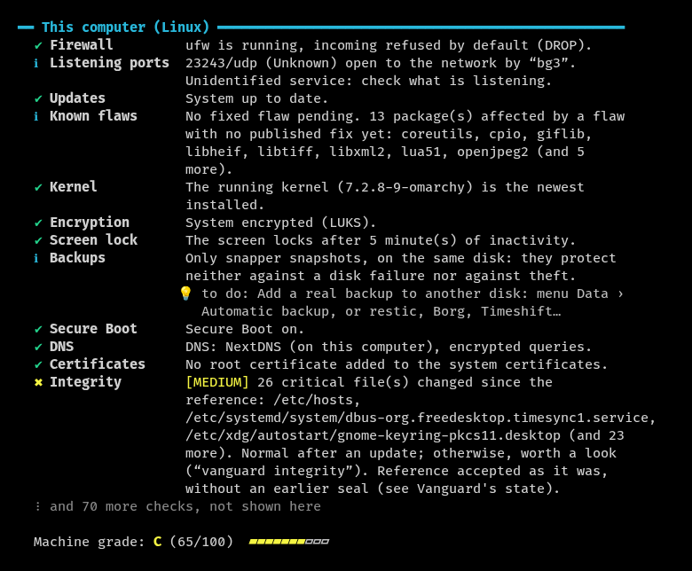
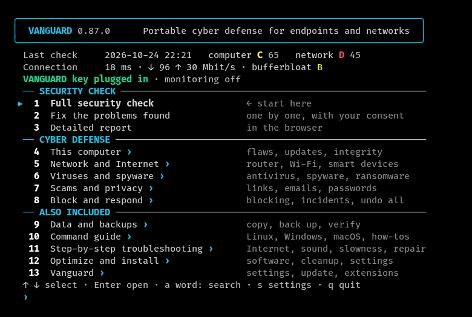
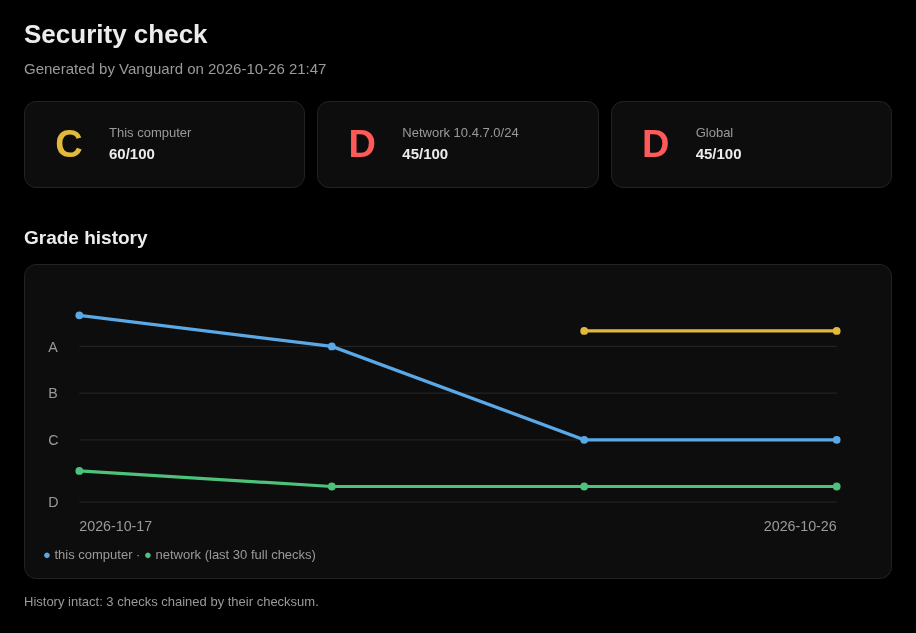
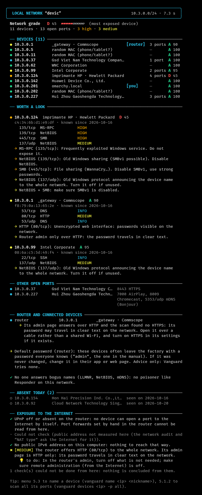
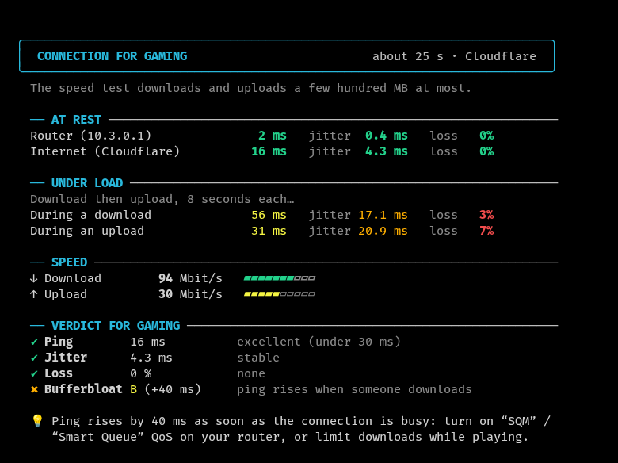

<h1 align="center"><picture><source media="(prefers-color-scheme: dark)" srcset="assets/banniere-blanche.png"></picture></h1>

<a href="README.md">Français</a> · <b>English</b>

  <b>Portable cyber defense for endpoints and networks, from a USB key.</b> 
  Vanguard hardens computers and detects vulnerabilities and intrusions, on each machine and across the network; 
  it blocks the threats found on the computer and collects the evidence of an incident. 
  Every finding is explained, and nothing is changed without consent. Troubleshooting tools are included as well. 
  Linux, Windows and macOS, nothing to install, in English and French. 
  It complements the system's antivirus (Microsoft Defender, XProtect, ClamAV): it does not replace it.

<b>In active development · all in Rust (under way) · defensive</b>

## Cyber defense

- **Harden.** Each weakness found is explained with its fix, applied after consent and preceded by a restore point
  when the system allows one; each rule cites its reference (CIS, Microsoft or ANSSI). Each fix records the previous
  state and can be undone one by one, except those that turn a protection back on; “Put everything back” undoes
  everything Vanguard changed. On Windows, fourteen hardening settings from a fixed allowlist are applied by Vanguard
  itself, without scripts, when they are not mixed with other fixes; Microsoft Defender's protections (attack surface
  reduction, controlled folder access) are turned on after consent and can be reverted exactly. On the go, public
  Wi-Fi mode closes the computer to the network of a café, a hotel or an airport.
- **Detect.** Known vulnerabilities (missing security updates, Linux distribution security advisories, actively
  exploited flaws from CISA's catalog, end of support), outdated software on Windows and macOS and misconfigurations,
  graded from A to F; a six-grade network audit, with every device inventoried and newcomers flagged; live threat
  hunting; spyware planted by someone close; 308 YARA rules and MalwareBazaar hashes (with a free abuse.ch key);
  Windows event logs and failed SSH login attempts; post-quantum key exchange missing from SSH, browsers and
  WireGuard. The self-test compares Vanguard's readings with those of the system's tools, without changing anything.
- **Block and respond.** Each threat found can be blocked with one click: program stopped and quarantined, connection
  closed at the firewall, startup entry removed; everything can be undone, except stopping a program. Before each
  action, Vanguard records what it will erase (program, command line, fingerprint, connections), and a sealed event
  log links the alert, this evidence, the action and its undoing. Once enabled, active protection blocks clear-cut
  threats on its own. Real-time protection (hourly monitoring and active protection) can be paused for one hour, four
  hours or until it is turned back on; the pause remains flagged. On Linux, the ransomware watcher spots an encryption
  burst within seconds and stops an almost-certain ransomware when active protection is on. After an infection, the
  evidence is collected before any cleanup, with the incident timeline.
- **Protect against AI agents.** AI servers open to the network, agents that act without asking and poorly secured MCP
  servers are flagged; the first two can be blocked with one click. Defense against emerging threats from AI agents is
  in development.
- **Report.** A draft vulnerability report in the format of the vendor's program (Microsoft, Google, Mozilla, Apple,
  GitHub advisory, CERT…), sorted first and stripped of anything personal, which the user reviews and sends
  personally: Vanguard sends nothing.

**Where Vanguard is going.** In progress: everything an AI agent can run; Windows event logs analyzed by Vanguard itself
(home-made .evtx reader, then its rules); a home-made scanning engine, as a second opinion (Defender stays the main antivirus);
every fix made by Vanguard itself, in Rust, without scripts; a test bench on the USB key, started with a double-click
on a real Windows; a study of a graphical interface. Releases signed twice (Ed25519 and ML-DSA, post-quantum) await a
decision. Next: live observation on Linux with eBPF; known vulnerabilities of the other Linux distributions. Always
defensive: Vanguard never attacks any device.

**What Vanguard protects, and what it does not**: the [threat model](MODELE-DE-MENACE.en.md). **What its rules see,
technique by technique**: the [MITRE ATT&CK coverage map](COUVERTURE-ATTACK.en.md).

## Also included

- **Troubleshooting**: everyday problems step by step (Internet, Wi-Fi, sound, printer, full disk), help with a
  relative's computer, the computer diagnostic, “Why is it slow?”
- **Optimization**: privacy and performance settings that can be reverted exactly, a cleanup that measures the space
  freed, software installed from its official source, a connection test for gaming.
- **Data and backup**: automatic backup with the system's tool and its verification (rsync copy), verified file copy.
- **Follow-up, tools and USB key**: HTML report, all settings in one place, extensions (plugins and scripts checked
  before they run), command guide; one USB key for every computer, write-protected anywhere but on its owner's
  computer. A key that can also start computers that no longer boot is in development.

## Getting started

**Download** (latest version): [Windows](../../releases/latest/download/vanguard-windows-x86_64.exe) ·
[Linux](../../releases/latest/download/vanguard-linux-x86_64) · [macOS](../../releases/latest/download/vanguard-macos)
— or the whole [releases page](../../releases/latest), with the SHA-256 checksums. What each version brought:
[history](CHANGELOG.en.md).

- **Windows**: double-click the program. It is not signed: SmartScreen may warn (“More info”, then “Run anyway”).
  Microsoft Defender sometimes mistakes it for a virus (“Trojan:Win32/Bearfoos.A!ml”, an automatic detection of
  a new program): it is a false positive; check the SHA-256 checksum on the release page.
- **Linux**: `chmod +x vanguard-linux-x86_64`, then `./vanguard-linux-x86_64` in a terminal (any distribution, nothing
  to install).
- **macOS**: copied from the Internet, the program is blocked the first time: `xattr -d com.apple.quarantine
  vanguard-macos`, then `./vanguard-macos` in Terminal. Tested automatically on a GitHub Mac, never tried on a real
  Mac; maintained, without Mac-specific new features.
- **From the USB key**: `Windows/vanguard.exe`, `Linux/vanguard`, or `Lancer Vanguard.command` on macOS; the key's guide
  is in `README.txt`.

In the menu, choose **1** (full security check), then **2** (fix). ↑ ↓ to move, Enter or → to select; Esc, ← or
Backspace to go back. The window fits the menu when it was opened for Vanguard.

The menu sorts the tools in two parts. **Cyber defense**: 4 This computer, 5 Network and Internet, 6 Viruses and
spyware, 7 Scams and privacy, 8 Block and respond. **Also included**: 9 Data and backups, 10 Command guide,
11 Step-by-step troubleshooting, 12 Optimize and install, 13 Vanguard (settings, update, extensions). A word typed in
the main menu ("antivirus", "backup") finds any tool; its path ("6.1.3") opens it directly.

## What Vanguard does

### Cyber defense, threat by threat

The threats to endpoints and their network, one by one: what the router exposes to the Internet, an intruder on the
Wi-Fi or a public network, a vulnerable connected device, outdated software, an infected computer, a hijacked DNS or
certificate, scams, spyware and other privacy intrusions.

| Threat or area | What Vanguard does |
|---|---|
| **The check** | A grade from A to F on everything below, and also: firewall, updates and known vulnerabilities, encryption, accounts, SSH, shares open to everyone, clock, end of support, forgotten accounts, disk health…; outdated software on Windows and macOS (browsers, Office, Java…) and its exploited flaws; post-quantum key exchange (SSH, browsers, WireGuard), read-only. Each rule cites its reference (CIS, Microsoft or ANSSI). Each problem is explained, with its fix, applied after consent and undoable. The self-test checks the check's own readings, without changing anything. |
| **Exposure to the Internet** | The network audit in six grades (exposure, Wi-Fi, device separation, DNS and certificates, connected devices, computers); the ports the router opens to the Internet (UPnP), this computer's open ports and firewall, the public Internet address on a blocklist, the router's admin page over HTTP only. |
| **Intruders on the Wi-Fi** | Every device on the network, its manufacturer, its open ports and its risks; newcomers flagged every hour, with a dashboard in the browser; the Wi-Fi's protection (WEP, WPA2, WPA3), the fake access point copying its name, Bluetooth devices paired recently; public Wi-Fi mode, which closes the computer to the network of a café, a hotel or an airport and puts it back as it was when you leave. |
| **Connected devices** | The router and the devices on the network (cameras, printers, NAS, TVs, smart home…) recognized, with their default password to change; hidden cameras, in a rental or at someone's place. |
| **Infected computer** | Antivirus scan as a second opinion (Defender or ClamAV), 308 YARA rules and the fingerprints of known malware from MalwareBazaar (free abuse.ch key), the memory of running programs (on demand), live threat hunting (guessed password, suspicious running programs), threat blocking, with one click or by itself for clear-cut threats (active protection), with the evidence recorded before each action and a sealed event log, decoy files and the ransomware watcher (Linux), Windows Defender blocking, what starts in secret, backdoors, Windows' hidden doors and vulnerable drivers, rootkit signs, suspicious event logs, connections to known botnet servers, a password thief like Responder unmasked, overly permissive AI agents, integrity of critical files, flaws in Docker images (trivy, when installed), reversible quarantine, and the traces collected before cleaning up, with the incident timeline; a draft report prepared for the vendor when a program misbehaves, never sent. |
| **Hijacked DNS and certificates** | The DNS really in use (and made-up answers), added root certificates (HTTPS interception), a forced proxy and sites redirected by the hosts file, automatic proxy discovery (WPAD), browser extensions that read every site. |
| **Scams and remote control** | Tech-support scam (remote control tools), dangerous links checked without opening them, downloaded files checked, leaked passwords and email addresses, hacked account, a sandbox for an unknown program. |
| **Privacy and secrets** | Spyware planted by someone close (known servers, programs reading the keyboard, monitoring permissions, known monitoring software), privacy check (who can access location, contacts, camera and microphone), camera and microphone, browser passwords without protection, sensitive files left in clear text, secrets forgotten in git project history, key data protected by a passphrase. |

<b>The details, threat by threat</b>

#### The check, graded from A to F

**Security check** — a grade from A to F, then each problem with its fix.

- Firewall, open ports (TCP and UDP), updates and known vulnerabilities, disk encryption, Secure Boot, screen lock,
  accounts (and their lockout after wrong passwords, minimum length: Linux, Windows), automatic proxy discovery
  (WPAD: Windows, macOS), SSH (and its failed login attempts, from the Internet or from the local network, and a
  client that does not check servers; forwarded ports open to the network, forwarded X11 display, too many password
  attempts; broken algorithms, SHA-1, CBC, 3DES, MD5 or DSA, reopened in sshd, removed after `sshd -t` without
  cutting any connection), sudo, groups worth root (docker, lxd, libvirt, disk), command folders other accounts can
  change, kernel hardening (on Linux: ICMP redirects in IPv4 and IPv6, impossible source addresses, user namespaces
  open to all; on macOS: sealed system volume, enforced code signing, library validation, added extensions), badly
  protected secret files, backups, file shares open to everyone (Samba, NFS, Windows shares, macOS File Sharing: the
  password-less access is closed after your consent, named accounts keep theirs).
- Clock set automatically; end of support: Windows 10 and the Windows 11 or macOS versions that no longer get fixes,
  programs abandoned by their publisher (Flash, Java 7, Office 2016…), browsers that no longer update; forgotten
  accounts (active but unused for six months); new administrators.
- Windows: WDigest (passwords in clear text in memory), Local Security Authority protection, PowerShell 2.0, Remote
  Assistance, automatic sign-in (and password in clear text in the registry), SmartScreen off, account control off
  for remote connections, memory integrity, paused updates, LM or NTLMv1 network authentication, share signing,
  PowerShell running any script, UAC that asks nothing, guest access to shares, accounts listed without a password,
  Secure Boot, suspended BitLocker, Defender cloud protection off, overly broad Defender exclusions, Office macros
  all allowed, passwords kept as LM hashes, Remote Registry, SMBv1 client, MSI installs with system rights, services
  with unquoted paths, exploit protection off, Windows Update turned off or paused, OpenSSH server (password sign-in,
  administrators_authorized_keys rights) and SSH keys without a passphrase or readable by others, Defender protections
  turned on by Vanguard and later turned off; Linux: automatic security updates, session that opens by itself without
  an encrypted disk; macOS: password policy and account lockout, startup security, login and background items, login
  hooks and authorization plugins, unencrypted Time Machine backup.
- Software installed since the last check, reported for a week (an inventory kept sealed on the computer, never sent);
  outdated software on Windows and macOS (see below).
- Each rule cites at least one CIS, Microsoft or ANSSI reference (`vanguard rules`), and has its time limit: one that
  exceeds it is reported as not checked, the others go on.
- Health: disk space, SMART status of the disks (without root), battery, temperatures.
- What could not be checked is said, never counted as healthy.
- The check reads what it checks by itself, without starting a program for each reading: on Windows, the accounts,
  the Run keys and the Startup folder (Windows functions and the registry, PowerShell as a fallback); on macOS, the settings,
  launchd agents, the version, the Mac's name, free space and administrators (plists read directly, instead of
  defaults, plutil, sw_vers, sysctl, scutil or df). Faster, and fewer ways to fail.
- Fixes applied only after confirmation, with a restore point created automatically beforehand when the system
  allows one (snapper or timeshift configured on Linux, Windows restore point, Time Machine snapshot on macOS). On
  Windows, fourteen hardening settings from a fixed allowlist (WDigest, Remote Desktop NLA, NTLMv2 only, LLMNR, WPAD,
  UAC…) are applied by Vanguard itself, relaunched as administrator: Windows' prompt names it, and the previous value
  is recorded to undo exactly; only Enter or yes applies them. Threat blocking adds, the same way, Microsoft's
  vulnerable driver blocklist. The other fixes, or those chosen along with them, go through a readable script.
- Each fix first records the previous state of what it changes, noted and sealed: “What Vanguard changed” undoes it,
  then reads the state back. A fix whose previous state cannot be read is called “not undoable” before it is applied,
  and one that turns a protection back on (firewall, antivirus, BitLocker, UAC, SELinux, Gatekeeper) is never undone;
  undoing never puts back a value that would reopen what the fix closed.

**Outdated software** (`vanguard outdated-software`, Windows and macOS, and in the check) — the installed version of
browsers (Chrome, Edge, Firefox, Brave), Office, Acrobat and Reader, Java, 7-Zip, PuTTY and Slack, read in the file
itself, compared with the latest published. The lists from the publishers, endoflife.date and Homebrew are downloaded
in full, the same for everyone: the list of your software never leaves the computer (Settings › Software versions to
turn these downloads off). For Firefox and Edge, each exploited flaw in CISA's catalog is checked against the
installed version: a version older than the fix is critical. What has no reliable source is said not checked.
Read-only; on Linux, the package manager takes care of it.

**Post-quantum check** (in the check, read-only) — encrypted traffic recorded today can be kept and read once a
quantum computer exists. The check says where post-quantum key exchange is missing: SSH server and client (from the
OpenSSH version, read without running it, and the algorithms actually kept; the advice only names an algorithm that
version knows and goes through `sshd -t`), browsers (X25519MLKEM768 turned off by a preference or a policy, or a
version too old to offer it), WireGuard peers without a pre-shared key (counted without keeping any key). The network
audit adds the router administration that offers none, and a path to the Internet that would remove it. Nothing is
changed, and what could not be read is said not checked.

**Self-test** (`vanguard self-test`) — Vanguard checks its own readings on the computer where it works. Every check
rule runs under a guard and a time limit, read only and proven so: any state write is refused, and BLAKE3 fingerprints
of its folder, before and after, would name what changed. Its readings are compared with those of the system's tools:
ten on Linux (pacman, dpkg, systemd units, listening ports, sshd version, DNS…), four on Windows (firewall, Defender,
BitLocker, local accounts). Offline by default; `--json` holds no value from the computer; exit code 0 (sound), 1
(gap) or 2 (not checked). Each rule's duration is measured: a rule three times slower than usual, or close to its
time limit, is reported. The monitoring runs it again every week; a gap goes to the error log, without any value from
the computer, and a contradicted reading is stated next to its rules' sound findings.

#### Exposure to the Internet and the local network

**Network audit, domain by domain** (`vanguard network-audit`, menu Network and Internet › 2, and right after the
full check) — six grades: Internet exposure (the ports the router opens, asked of the router itself, a public IPv6
without a firewall), Wi-Fi (encryption, WPS, fake access point, read in the beacons), device separation (connected
devices on the computers' network, a DHCP server that is not the router, ARP integrity), DNS and certificates,
connected devices, computers. Nothing is attacked. What could not be checked is said and never counts as safe:
without enough checks, no grade.

**Local network** — every device, its manufacturer, its open ports (TCP, and UDP: SNMP, NetBIOS, UPnP, DNS, mDNS) and
its risks; newcomers flagged, one notebook per network (the owner's, each friend's), nicknames ("HP printer"); the
ports that devices opened to the Internet on the router through UPnP (read-only, by a UPnP client written in Rust; as
a fallback, miniupnpc on Linux and macOS, the Windows UPnP interface on Windows).
After your consent, the public Internet address is looked up in four blocklists (Spamhaus, SpamCop, DroneBL, PSBL):
listed for spam or attacks, a device is probably infected. During the scan, Vanguard also asks for a name that does
not exist (LLMNR, NetBIOS, mDNS): nobody legitimate answers, and the device that does is a poisoner like Responder,
which steals the network's Windows passwords; the hourly monitoring flags it too.

#### Intruders on the Wi-Fi

- Wi-Fi: the network's protection (WEP, WPA2, WPA3), and fake access points ("evil twin") that copy its name without
  a password to lure devices; on Linux, saved open networks that reconnect by themselves.
- Bluetooth: computer visible all the time, and devices paired less than a week ago (a keyboard paired by someone
  else types whatever it wants).
- Hourly monitoring: a notification if an unknown device shows up, if a port opens, if the machine's grade drops, if
  the router seems spoofed (shared or changed MAC address: ARP spoofing), or if a program or a disguised file lands
  in Downloads (to check before opening it; with active protection, one whose fingerprint is in MalwareBazaar is
  quarantined by itself). Its dashboard, a local page opened in the browser:
  its state, the alerts day by day (kept even when the night's notification is gone), the devices that showed up and
  the connections to botnet servers. Nothing is sent.

**Public Wi-Fi mode** (`vanguard public-wifi`, Network and Internet menu) — to turn on when arriving at a café, a
hotel or an airport, and off when leaving. The computer no longer accepts any connection from that network (an SSH
session already open stays), file sharing and the announcement of its name are off, and the DNS switches to the
Canadian Shield “Protected”, encrypted on Linux (a DNS that already protects you is kept). On Linux, a separate
nftables table, which also closes container ports; on Windows, the Public category, the firewall's Public profile
closed to incoming connections and NetBIOS off, in a single administrator prompt; on macOS, the firewall set to “block
all” and stealth mode. Each change is shown with its previous value, noted and sealed; turning off puts everything
back in reverse order, even after a restart, and what could not be closed is stated in the menu and the check.
`vanguard public-wifi portal` reopens the network's sign-in page. Nothing is sent to recognize a public network.

#### Connected devices

**Router and connected devices** — after the scan, or later from the last scan kept (`vanguard smart-devices`), what the router
says about itself (often its model and software version), an admin page over HTTP only, and the cameras, printers,
NAS, TVs, speakers, consoles and smart home devices, recognized by their manufacturer, name, ports and
announcements. For the router, cameras, printers and NAS, the advice to change the default password: nothing more is
probed and no password is tried. One exception, announced during the scan: a single SNMP “describe yourself”
request with the factory read password “public”, read-only, which gives the model of printers and NAS; a device that
answers it is reported, since anyone on the network can then read it.

**Hidden cameras** — in a rental or at someone's place, the devices on the network that look like cameras (maker,
video stream, ONVIF), without turning anything off or watching anything.

#### Infected computer

**Against ransomware and malware** — decoy files: a decoy text file and PDF in Documents, Pictures and Desktop,
which nobody has a reason to touch. Ransomware that encrypts or renames them triggers a critical alert, at each
check and hourly through monitoring, with what to do; placed and removed after your consent. And a YARA scan: 308
ReversingLabs rules that recognize whole families (ransomware, password stealers, trojans, backdoors…), alongside
the antivirus, applied by Vanguard's own YARA engine: nothing to install. Each file read is also compared with
the SHA-256 fingerprints of known malware from MalwareBazaar (abuse.ch): there, it is that very
program, beyond doubt. The full list is downloaded once a week (about 43 MB), the last 48 hours once a day; offline,
the saved copy is used, and with no copy at all, it says so.

The MalwareBazaar, URLhaus and ThreatFox lists need a free abuse.ch key (account at https://auth.abuse.ch/, key given
in Settings): abuse.ch closed its public downloads on October 21, 2026. The key stays on the computer, never shown in
full; without it, these lists are reported as not checked. What the antivirus or YARA finds can go into a reversible quarantine: the file is made unusable and noted, then put back exactly in its place if it was a false
positive.

**Threat blocking** (Block and respond › Threat blocking menu, `vanguard blocking`) — each threat found offers
"Block": the action is shown, carried out after your consent, written down in "What Vanguard changed" and undone
exactly by `vanguard blocking undo`; only stopping a program cannot be undone. Depending on the threat: the program
stopped then quarantined, the connection closed at the firewall (ufw, nftables, Windows Firewall, pf), a launch
removed from startup, Windows' vulnerable driver blocklist turned on, an AI server's port closed to the network, an
AI agent set back to asking before it acts. **Active protection**, once enabled, blocks clear-cut threats on its
own (a file whose fingerprint is in MalwareBazaar, a known attack tool running, a connection to a known command
server), during the check and in the hourly monitoring, then lets you know; what is doubtful stays an alert with its
button. Four categories (programs, connections, startup and drivers, AI agents), each off, one click or automatic
(programs and connections). Never Vanguard, a system program, a critical process, a remote session in progress, a
local address or a public DNS; an interpreter (python3, PowerShell) is never quarantined, at most the script it
runs. As administrator, nothing is blocked by itself: the blocking settings can be written by any program of the
account, and clear-cut threats are offered with one click there.

**Evidence before the action** — before stopping a program, quarantining a file or blocking an address, including on
its own at night, Vanguard records what the action will erase: the program, its command line, its parent, its account,
the file's SHA-256 fingerprint, the current connections; what cannot be read is noted “not possible (reason)”, and the
block happens anyway. The evidence is kept with the block, and the antivirus and YARA quarantine goes the same way,
undone with `vanguard blocking undo`. **The event log** (`vanguard events`) links the alerts, this evidence, blocks,
quarantines and fixes, their undoing, alerts declared normal and version changes, on this computer only: append-only,
each line carries the fingerprint of the previous one and the head is sealed; a removed, changed or added line shows,
and a broken chain is reported by the check. `--incident <id>` follows an incident's thread, from the alert to the
undo.

**Windows Defender blocking** — on top of its own blocking, Vanguard turns on, after your consent, what Windows blocks
from its kernel and protects against being turned off. Attack surface reduction rules (password theft from memory,
vulnerable drivers, booby-trapped Office documents and attachments), network protection against dangerous sites,
unwanted software, controlled folder access against ransomware. Each rule is named before you agree and can be
reverted exactly; those that would block Vanguard on its USB drive or troubleshooting are never turned on, and
nothing is offered when another antivirus replaces Defender.

**Collect the traces** — after an infection, before cleaning up or reinstalling: what a specialist will want to
see, kept in a dated folder on the VANGUARD key (or in this computer's Vanguard folder), in the order it vanishes.
Processes (with their program's SHA-256 fingerprint), current connections, what starts by itself, the check as JSON,
accounts, logs of the last 7 days (as .evtx on Windows), recent files from risky places (described, not copied);
LISEZMOI.txt, in French and English, tells what each file holds and what could not be read, MANIFESTE.txt gives
their fingerprints (`sha256sum -c MANIFESTE.txt`). Read-only: nothing is stopped, moved or sent. The folder holds
personal data, to hand only to someone you trust. It is also the first step of “After an infection”, ticked by
default: cutting the network or cleaning up erases these traces. With ransomware or a remote control still connected to
the Internet, cutting comes first: every minute counts. Since 0.83, an incident timeline (CHRONOLOGIE.txt) puts
everything in time order, oldest first: accepted or refused sign-ins, created accounts, added services and tasks,
cleared logs, Defender detections, recent files that matter (programs, scripts, hidden files). The traces also
include what Vanguard saw and did (07-vanguard.txt): its alerts, its blocks with their evidence.

**Report a flaw to a vendor** (Block and respond › Report a flaw to a vendor menu, `vanguard disclose`) — when a program behaves
abnormally, Vanguard prepares the draft report, which the person reviews and sends personally. It sorts first: an
already known flaw (CVE, CISA's catalog) is fixed by an update; malware, a missed detection or a phishing site are not
flaws of the vendor, and the right recipient is named. Otherwise, the draft follows the chosen program's format (MSRC,
Google, Chrome, Mozilla, Apple, GHSA advisory, CERT/CC, CERT-FR, Vanguard), with the thread of an incident from the
event log or a tool's last examination; it stays titled INCOMPLETE while what only the person knows is missing (the
steps, what happened, the required proof of concept). What is personal is removed in three layers (nothing useless;
paths, names and addresses masked; a final check that refuses to write if a known name survives), and the count is
shown. The text is shown in full, then written after consent in Vanguard's folder on this computer; `--effacer`
removes the drafts. Nothing is ever sent: the module holds no network code, no clipboard, no email.

**Live threat hunting** — a successful sign-in from an address that had just failed at least ten passwords (sshd's log
on Linux, Remote Desktop on Windows): the sign of a guessed password. And suspicious running programs: a known
offensive tool (mimikatz, xmrig…), a command line that downloads or hides what it runs (encoded PowerShell, mshta,
certutil, curl piped to a shell), a program started from Downloads, a temporary folder or the recycle bin.

**The watcher** (Linux 6.6 and later, off by default, `vanguard watcher on`) — between two monitoring runs, each program
started, even one of a few milliseconds, and each TCP or UDP connection as it closes. Programs are judged as in the
check, connections against the botnet command servers already downloaded; what is serious goes to the dashboard
and as a notification. Without root or code loaded into the kernel, this part stops nothing. A program gone before
it could be read is counted as such, never judged safe, and the program of a closed connection is not known (the
kernel does not give it).

**Ransomware watcher** (Linux, offered when the watcher is turned on, or `vanguard watcher ransomware on`, off by
default) — personal folders (Documents, Pictures, Desktop, Music, Videos, Downloads) watched live, without
administrator rights. An encryption burst (dozens of files rewritten in seconds, content no longer matching its
format, a ransom note, a decoy file touched, backup copies erased) raises an alert within seconds, instead of
waiting for the hourly decoy check, and “Block” is offered at the next check. With active protection and an almost-certain case (a decoy touched and
a burst attributed without ambiguity to one program), the program and its descendants are frozen, the evidence is
recorded, then they are stopped and quarantined, with the blocking safeguards; otherwise, Vanguard only alerts. A
malicious program in the account can switch it off: a backup remains the real protection. Stated limit: a write
through a hard link placed outside these folders escapes the live watch (decoys are still checked hourly).

**Windows' hidden doors and kernel drivers** — the DLLs Windows loads by itself, often with system rights: LSA
packages (a password filter receives every new password in clear text), AppCertDlls, print monitors, time providers,
the Winsock catalog. And kernel drivers stored where nothing installed puts one, or known to be vulnerable (the
LOLDrivers list): being signed, they are used to disarm the antivirus.

**Program memory** (`vanguard memory`, on demand) — the YARA rules applied to the memory of running programs:
"fileless" malware lives nowhere else. LSASS and protected processes: their memory is never read; nothing read is
kept, and what could not be read is said.

**AI agents** — a local AI server (Ollama, LM Studio, ComfyUI) open to the whole network without a password, an agent
set to do everything without asking, an MCP server started without a pinned version, reached without encryption or
with a key written in clear text (the key's name only, never its value).

**Recognized open source tools, when installed** — Vanguard runs them and explains what they find, without
changing anything; when missing, it offers to install them with the system's tool. trivy tells the known serious or
critical flaws in Docker or Podman images: an image does not update by itself. And when someone fails SSH logins, the check tells whether fail2ban,
sshguard or CrowdSec already blocks the addresses that keep trying.

- What hides: programs started at boot, scheduled tasks, library preloading, modified privileged programs. On
  Windows, the classic backdoors: a debugger set on a sign-in screen accessibility program (IFEO, SilentProcessExit),
  sethc or utilman (Sticky Keys, Ease of Access) replaced by cmd, Winlogon's Shell or Userinit hijacked, AppInit_DLLs,
  WMI subscriptions that run a command; tracked by the monitoring, fixed when the original state is known exactly.
  On Linux, the signs of a rootkit: hidden processes, programs running without a file (memfd, deleted, started from
  /tmp), a kernel module that hides or unknown unsigned modules, a network card in promiscuous mode (it listens to
  the whole network).
- Windows event logs, over the last 7 days, in the check-up and in “What happened?” (Block and respond › Windows logs
  menu, `vanguard windows-logs`): thirteen EVT- rules read by Vanguard itself, a single judge. Cleared traces, one
  more administrator, guessed passwords, Remote Desktop from outside, a service or scheduled task that runs an
  interpreter or a program from a temporary folder, suspicious processes (attack tools, encoded command, download by
  certutil, bitsadmin, mshta…), malicious PowerShell, Defender disarmed, BITS, WMI, audit policy. What Windows does
  not log by default (tasks, command lines) is said “not verified”, with the setting to turn on; the security log
  can only be read as administrator: without that right, it is said. On this Windows, or on a folder of .evtx from
  Linux or macOS (disk mounted from the rescue drive), then the alerts in time order, with the period really read per
  log; included in the report and in the evidence's CHRONOLOGIE.txt.
- Antivirus: ClamAV (Linux, macOS) or Microsoft Defender (Windows), on the computer or on a chosen USB key / folder,
  with the tricks of USB worms (shortcut posing as a folder, autorun.inf, scripts).
- Integrity of critical files (accounts, sudo, SSH, PAM, cron, services, autostart): BLAKE3 fingerprints, what changed
  since the reference, and live monitoring.
- Who talks to the Internet?: each program's current connections, with the server's name; a program started from a
  temporary folder or Downloads, a remote access tool's port, a server without a name or a known botnet command
  server (Feodo Tracker and ThreatFox lists, abuse.ch; ThreatFox's with the free abuse.ch key) are flagged.
  Read-only: nothing is cut here; a known command server is blocked through threat blocking.
- Vanguard also distrusts itself: at startup, it says whether a library is injected into every program of the session
  (LD_PRELOAD, DYLD_INSERT_LIBRARIES, AppInit_DLLs: one from a system package, like GameMode, is mere information) and
  whether it runs as root for no reason, since its results go through there. In the check: the hourly monitoring that
  was turned on and has disappeared (malware first cuts what watches it), the check history rewritten afterwards (each
  check carries the previous one's checksum), and its own state (learned alerts, versions already seen, monitoring,
  integrity) changed outside it: each file is sealed by a BLAKE3 checksum, so that a program cannot silence its alert.
  Each night the code has changed, CI builds Vanguard twice and checks that the program is identical down to the byte.
  Every included library is checked at each version and every night (cargo deny: known flaws, compatible licenses,
  origin), and the released version checks its calculations: a number that overflows on hostile data stops the check
  concerned instead of skewing what follows.

#### Hijacked DNS and certificates

- The DNS actually used (and forged answers), added root certificates (HTTPS interception), browser extensions that
  read every site.
- Hijacked browsing (forced proxy, sites redirected by the hosts file).

#### Scams and remote control

- Is my computer being controlled?: the tech-support scam (“your computer is infected”) gets a remote control tool
  installed. Vanguard looks for AnyDesk, TeamViewer, RustDesk, Quick Assist, Splashtop, UltraViewer… installed (and
  since when), started at boot, running or simply sitting in Downloads; it explains what to do (cut the Internet, tell
  the bank, change passwords) and removes them after your consent. A running program is never cut without a second,
  explicit consent: the person helping may be connected through it. In the check too (“Remote access”).
- Is this link dangerous?: a link you received, checked without ever opening it (disguised letters, misleading
  subdomain, imitated brand, link shortener, raw IP address); after your consent, the domain's age and three public
  lists of dangerous sites (URLhaus with the abuse.ch key, Spamhaus, SURBL). Only the domain name leaves the computer.
- Check a downloaded file: its checksum compared with the one the site publishes (pasted, or a SHA256SUMS next to
  it), its name and content (double extension, program disguised as a document), then YARA and the antivirus.
- Sandbox: run an unknown program without network, with a read-only system and an invisible home folder (bubblewrap
  or firejail on Linux, Windows Sandbox on Windows, sandbox-exec on macOS).
- Leaked passwords: checked with Have I Been Pwned without ever sending the password (only 5 characters of its hash);
  email address leaks, after your consent (the address is sent to the service).

#### Privacy and secrets

**Spyware** (`vanguard spyware`, Viruses and spyware menu, and in the check) — signs of spyware planted by
someone close: connections and names asked towards known spyware servers and sites (list from the Échap association,
CC-BY 4.0, downloaded when used), known monitoring software installed or running (parental control and employee
monitoring are called normal if installed on purpose), programs reading the keyboard (Linux), Input Monitoring,
Accessibility and Screen Recording permissions (macOS). Read-only: nothing is removed, since whoever planted it could
notice; the screen says to keep screenshots and ask for help first. What could not be checked is counted, and the
verdict is never “no spyware”.

**Protect the key's data** — the key's device record (names, MAC addresses, nicknames) encrypted by a passphrase
(XChaCha20-Poly1305, passphrase derived by Argon2id), against a lost or lent key. On the owner's computer, nothing
changes: the data key is kept there. Elsewhere, Vanguard asks for the passphrase, or goes on without the record. The
report and the diagnostic are no longer written to the key. On request, reversible, with a backup offered first; the
check reports a record left in clear.

**Secrets in git projects** — Vanguard reads the history of the git projects in the home folder: a password, API
key or token written once stays there, even when deleted later. Its own rules recognize keys by their shape (AWS,
GitHub, GitLab, Google, Stripe, Slack…), private keys, passwords in an address or written in the code; gitleaks, when
installed, adds its own. No secret is shown or kept.

**Camera and microphone: who uses them?** — on Windows, each program that used the camera or the microphone, and the
last time (a program started from a temporary folder or Downloads is flagged); on Linux, what holds them right now.
Read-only. **Privacy check**: the apps that can access location, contacts, camera and microphone, and their last use
when the system records it (the permission store on Windows, Flatpak and Snap on Linux, the macOS permission
database, readable with Full Disk Access). Nothing is removed: what to do is given, and what could not be read is
said to be unchecked.

**Browser passwords** (`vanguard browser-passwords`) — how many each browser keeps and how they are protected:
counted, never read or sent. The browser's built-in check (weak, reused, compromised passwords) is pointed to, and a
typed password can be looked up in leaks (Have I Been Pwned, only 5 characters of its fingerprint).

- Passwords saved in the browser without protection, sensitive files left in clear text (passwords or keys).

### Also included, area by area

Beyond defense: troubleshooting, optimization, data, then follow-up, tools and the USB key.

| Area | What Vanguard does |
|---|---|
| **Troubleshooting** | Computer diagnostic, everyday problems step by step (Internet, Wi-Fi, slowness, sound, printer, full disk), after an infection, new computer, computer leaving, a relative's computer, “Why is it slow?”, computer specs, report to leave behind, repairs. |
| **Optimizing, software and gaming** | Privacy and performance settings that can be reverted exactly, “Put everything back” to undo it all, a cleanup checklist with the space gained measured, startup programs; the best software in 10 categories, from its official source, and updating everything at once; connection for gaming (ping, jitter, loss, speed and bufferbloat, compared with usual measurements), crowded Wi-Fi, NAT type, fastest DNS (without removing a DNS that protects you), settings for gaming. |
| **Data and backup** | Automatic backup and check my backup (rsync copy actually read back), copy my files (checked copy) and check a copy. |
| **Follow-up, tools and USB key** | HTML report with the grade curve, monthly check-up, learning on the computer, what Vanguard changed (each fix, dated, undoable one by one) and the sealed event log, every setting in one place, custom extensions (plugins and scripts, checked before they run); a USB key write-protected anywhere but on its owner's computer, check my drive (fake drives, speed), my computers (tracked by the key), shortcut on this computer, Vanguard updated from the key or from GitHub (versions signed by the author), complete removal of Vanguard from a computer, command guide, search in every menu. |

<b>The details, area by area</b>

#### Troubleshooting

**Computer diagnostic** — the first step of any troubleshooting: hardware, system, and recent problems (journal
errors and crashed programs on Linux; blue screens, sudden shutdowns and crashes on Windows; kernel panics and crash
reports on macOS), with a text copy saved on the key.

**Troubleshoot step by step** — everyday problems, handled the way someone who knows would: no Internet, Wi-Fi
dropping, slow computer, no sound, printer not working, disk full. Two or three questions, then Vanguard checks by
itself (address, router, Internet, DNS; Wi-Fi signal; sound service and selected output; print queue and printer on
the network; disk space) and suggests the right repair or the right tool, always with your consent. And three
journeys for the big moments: **after an infection** (the traces kept first, then what is urgent depending on the
sign, the check of what may have been installed, the scans in order, then the passwords to change, email first);
**new computer** (updates, encryption, backups, starter pack, privacy, in order); **computer leaving**, sold or given
(verified copy first, accounts signed out, BitLocker or FileVault key set aside, secure wipe by the system's tool,
TPM chip cleared). Vanguard never wipes anything itself. And **my account was hacked**: take back control through the
official page, then password, two-step verification, sessions signed out, and a check that this computer did not give
the password away. Slow **since an update**: the latest updates, dated, and how to go back. And **a relative's
computer** (`vanguard troubleshoot relative`): three questions (who uses it, why you were asked to look at it, and whether their
network may be looked at, only with their consent), the check, then a summary in everyday words, ordered by the
answers: what is left to do first, what is fine next. The tools that match the reason (slowness, antivirus, fake
technician), the fixes one by one, and the page to leave behind, with tips chosen for the person.

**Report to leave behind** — a simple page for the person you just helped: their grade, what is left to do from the most
to the least serious, what is fine and three habits; put on their Desktop, to read or print.

**Why is it slow?** — a two-second snapshot: what keeps the processor, memory and disk busy, program by program;
how long startup takes and what delays it; the programs started at login and their weight. Those that work for a
while then calm down (antivirus scanning, indexing, updates) are named as such. Startup programs are removed from
there, after your consent: they stay installed, and each removal can be reverted exactly (`vanguard startup`).

**Computer specs** — model, motherboard, BIOS, processor, memory (modules, type, speed), graphics card and driver,
disks: what you are asked on the phone or to buy a part. Serial numbers are shown on screen only, never written.

- Repairs: Internet, hijacked browsing, firewall, disk, full disk, deep cleaning, stuck Windows Update, system files,
  clock.

#### Optimizing, software and gaming

**Optimize** — privacy, performance and comfort settings written for Vanguard. On Windows: telemetry kept to a
minimum, ads and tracking off, Recall without screen snapshots, file extensions shown, no autorun from USB drives,
fast startup, full right-click menu. On Linux: SSD maintenance, journal size, reports sent by GNOME or Ubuntu. On
macOS: ads, analytics, no .DS_Store on drives. Each setting shows its state and can be reverted exactly: the previous
value is recorded, sealed, then put back. None of them weakens security. “Put everything back”
(`vanguard optimize undo`) undoes, from the most recent to the oldest and in one administrator request, check-up
fixes, Optimize, Gaming, blocks and public Wi-Fi mode.

**Clean up the system** — a checklist of what takes space for nothing: downloaded and unneeded packages, old Snap
versions, unused Flatpak runtimes, AUR builds, old caches, thumbnails, old logs, crash reports (Linux); temporary
files, Windows Update and Delivery Optimization caches, old components (Windows); old caches, Homebrew, Xcode, local
snapshots (macOS). The space each item frees is measured first, what rebuilds itself is checked by default, the trash
never; the free space read again afterwards tells what was really gained.

**Connection for gaming** — ping, jitter, loss, speed and bufferbloat (the lag when someone downloads), with a
verdict criterion by criterion and advice.

**Wi-Fi, NAT and DNS** — crowded Wi-Fi: nearby networks by channel, and the freest channel to set on the
router; the NAT type for gaming (open, moderate or strict, as consoles show it), double NAT and provider-shared
address included; the fastest DNS, measured here, offered only if it does not replace a DNS that protects you
(NextDNS, encrypted, filtering), and undoable.

- Update everything at once: system, programs, drivers, firmware.
- Software: the best program for each use, mostly open source, in 10 categories (browsers and email, messaging and
  sharing, accounts and encryption, office, video and music, images and design, system tools, programming, privacy
  and network, backup) plus a starter pack (Firefox, Bitwarden, VLC, LibreOffice, 7-Zip): checklist, installed
  ones recognized, installation from the official source that checks each download (winget, distribution packages
  or Flathub, Homebrew).
- Gaming: on Windows, game components and Windows settings; on Linux, Steam, 32- and 64-bit Vulkan drivers for your
  graphics card, GameMode, MangoHud, Gamescope, Wine, Lutris, Heroic, ProtonUp-Qt, vm.max_map_count, ntsync; on
  macOS, Rosetta 2, Steam, Heroic, Epic Games, GOG Galaxy, Prism Launcher and the Metal frame counter.

#### Data and backup

**Automatic backup** — set up with the system's tool (Déjà Dup or a daily rsync copy on Linux, Time Machine, File
History on Windows), to an external disk, after your consent and undoable. **Check my backup**: the rsync copy
actually read back from the disk, random files compared with their original; an original changed since, newer than
its copy, is not counted as an error, a copy that differs from an unchanged original means a disk losing data, and a
copy rewritten after the backup, newer than its original, is reported as damaged: that is how ransomware encrypting
the backup disk shows up. For Time Machine, Déjà Dup and File History, which keep their backups in their own format,
how to restore one file. Nothing is written or deleted.

**Copy my files** — Documents, Pictures, Desktop, Videos and Music to an external disk, before a risky repair or a
reinstall: space is checked first, each file is read back and compared with the original (BLAKE3 fingerprint),
nothing is deleted or overwritten, and an interrupted copy resumes where it stopped. **Check a copy**, later, is the
restore test: files spread over the whole copy are read back from the disk and compared with their original; a disk
that loses data shows up before the day you need it.

- Missing backup: reported by the check, with the way to set one up.

#### Follow-up, tools and USB key

**Learning** — Vanguard learns on the computer, sending nothing. An alert declared normal ("i" when it is offered as a
fix, in monitoring, the watcher or blocking) drops to information for 90 days, or until it gets worse; the choice is
about what the alert is about (the program, the address, the device), not its text, and a certain threat is never
silenced. Each connection test is compared with the usual measurements on the same network; a known device that
suddenly seems all closed (asleep) is checked again more patiently. "What Vanguard has learned" shows everything and
lets you forget.

**Settings** (Vanguard › Settings, "s" in the main menu, `vanguard settings`) — every setting in one place: language,
emojis, working without the Internet, real-time protection, hourly monitoring, monthly check-up, learned alerts, threat
blocking, extension restrictions, the abuse.ch key, software versions, the weekly self-test and AUR packages (Arch
Linux: off by default, no package name is sent to the AUR without it). Each change shows the previous value and the
command to put it back; learned alerts and blocking open their own screen ("What Vanguard has learned", Threat
blocking). Language, emojis and working without the Internet stay chosen from one launch to the next (VANGUARD_LANG,
VANGUARD_EMOJI and VANGUARD_HORS_LIGNE always win).

**Real-time protection** (Settings, `vanguard settings real-time no [--for 1h|4h]`) — turns off at once, after
consent and the list of what stops, what Vanguard does by itself all the time: the hourly monitoring (and everything it
watches and notifies) and the active protection of blocking, which no longer blocks anything by itself. For 1 hour, 4
hours or until it is turned back on (`vanguard settings real-time yes`); it comes back by itself when the time is up, and
the monitoring checks that itself. Each part's settings do not change: when it comes back, each one is as it was. While
it is off, this is said again at the top of the main menu and on its Monitoring and Blocking lines, in each check-up (a
piece of information, with no effect on the grade), in "Who talks to the Internet?", in blocking and on the monitoring
dashboard, by a notification at the first run then once a day, and in the monthly check-up: a program that turned it off
quietly does not go unnoticed. It only concerns Vanguard: Defender, the firewall and UAC are never touched, and a block
already made stays in place. As administrator, it is not set: its setting belongs to the user account (under sudo, the one
of the account that started it is read).

**Extensions** (menu 12, `vanguard extensions`) — custom programs in Vanguard, without touching its code. A plugin
is a folder with a `plugin.toml` manifest, added once from a folder or a .zip archive (`vanguard plugins add`); a lab
script is a file dropped as it is (`vanguard lab`), to try an idea quickly. A plugin is a script (sh, bash,
PowerShell, Python) or a compiled program, in Rust for instance with the `extensions/sdk` library. Their findings are
shown apart and never count in the grade (`--report` puts them in a separate section of the HTML report). Before your
consent, the whole folder or archive is scanned (YARA, MalwareBazaar fingerprints) and every file hashed: a file
changed, added or removed, and it must be approved again. The checked copy is what runs, without a terminal, with a
bounded time and output; an archive cannot write anything outside its folder; on Linux, `--isolated` runs it without
network, the home folder hidden. As administrator, nothing runs by itself and each run is asked for. The
**Restrictions** switch (Extensions › 3, Settings, or for a single plugin or script) turns these safeguards off for
custom extensions; one rule stays: the extensions folder must belong to the account, closed to other accounts.
How-to (in French):
[extensions/LISEZMOI.md](extensions/LISEZMOI.md).

**Check my drive** — does a USB stick or an external disk hold what it claims? Fake drives (a 16 GB chip sold as
“1 TB”) accept everything and return garbage beyond their real size. After your consent, Vanguard writes recognizable
content into the free space, reads it all back bypassing the computer's memory, measures the write and read speeds,
then erases everything; the files already on the drive are not touched. Quick (a quarter of the free space) or full
(all of it, the only proof); never on the VANGUARD key or the system disk.

**My computers** — each full check run with the VANGUARD key notes the computer there: nickname (“system · model”,
renamable), grade, remaining problems (their category and level only, the five worst), date of the last check. The
table travels on the key's VANGUARDLOG partition, without computer name, account, address or Wi-Fi name; it never
goes to GitHub.

**Shortcut on this computer** — Vanguard copied here and started with one click.

**Remove Vanguard from this computer** — everything it placed there (monitoring, monthly check-up, automatic backup,
watcher, decoy files, shortcut and icon, program copy, leftovers of an earlier version) is found, shown with what will
be done, then checked. The data folder is erased only after a second consent; changes made to the system are first undone by
their own tools, or said with their command; the key is never touched.

**Command guide** — the useful commands of Omarchy, Arch, Fedora, Debian and Ubuntu (and other Linux), Windows 11,
macOS, and the ones typed the same way everywhere (Vanguard, ping, nslookup, ssh, curl, git…), each one explained; ⚠
marks the ones that change something. Each distribution has its introduction, its “Step by step” guides (update,
install, free up space, repair, firewall, NVIDIA drivers, new release…), its programs (pacman, dnf, apt, SELinux,
AppArmor…), then those common to Linux; Windows 11 and macOS have their step-by-step guides too (repair Windows,
network, security, slowness, Time Machine…). You type what you are looking for: commands show up as you type, and Tab completes the word. Each command
has its page: copy it, to type it here or on the computer of the person you help, or run it here when it only reads;
its output scrolls in Vanguard, and Esc stops it. Every system can be read everywhere (Windows commands from Linux,
for example), and the guide tells when a program is missing on this computer. On top of that, the examples of
[tldr-pages](https://tldr.sh) (CC BY 4.0 license): over 30,000 community commands for Linux, Windows, macOS and
others. The guide downloads them by itself, at most once a week, so do the monitoring and the monthly check-up (without
opening the guide, once it has used them), and the key brings them along: run from the key, it
has them from the first launch, even without Internet. They can be searched and copied, but never run from here,
since Vanguard has not checked them.

- Monthly check-up: one notification a month with the machine's grade, waiting updates, the space a cleanup would
  free and new problems; nothing is changed.
- HTML report with the grade history curve, and what changed since the previous check.
- Check Vanguard itself: its version, the date of its last commit and its SHA-256 checksum, to compare with the
  release page (Vanguard is not signed: this comparison is what proves it is genuine). A copy older than six months
  says so in the menu. And the key manifest: at deployment, the checksum of every file on the key is kept on the owner's
  computer; back from someone's place, the check names what was added, replaced or removed (a planted autorun, a
  replaced program). Data, ISO images and the Ventoy menu, which change normally, are not compared. Each key has
  its own reference (recognized by its volume identifier): a second VANGUARD key does not pass for a modified one.
- Update itself: from a newer VANGUARD key, or, without a key, from GitHub. The published programs have their own
  repository there, [vanguard-update](https://github.com/d9v3/vanguard-update), next to the code's; the latest version
  is described by a manifest signed with Ed25519 on the author's computer, whose public key Vanguard carries, along
  with that of a backup signing key kept offline, which can revoke the main one if it were stolen. A badly signed
  manifest, a version older than the highest already seen, a program whose size or checksum differs: refused; a
  manifest that is too old, or a clock running behind, is called not verified, never “up to date”. The menu announces
  a newer version; nothing is installed without your consent. The signed version history lets `vanguard self-check`
  also check a copy that is no longer the latest.
- Keyboard menus: ↑ ↓ to move, Enter or → to select, Esc, ← or Backspace to go back (on the main menu, ← does nothing,
  so as not to quit by mistake; in a checklist, only Enter confirms). The window opened for Vanguard takes the menu's
  size and centers itself (Hyprland, Windows console).
- Search in every menu and checklist: type a word (wifi, disk, dns, update…), only the lines containing it stay,
  whatever the accents or capitals; the end of the most likely word shows in grey, and Tab completes it. In the main
  menu, it also finds each tool of the submenus, and each page and each command of the guide.

Vanguard never cuts a remote connection in use (Remote Desktop, SSH). Only use it on your own network, or a network
you are allowed to audit.

## In pictures

<table>
  <tr>
    <td width="50%"> The menu: last check,
    connection, key plugged in.</td>
    <td width="50%"> The HTML report and
    the grade history.</td>
  </tr>
  <tr>
    <td width="50%"> The network: every
    device, its ports and what deserves a look.</td>
    <td width="50%"> The
    connection for gaming: ping, jitter, speed, bufferbloat.</td>
  </tr>
</table>

Screenshots retaken at each version, on a copy of the data; the local network's addresses and names are
masked.

## Supported systems

| System | Versions |
|---|---|
| Windows | 10 and 11 |
| macOS | 12 and later, Apple Silicon and Intel (tested on GitHub's Macs, not yet on a real Mac) |
| Linux | Arch and derivatives (Omarchy, Manjaro, EndeavourOS, CachyOS), Debian, Ubuntu, Mint, Pop!_OS, Fedora (and RHEL, Rocky, Nobara), openSUSE |
| Atomic Linux | Bazzite, Silverblue, Kinoite, Bluefin, Aeon |

Vanguard recognizes the distribution and offers its own commands: `omarchy update` / `omarchy pkg add` on Omarchy,
`ujust update` on Bazzite, `rpm-ostree` or `transactional-update` on an atomic system, otherwise pacman, apt, dnf or
zypper.

## Commands

Each menu entry is also a command.

<b>All the commands</b>

| Command | Purpose |
|---|---|
| **Security check** | |
| `vanguard check [--html] [--text]` | full check: machine + network; `--text` shows it as plain text (emergency mode) |
| `vanguard fix` | fix the problems found |
| `vanguard report` | the detailed report in the browser: this session's check, otherwise a full check first |
| `vanguard search <words> [--first] [--json]` | find a tool, a guide page, a program or a setting, as in the main menu: synonyms ("box" → router) and typos included; a number opens the result |
| **4 This computer** | |
| `vanguard audit [--json]` | audit of this machine |
| `vanguard updates` | updates |
| `vanguard latest-flaws [--days N]` | latest exploited flaws: those CISA just added to its catalog, most recent first |
| `vanguard integrity [--accept] [--live]` | integrity of critical files (BLAKE3 fingerprints), live if wanted |
| `vanguard maintenance [on\|off]` | monthly check-up; without an argument: what it would say now |
| `vanguard specs [--json]` | computer specs; `--json` without the serial numbers |
| `vanguard handout` | report to leave behind: a simple page for the person you helped |
| `vanguard secrets` | secrets forgotten in the history of git projects (and gitleaks, if installed; read-only) |
| `vanguard containers` | known flaws in Docker or Podman images (trivy, if installed; read-only) |
| `vanguard outdated-software` | outdated software (Windows, macOS): browsers, Office, Acrobat, Java, 7-Zip, PuTTY, Slack compared with their latest version; exploited flaws (read-only) |
| `vanguard defender` | Windows Defender blocking: ASR rules, network protection, unwanted software, controlled folder access; each after your consent, undoable (Windows) |
| **5 Network and Internet** | |
| `vanguard devices [target] [-p common\|all\|22,80,8000-8100] [--json]` | scan the network or one device |
| `vanguard network-audit [--json] [--html] [--guest]` | network audit by domain: six grades (exposure, Wi-Fi, device separation, DNS and certificates, connected devices, computers), attacking nothing; `--guest`: on the guest network, checks that it is really separated from the main one |
| `vanguard name <ip\|mac> <nickname>` | name a device |
| `vanguard smart-devices [--json]` | router and connected devices from the last scan kept: the router's model, cameras, printers, NAS… and their default password (nothing is probed) |
| `vanguard hidden-cameras` | hidden cameras on the network (rental, someone else's place) |
| `vanguard blocklists [--json] [--internet]` | the public Internet address on a blocklist? (after your consent; `--internet` gives it in advance) |
| `vanguard monitor on\|off` | hourly monitoring |
| `vanguard dashboard [--no-open]` | monitoring dashboard: a local page opened in the browser; `--no-open` only writes it |
| `vanguard public-wifi [on\|off\|portal]` | public Wi-Fi mode (café, hotel, airport): incoming connections closed, sharing and name announcement off, protective DNS, after your consent; `off` puts everything back exactly, `portal` reopens the network's sign-in page |
| **6 Viruses and spyware** | |
| `vanguard antivirus [--full] [folder]` | antivirus scan (computer, or a key / a folder) |
| `vanguard yara [--full] [folder]` | YARA scan: 308 rules for malware families, and MalwareBazaar's fingerprints |
| `vanguard spyware` | spyware: known servers and sites (Échap list), programs reading the keyboard, monitoring permissions, known monitoring software (read-only) |
| `vanguard outbound-connections [--json]` | who talks to the Internet: each program's connections (read-only) |
| `vanguard memory` | YARA scan of the memory of running programs (fileless malware), on demand; LSASS and protected processes: their memory is never read |
| `vanguard decoys [--remove]` | decoy files against ransomware: place them, check them, remove them |
| `vanguard check-file <file> [checksum]` | check a downloaded file: checksum, name and content, YARA, antivirus |
| `vanguard sandbox <file>` | run an unknown program in a sandbox (bubblewrap or firejail, Windows Sandbox) |
| `vanguard quarantine` | the isolated files, to put back in their place or to delete |
| **7 Scams and privacy** | |
| `vanguard link <address> [--json] [--internet]` | is this link dangerous? (checked without opening it; online after your consent, which `--internet` gives in advance) |
| `vanguard suspicious-email <file.eml>` | is this email a scam? the sender and their authentication, the links, the attachments, examined without opening anything; online after your consent |
| `vanguard remote-access [--json]` | is my computer being controlled? remote control tools (tech-support scam), removed after consent |
| `vanguard password-leak` | leaked passwords |
| `vanguard browser-passwords` | browser passwords: how many and how protected (counted, never read), each browser's built-in check, and a typed password looked up in leaks |
| `vanguard email-leak` | email address leaks (XposedOrNot, or Have I Been Pwned with `VANGUARD_HIBP_CLE`) |
| `vanguard camera-mic` | camera and microphone: who uses them? (read-only) |
| `vanguard privacy-review [--json]` | privacy check: who can access location, contacts, camera and microphone (read-only) |
| **8 Block and respond** | |
| `vanguard blocking [search\|undo\|auto\|click\|category mode]` | threat blocking: one-click “Block” for each threat (action shown, written down, undoable); active protection, after a consent, that blocks clear-cut threats by itself (MalwareBazaar fingerprint, known attack tool, command server) |
| `vanguard dangerous-sites [on\|off]` | dangerous sites blocked by the hosts file (URLhaus, ThreatFox command servers), after your consent; `off` removes them exactly |
| `vanguard events [--json] [--incident id]` | the event log: alerts, evidence recorded before an action, actions, undos, alerts declared normal and version changes, linked; the state of its sealed chain first |
| `vanguard changes` | what Vanguard changed: each fix run here, its date and its result; a fix marked “undoable” is undone there, then the previous state is read back |
| `vanguard undo` | put everything back: undoes what Vanguard changed (settings, fixes, gaming, blocks, public Wi-Fi), after your consent; like `optimize undo` |
| `vanguard disclose [--incident id] [--outil id] [--programme name] [--langue fr\|en] [--json] [--effacer]` | prepare a report for a vendor (MSRC, Google, Chrome, Mozilla, Apple, GHSA advisory, CERT/CC, CERT-FR, Vanguard): sorted first, a draft in the program's format, what is personal removed, written on this computer and shown in full; nothing is ever sent |
| `vanguard windows-logs [--folder D] [--days N] [--json]` | what happened? The EVT- rules on the Windows logs, of this computer (Windows) or of a folder of .evtx (any system: `winevt\Logs` of a mounted disk, folder of `troubleshoot evidence`): each rule's verdict (“not verified” and why when a log is missing), the alerts in time order with account, program and address, the period really read per log; 7 days by default (read-only) |
| `vanguard watcher [on\|off]` | watcher (Linux 6.6 and later): programs started and connections closed, seen as they happen; `ransomware on\|off`: personal folders watched live against ransomware; off by default |
| `vanguard protection [on\|off] [--for 1h\|4h] [--json]` | the state of each protection switch on one screen (`--json`: without changing anything); `on` or `off` acts on real-time protection |
| **9 Data and backups** | |
| `vanguard copy-files [destination]` | copy my files to an external disk, checked copy |
| `vanguard auto-backup [--undo]` | automatic backup to an external disk, with the system's tool |
| `vanguard check-backup` | check my backup: the rsync backup read back, random files compared with their original (read-only) |
| `vanguard check-copy [folder]` | check a copy: read back from the disk and compared with the originals (restore test) |
| `vanguard check-drive [folder]` | check my drive: real capacity, speeds, bad blocks (writes into the free space after your consent, then erases) |
| **10 Command guide** | |
| `vanguard guide [system\|program\|words]` | command guide: a system (`omarchy`, `arch`, `fedora`, `debian`, `windows`, `macos`, `all`, or `linux` for the common programs, or `tldr`), a program (`winget`, `systemctl`…) or words to look for (`dns cache`) |
| **11 Step-by-step troubleshooting** | |
| `vanguard troubleshoot [subject]` | troubleshoot step by step: `internet`, `wifi`, `slow`, `sound`, `printer`, `disk`, `infection`, `new`, `leaving`, `account`, `evidence`, `relative`; `evidence [folder]` collects an incident's evidence into that folder, `relative` opens the relative's-computer guide |
| `vanguard repair` | repairs and cleaning |
| `vanguard diagnostics [--json]` | computer diagnostic: hardware, system, recent crashes and errors |
| **12 Optimize and install** | |
| `vanguard software [--list] [--recommended]` | software to install by category; `--list`: their state, installing nothing |
| `vanguard clean [--list]` | clean up the system; `--list`: the space to gain, deleting nothing |
| `vanguard slow [--json]` | why it is slow: processor, memory, disk, startup, programs at login |
| `vanguard startup` | startup programs: remove or put them back, after your consent; each removal can be reverted exactly |
| `vanguard optimize [recommended\|privacy\|performance\|comfort\|undo]` | the Optimize settings, each shown, accepted and exactly undoable; `undo` puts everything back as it was (check-up fixes, Optimize, Gaming, blocks, public Wi-Fi mode); no argument: the Optimize menu |
| `vanguard jeux` | packages and settings for gaming (Windows and Linux) |
| `vanguard fast-dns` | fastest DNS, measured here and undoable; a DNS that protects you is kept |
| `vanguard connection-test [--json]` | connection test for gaming |
| `vanguard nat` | NAT type for gaming: open, moderate or strict |
| `vanguard wifi-channels` | crowded Wi-Fi: nearby networks by channel, and the freest channel |
| **13 Vanguard** | |
| `vanguard settings [setting value]` | settings (also “s” in the main menu): language, emojis, working without the Internet, real-time protection (`real-time no --for 1h\|4h`, or until turned back on), monitoring, monthly check-up, learned alerts, blocking, extension restrictions, abuse.ch key (masked), software versions, weekly self-test, AUR packages (Arch Linux, off by default); the previous value is shown to go back |
| `vanguard learned` | what Vanguard has learned: the habits and choices recorded, and forgetting them |
| `vanguard self-update` | update Vanguard on this computer, from the key or from GitHub (versions signed by the author) |
| `vanguard self-check [program]` | check Vanguard itself: version, build date, SHA-256 checksum to compare with the release page; on the owner's key, the key manifest; after your consent, the signed history of published versions, which also checks another copy (`program`), even an earlier version |
| `vanguard self-test [--json] [--internet] [--detail] [--one-by-one]` | self-test: every check rule under a guard and a time limit, read only and proven so by fingerprints, and Vanguard's readings compared with the system's tools (pacman, systemctl, ss, PowerShell…); nothing is changed, offline by default, a gap goes to the error log without any value from the computer; exit code 0 sound, 1 gap, 2 not checked. Done again every week with the monitoring (`vanguard settings autotest no` to turn it off) |
| `vanguard rules` | the check rules declared for this system: identifier, subject, references |
| `vanguard computers` | my computers: those where the key ran a check, their grade and their remaining problems |
| `vanguard export [file]` | data backup (nicknames, network history, monitoring state) to a JSON file |
| `vanguard shortcut [on\|off]` | shortcut on this computer |
| `vanguard extensions [--no-restrictions on\|off]` | extensions: the menu of plugins and lab scripts; `--no-restrictions on` turns their safeguards off for custom extensions (refused as administrator) |
| `vanguard uninstall [--list]` | remove Vanguard from this computer: what it placed, found, shown then checked (data kept unless you agree twice, key never touched); `--list`: without removing anything |
| `vanguard import <file>` | adds a backup to the current database, erasing nothing |
| `vanguard plugins [add <folder\|archive.zip>\|approve <name>\|list\|remove <name>\|<name> [--report] [--isolated]]` | plugins: added after a scan (YARA, MalwareBazaar) and approved by their SHA-256 fingerprints, run, approved again after a change, removed; outside the grade |
| `vanguard lab [open\|list\|<file> [--isolated] [arguments]]` | lab: a script dropped as it is, shown and approved by its fingerprint at its first run; outside the grade |

**Language**: the system's (English or French). To force it: the Settings menu, or `VANGUARD_LANG=en` or
`VANGUARD_LANG=fr` (the variable wins). The commands also keep their French names (`bilan`, `chercher`, `corriger`, `rapport`, `annuler`, `appareils`, `audit-reseau`, `surveillance`, `tableau-de-bord`, `dernieres-failles`, `sites-dangereux`, `veilleur`, `entretien`, `mises-a-jour`, `reparer`, `jeux`, `diagnostic`, `logiciels`, `nettoyer`, `optimiser`, `appris`, `test-connexion`, `listes-noires`, `canaux-wifi`, `cameras-cachees`, `objets-connectes`, `dns-rapide`, `wifi-public`, `integrite`, `pieges`, `memoire`, `isoler`, `fuite-courriel`, `fuite-mot-de-passe`, `mots-de-passe-navigateurs`, `connexions-sortantes`, `acces-a-distance`, `lien`, `verifier-fichier`, `courriel-suspect`, `logiciels-espions`, `logiciels-perimes`, `signaler`, `camera-micro`, `bilan-confidentialite`, `quarantaine`, `conteneurs`, `parametres`, `blocage`, `exporter`, `importer`, `nommer`, `lenteur`, `demarrage`, `fiche-ordinateur`, `copier-fichiers`, `verifier-copie`, `verifier-sauvegarde`, `verifier-cle`, `rapport-a-laisser`, `changements`, `evenements`, `journaux-windows`, `sauvegarde-auto`, `raccourci`, `ordinateurs`, `se-mettre-a-jour`, `desinstaller`, `regles`, `autotest`, `depanner`, `verifier-moi`, `labo`).

**Emojis**: in the old Windows console (command prompt or PowerShell outside Windows Terminal, common on Windows 10),
which draws them badly and shifts the menus, 💡 and 🔧 become → and +. `VANGUARD_EMOJI=0` removes them everywhere,
`VANGUARD_EMOJI=1` keeps them everywhere; the Settings menu does the same.

## Development

Building, testing, deploying, the USB key, the error journal: see [CONTRIBUTING.en.md](CONTRIBUTING.en.md).
A security flaw in Vanguard? Report it privately: see [SECURITY.md](SECURITY.md#security).
Every published program carries the list of its dependencies, versions included (cargo auditable), which cargo audit
checks against the known vulnerabilities of the RustSec database:
`cargo audit bin <program>`. Up to 0.86, the program carried YARA-X, and with it rsa (no fixed version) and bincode
(unmaintained), two advisories accepted with their proof in [deny.toml](deny.toml): for those versions, add
`--ignore RUSTSEC-2023-0071 --ignore RUSTSEC-2025-0141`. On macOS, on one half of the universal
program, which it cannot read as is: `lipo vanguard-macos -thin arm64 -output vanguard-arm64`. The check run before
each release, advisories handled as cargo deny does: `outils/failles-programmes.sh <program>`, from the source.

## License

© 2026 d9v3. Vanguard is free software: you can redistribute it and modify it under the terms of the
[GNU General Public License](LICENSE) (GPL), version 3 or any later version. It comes with no warranty. A modified
version you distribute must stay under this license, with its source code.

The included libraries keep their own licenses (MIT, Apache-2.0, BSD, ISC…): see `LICENCES-TIERCES.txt`.
