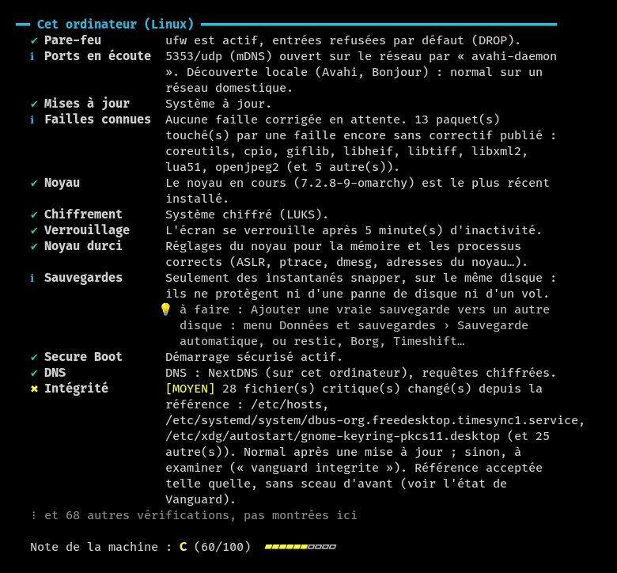
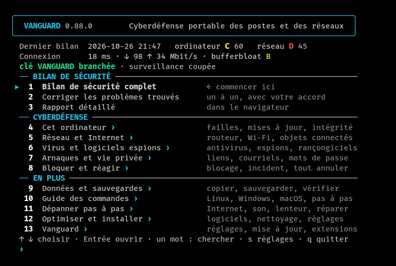
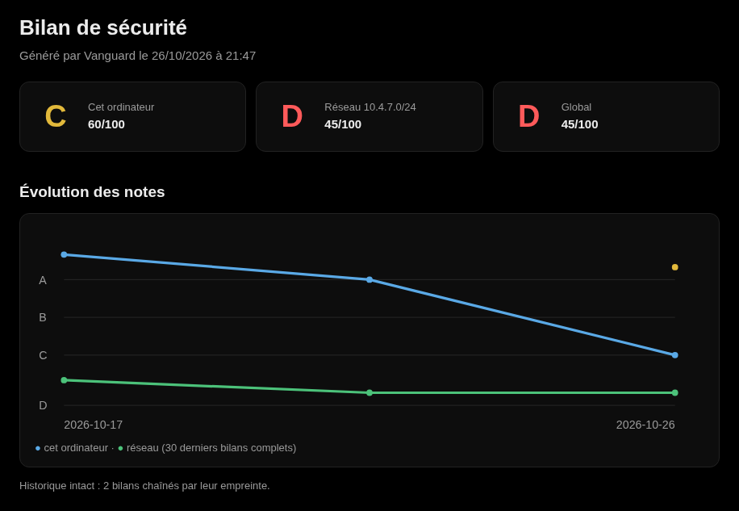
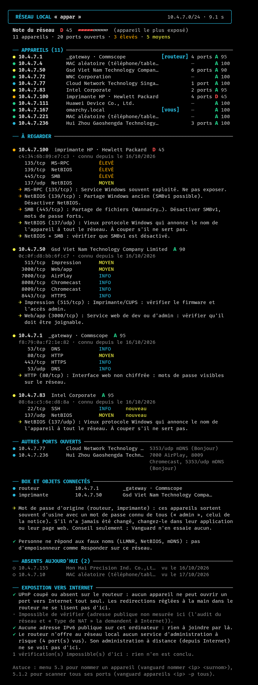
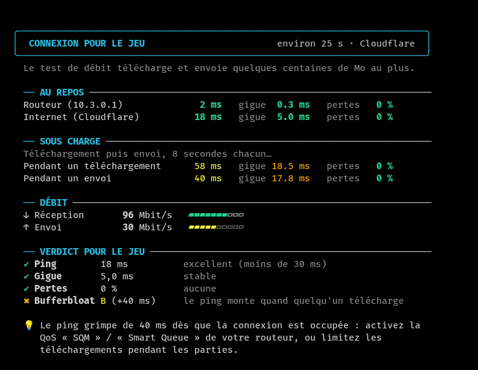

<h1 align="center"><picture><source media="(prefers-color-scheme: dark)" srcset="assets/banniere-blanche.png"></picture></h1>

<b>Français</b> · <a href="README.en.md">English</a>

  <b>Cyberdéfense portable des postes et des réseaux, depuis une clé USB.</b> 
  Vanguard durcit les ordinateurs et détecte les failles et les intrusions, sur chaque machine comme sur le réseau ; 
  il bloque les menaces trouvées sur l'ordinateur et collecte les traces d'un incident. 
  Chaque constat est expliqué, et rien n'est modifié sans accord. Le dépannage vient en plus. 
  Linux, Windows et macOS, sans installation, en français et en anglais.

<b>En développement actif · tout en Rust (en cours) · défensif</b>

## Cyberdéfense

- **Durcir.** Chaque faiblesse relevée est expliquée avec sa correction, appliquée après accord et précédée d'un point
  de restauration quand le système en permet un ; chaque règle cite sa référence (CIS, Microsoft ou ANSSI). Chaque
  correction note l'état d'avant et s'annule une par une, sauf celles qui rallument une protection ; « Tout remettre
  comme avant » défait tout ce que Vanguard a changé. Sous Windows, quatorze réglages de durcissement d'une liste
  fermée sont appliqués par Vanguard lui-même, sans script, quand ils ne sont pas mêlés à d'autres corrections ; les
  protections de Microsoft Defender (réduction de la surface d'attaque, accès contrôlé aux dossiers) s'activent après
  accord et s'annulent exactement. En déplacement, le mode Wi-Fi public ferme l'ordinateur au réseau d'un café, d'un
  hôtel ou d'un aéroport.
- **Détecter.** Les failles connues (mises à jour de sécurité manquantes, avis de sécurité des distributions Linux,
  failles activement exploitées du catalogue de la CISA, fin de support), les logiciels pas à jour sous Windows et
  macOS et les mauvais réglages, notés de A à F ; l'audit du réseau en six notes, chaque appareil inventorié et les
  nouveaux venus signalés ; la chasse aux menaces en direct ; les logiciels espions posés par un proche ; 308 règles
  YARA et les empreintes de MalwareBazaar (avec une clé abuse.ch gratuite) ; les journaux d'événements de Windows et
  les tentatives de connexion SSH ratées ; l'échange de clés post-quantique absent de SSH, des navigateurs et de
  WireGuard. L'autodiagnostic compare les lectures de Vanguard à celles des outils du système, sans rien changer.
- **Bloquer et répondre.** Chaque menace trouvée se bloque d'un clic : programme arrêté et mis en quarantaine,
  connexion fermée au pare-feu, lancement retiré du démarrage ; tout s'annule, sauf l'arrêt d'un programme. Avant
  chaque geste, Vanguard relève ce qu'il va effacer (programme, ligne de commande, empreinte, connexions), et un
  journal des événements scellé relie l'alerte, cette preuve, le geste et son annulation. Une fois mise en marche, la
  protection active bloque d'elle-même ce qui ne fait aucun doute. La protection en temps réel (surveillance horaire
  et protection active) peut être coupée pour une heure, quatre heures ou jusqu'à sa remise en marche ; la coupure
  reste signalée. Sous Linux, le veilleur anti-rançongiciel repère une rafale de chiffrement en quelques secondes et
  arrête un rançongiciel quasi certain quand la protection active est en marche. Après une infection, les traces sont
  collectées avant tout nettoyage, avec la chronologie de l'incident.
- **Protéger contre les agents d'IA.** Les serveurs d'IA ouverts au réseau, les agents qui agissent sans demander et
  les serveurs MCP mal protégés sont signalés ; les deux premiers se bloquent d'un clic. La défense contre les
  nouvelles menaces liées aux agents d'IA est en développement.
- **Signaler.** Un brouillon de rapport de faille au format du programme de l'éditeur (Microsoft, Google, Mozilla,
  Apple, avis GitHub, CERT…), trié d'abord et débarrassé de ce qui est personnel, que l'utilisateur relit et envoie
  lui-même : Vanguard n'envoie rien.

**Où va Vanguard.** En cours : tout ce qu'un agent d'IA peut exécuter ; les journaux de Windows analysés par
Hayabusa ; toutes les corrections faites par Vanguard lui-même, en Rust, sans script ; un banc d'essai sur la clé,
lancé d'un double-clic sur un vrai Windows ; l'étude d'une interface graphique. Les versions signées deux fois (Ed25519
et ML-DSA, post-quantique) attendent une décision. Ensuite : l'observation en direct sous Linux par eBPF ; les failles
connues des autres distributions Linux. Toujours défensif : Vanguard n'attaque aucun appareil.

## En plus

- **Dépannage** : les pannes courantes pas à pas (Internet, Wi-Fi, son, imprimante, disque plein), l'aide pour
  l'ordinateur d'un proche, le diagnostic de l'ordinateur, « Pourquoi c'est lent ? »
- **Optimisation** : réglages de confidentialité et de performance qui s'annulent exactement, nettoyage avec mesure
  de l'espace libéré, logiciels installés depuis leur source officielle, test de la connexion pour le jeu.
- **Données et sauvegarde** : sauvegarde automatique par l'outil du système et sa vérification (copie rsync), copie
  de fichiers vérifiée.
- **Suivi, outils et clé USB** : rapport HTML, paramètres réunis au même endroit, extensions (plugins et scripts
  vérifiés avant de tourner), guide des commandes ; une clé USB pour tous les ordinateurs, protégée en écriture
  ailleurs que sur l'ordinateur de son propriétaire. Une clé qui démarre aussi les ordinateurs en panne est en
  développement.

## Démarrer

**Télécharger** (dernière version) : [Windows](../../releases/latest/download/vanguard-windows-x86_64.exe) ·
[Linux](../../releases/latest/download/vanguard-linux-x86_64) · [macOS](../../releases/latest/download/vanguard-macos)
— ou toute la [page des versions](../../releases/latest), avec les empreintes SHA-256. Ce qu'a apporté chaque
version : [historique](CHANGELOG.md).

- **Windows** : double-clic sur le programme. Il n'est pas signé : SmartScreen peut avertir (« Informations
  complémentaires » puis « Exécuter quand même »). Microsoft Defender le prend parfois à tort pour un virus
  (« Trojan:Win32/Bearfoos.A!ml », une détection automatique sur un programme neuf) : c'est un faux positif ;
  vérifier l'empreinte SHA-256 sur la page de la version.
- **Linux** : `chmod +x vanguard-linux-x86_64`, puis `./vanguard-linux-x86_64` dans un terminal (toutes les
  distributions, rien à installer).
- **macOS** : copié depuis Internet, le programme est bloqué la première fois : `xattr -d com.apple.quarantine
  vanguard-macos`, puis `./vanguard-macos` dans le Terminal.
- **Depuis la clé USB** : `Windows/vanguard.exe`, `Linux/vanguard`, ou `Lancer Vanguard.command` sous macOS ; le guide
  de la clé est dans `LISEZMOI.txt`.

Dans le menu, choisir **1** (bilan de sécurité complet), puis **2** (corriger). Les flèches ↑ ↓ pour se déplacer, Entrée ou → pour
choisir ; Échap, ← ou Retour arrière pour revenir. La fenêtre se met à la taille du menu quand elle a été ouverte pour
Vanguard.

Le menu range les outils en deux parties. **Cyberdéfense** : 4 Cet ordinateur, 5 Réseau et Internet, 6 Virus et
logiciels espions, 7 Arnaques et vie privée, 8 Bloquer et réagir. **En plus** : 9 Données et sauvegardes, 10 Guide des
commandes, 11 Dépanner pas à pas, 12 Optimiser et installer, 13 Vanguard (paramètres, mise à jour, extensions). Un mot
tapé au menu principal (« antivirus », « sauvegarde ») retrouve n'importe quel outil ; son chemin (« 6.1.3 ») l'ouvre
directement.

## Ce que fait Vanguard

### Cyberdéfense, menace par menace

Les menaces des postes et du réseau, une par une : ce que le routeur expose à Internet, un intrus sur le Wi-Fi ou un
réseau public, un objet connecté vulnérable, un logiciel pas à jour, un ordinateur infecté, un DNS ou un certificat
détourné, les arnaques, un logiciel espion et les autres atteintes à la vie privée.

| Menace ou domaine | Ce que fait Vanguard |
|---|---|
| **Le bilan** | Une note de A à F sur tout ce qui suit, et aussi : pare-feu, mises à jour et failles connues, chiffrement, comptes, SSH, partages ouverts à tous, heure, fin de support, comptes oubliés, santé des disques… ; les logiciels pas à jour sous Windows et macOS (navigateurs, Office, Java…) et leurs failles exploitées ; l'échange de clés post-quantique (SSH, navigateurs, WireGuard), en lecture seule. Chaque règle cite sa référence (CIS, Microsoft ou ANSSI). Chaque problème est expliqué, avec sa correction, appliquée après accord et annulable. L'autodiagnostic vérifie les lectures du bilan elles-mêmes, sans rien changer. |
| **Exposition vers Internet** | L'audit du réseau en six notes (exposition, Wi-Fi, séparation des appareils, DNS et certificats, objets connectés, ordinateurs) ; les ports que le routeur ouvre vers Internet (UPnP), les ports ouverts et le pare-feu de cet ordinateur, l'adresse Internet publique sur liste noire, la page d'administration du routeur en HTTP seul. |
| **Intrus sur le Wi-Fi** | Chaque appareil du réseau, son fabricant, ses ports ouverts et ses risques ; les nouveaux venus signalés toutes les heures, avec un tableau de bord dans le navigateur ; la protection du Wi-Fi (WEP, WPA2, WPA3), le faux point d'accès qui copie son nom, les appareils Bluetooth appairés depuis peu ; le mode Wi-Fi public, qui ferme l'ordinateur au réseau d'un café, d'un hôtel ou d'un aéroport et le remet comme avant en partant. |
| **Objets connectés** | Le routeur et les objets du réseau (caméras, imprimantes, NAS, télés, domotique…) reconnus, avec leur mot de passe d'origine à changer ; les caméras cachées, dans une location ou chez quelqu'un. |
| **Poste infecté** | Antivirus, 308 règles YARA et les empreintes de logiciels malveillants connus de MalwareBazaar (clé abuse.ch gratuite), la mémoire des programmes qui tournent (à la demande), la chasse aux menaces en direct (mot de passe deviné, programmes en marche suspects), le blocage des menaces, d'un clic ou tout seul pour ce qui ne fait aucun doute (protection active), avec la preuve relevée avant chaque geste et un journal des événements scellé, fichiers-pièges et veilleur anti-rançongiciel (Linux), blocages de Windows Defender, ce qui se lance en cachette, portes dérobées, portes cachées de Windows et pilotes vulnérables, signes de rootkit, journaux d'événements suspects, connexions vers des serveurs de botnets connus, un voleur de mots de passe comme Responder démasqué, agents d'IA trop permissifs, intégrité des fichiers critiques, failles des images Docker (trivy, s'il est installé), quarantaine réversible, et les traces collectées avant de nettoyer, avec la chronologie de l'incident ; un brouillon de signalement préparé pour l'éditeur quand un logiciel se comporte mal, jamais envoyé. |
| **DNS et certificats détournés** | Le DNS réellement utilisé (et les réponses inventées), les certificats racine ajoutés (interception du HTTPS), le proxy imposé et les sites redirigés par le fichier hosts, la recherche automatique du proxy (WPAD), les extensions de navigateur qui lisent tous les sites. |
| **Arnaques et prise de contrôle** | Faux technicien (logiciels de prise de contrôle à distance), liens dangereux examinés sans les ouvrir, fichiers téléchargés vérifiés, mots de passe et adresses courriel fuités, compte piraté, bac à sable pour un programme inconnu. |
| **Vie privée et secrets** | Logiciels espions posés par un proche (serveurs connus, programmes qui lisent le clavier, autorisations de surveillance, logiciels de surveillance connus), bilan de confidentialité (qui a accès à la position, aux contacts, à la caméra et au micro), caméra et micro, mots de passe du navigateur sans protection, fichiers sensibles laissés en clair, secrets oubliés dans l'historique des projets git, données de la clé protégées par une phrase. |

<b>Le détail, menace par menace</b>

#### Le bilan, noté de A à F

**Bilan de sécurité** — une note de A à F, puis chaque problème avec sa correction.

- Pare-feu, ports ouverts (TCP et UDP), mises à jour et failles connues, chiffrement du disque, Secure Boot,
  verrouillage de l'écran, comptes (et leur blocage après des mots de passe faux, longueur minimale : Linux, Windows),
  recherche automatique du proxy (WPAD : Windows, macOS), SSH (et ses tentatives de connexion ratées, venues
  d'Internet ou du réseau local, et le client qui ne vérifie pas les serveurs ; les ports renvoyés ouverts au réseau,
  l'affichage X11 renvoyé, trop d'essais de mot de passe ; les algorithmes cassés, SHA-1, CBC, 3DES, MD5 ou DSA,
  rouverts dans sshd, retirés après `sshd -t` sans couper aucune connexion), sudo, groupes qui valent root (docker,
  lxd, libvirt, disk), dossiers de commandes que d'autres comptes peuvent modifier, durcissement du noyau (sous
  Linux : redirections ICMP en IPv4 et IPv6, adresses d'origine impossibles, espaces de noms ouverts à tous ; sous
  macOS : volume du système scellé, signature du code imposée, validation des bibliothèques, extensions ajoutées),
  fichiers secrets mal protégés, sauvegardes, partages de fichiers ouverts à tout le monde (Samba, NFS, partages
  Windows, Partage de fichiers de macOS : l'accès sans mot de passe est fermé après accord, les comptes nommés gardent
  le leur).
- Heure réglée automatiquement ; fin de support : Windows 10 et les versions de Windows 11 ou de macOS qui ne
  reçoivent plus de corrections, programmes abandonnés par leur éditeur (Flash, Java 7, Office 2016…), navigateurs qui
  ne se mettent plus à jour ; comptes oubliés (actifs mais inutilisés depuis six mois) ; nouveaux administrateurs.
- Windows : WDigest (mots de passe en clair dans la mémoire), protection de l'autorité de sécurité locale, PowerShell
  2.0, Assistance à distance, ouverture de session automatique (et mot de passe en clair dans le registre),
  SmartScreen coupé, contrôle de compte coupé pour les connexions à distance, intégrité de la mémoire, mises à jour
  en pause, authentification réseau LM ou NTLMv1, signature des partages, PowerShell qui lance tout script, UAC qui
  ne demande rien, partages ouverts en invité, comptes listés sans mot de passe, Secure Boot, BitLocker suspendu,
  protection dans le cloud de Defender coupée, exclusions de Defender trop larges, macros d'Office toutes permises,
  mots de passe gardés sous forme LM, Registre à distance, client SMBv1, installation MSI avec les droits du système,
  services au chemin sans guillemets, protection contre les exploits coupée, Windows Update coupé ou en pause, serveur
  OpenSSH (connexion par mot de passe, droits de administrators_authorized_keys) et clés SSH sans phrase de passe ou
  lisibles par d'autres, protections de Defender activées par Vanguard puis coupées ; Linux : mises à jour de sécurité
  automatiques, session qui s'ouvre toute seule sans disque chiffré ; macOS : règle des mots de passe et blocage des
  comptes, sécurité du démarrage, éléments d'ouverture et de fond, crochets de connexion et extensions d'autorisation,
  sauvegarde Time Machine non chiffrée.
- Logiciels installés depuis le dernier bilan, dits pendant une semaine (un inventaire gardé scellé sur l'ordinateur,
  jamais envoyé) ; logiciels pas à jour sous Windows et macOS (voir plus bas).
- Chaque règle cite au moins une référence du CIS, de Microsoft ou de l'ANSSI (`vanguard regles`), et a son délai :
  celle qui le dépasse est dite non vérifiée, les autres continuent.
- Santé : espace disque, état SMART des disques (sans root), batterie, températures.
- Ce qui n'a pas pu être vérifié est dit, jamais compté comme sain.
- Le bilan lit lui-même ce qu'il vérifie, sans lancer un programme par lecture : sous Windows, les comptes, les clés Run
  et le dossier Démarrage (fonctions de Windows et registre, PowerShell en secours) ; sous macOS, les réglages,
  les agents launchd, la version, le nom du Mac, la place libre et les administrateurs (plist lus directement, au
  lieu de defaults, plutil, sw_vers, sysctl, scutil ou df). Plus rapide, et moins de façons d'échouer.
- Corrections appliquées seulement après confirmation, avec un point de restauration créé automatiquement avant quand
  le système le permet (snapper ou timeshift configuré sous Linux, point de restauration Windows, instantané Time
  Machine sous macOS). Sous Windows, quatorze réglages de durcissement d'une liste fermée (WDigest, NLA du Bureau à
  distance, NTLMv2 seul, LLMNR, WPAD, UAC…) sont appliqués par Vanguard lui-même, relancé en administrateur : la
  fenêtre de Windows le nomme, et la valeur d'avant est notée pour annuler exactement ; seuls Entrée ou oui les
  appliquent. Le blocage des menaces y ajoute, de la même façon, la liste de Microsoft qui bloque les pilotes
  vulnérables. Les autres corrections, ou celles choisies avec elles, passent par un script lisible.
- Chaque correction relève d'abord l'état d'avant de ce qu'elle change, noté et scellé : « Ce que Vanguard a changé »
  l'annule, puis relit l'état. Une correction dont l'état d'avant ne se relève pas est dite « non annulable » avant
  d'être appliquée, et celle qui rallume une protection (pare-feu, antivirus, BitLocker, UAC, SELinux, Gatekeeper) ne
  se défait jamais ; annuler ne remet jamais une valeur qui rouvrirait ce que la correction a fermé.

**Logiciels pas à jour** (`vanguard logiciels-perimes`, Windows et macOS, et au bilan) — la version installée des
navigateurs (Chrome, Edge, Firefox, Brave), d'Office, d'Acrobat et Reader, de Java, de 7-Zip, de PuTTY et de Slack,
lue dans le fichier même, comparée à la dernière publiée. Les listes des éditeurs, d'endoflife.date et de Homebrew
sont téléchargées en entier, les mêmes pour tous : la liste des logiciels ne sort jamais de l'ordinateur (Paramètres ›
Versions des logiciels pour couper ces téléchargements). Pour Firefox et Edge, chaque faille exploitée du catalogue de
la CISA est vérifiée contre la version installée : une version antérieure au correctif est critique. Ce qui n'a pas de
source fiable est dit non vérifié. Lecture seule ; sous Linux, le gestionnaire de paquets s'en charge.

**Bilan post-quantique** (au bilan, en lecture seule) — un trafic chiffré capté aujourd'hui peut être gardé et lu le
jour où un ordinateur quantique existera. Le bilan dit où l'échange de clés post-quantique manque : serveur et client
SSH (d'après la version d'OpenSSH, lue sans la lancer, et les algorithmes réellement retenus ; le conseil ne nomme
qu'un algorithme que cette version connaît et passe par `sshd -t`), navigateurs (X25519MLKEM768 coupé par une
préférence ou une stratégie, ou version trop ancienne pour le proposer), pairs WireGuard sans clé pré-partagée
(comptés sans garder aucune clé). L'audit du réseau y ajoute l'administration du routeur qui n'en propose pas et un
chemin vers Internet qui le retirerait. Rien n'est changé, et ce qui n'a pas pu être lu est dit non vérifié.

**Autodiagnostic** (`vanguard autotest`) — Vanguard vérifie ses propres lectures sur l'ordinateur où il travaille.
Chaque règle du bilan tourne sous garde et délai, en lecture seule prouvée : toute écriture d'état est refusée, et des
empreintes BLAKE3 de son dossier, avant et après, nommeraient ce qui aurait changé. Ses lectures sont comparées à
celles des outils du système : dix sous Linux (pacman, dpkg, unités systemd, ports en écoute, version de sshd, DNS…),
quatre sous Windows (pare-feu, Defender, BitLocker, comptes locaux). Hors ligne par défaut ; `--json` ne contient
aucune valeur de l'ordinateur ; code de sortie 0 (sain), 1 (écart) ou 2 (non vérifié). La durée de chaque règle est
mesurée : une règle trois fois plus lente que d'habitude, ou proche de son délai, est signalée. La surveillance le
refait chaque semaine ; un écart va au journal des erreurs, sans aucune valeur de l'ordinateur, et une lecture
contredite est dite à côté des constats sains de ses règles.

#### Exposition vers Internet et réseau local

**Audit du réseau, domaine par domaine** (`vanguard audit-reseau`, menu Réseau et Internet › 2, et à la suite du
bilan complet) — six notes : exposition à Internet (les ports que le routeur ouvre, demandés au routeur lui-même,
l'IPv6 publique sans pare-feu), Wi-Fi (chiffrement, WPS, faux point d'accès, lus dans les balises), séparation des
appareils (objets connectés sur le réseau des ordinateurs, serveur DHCP qui n'est pas le routeur, intégrité ARP), DNS
et certificats, objets connectés, ordinateurs. Rien n'est attaqué. Ce qui n'a pas pu être vérifié est dit et ne compte
jamais comme sain : sans assez de vérifications, pas de note.

**Réseau local** — tous les appareils, leur fabricant, leurs ports ouverts (TCP, et UDP : SNMP, NetBIOS, UPnP, DNS,
mDNS) et leurs risques ; les nouveaux venus signalés, un carnet par réseau (celui du propriétaire, celui de chaque
ami), des surnoms (« imprimante HP ») ; les ports que des appareils ont ouverts vers Internet sur le routeur par UPnP
(lecture seule, par un client UPnP écrit en Rust ; en secours, miniupnpc sous Linux et macOS, l'interface UPnP de
Windows sous Windows). Après accord, l'adresse Internet publique est cherchée dans quatre listes noires (Spamhaus,
SpamCop, DroneBL, PSBL) : listée pour pourriel ou attaques, un appareil est sans doute infecté.
Pendant le scan, Vanguard demande aussi un nom qui n'existe pas (LLMNR, NetBIOS, mDNS) : personne de légitime n'y
répond, et l'appareil qui le fait est un empoisonneur comme Responder, qui vole les mots de passe Windows du réseau ;
la surveillance horaire le signale aussi.

#### Intrus sur le Wi-Fi

- Wi-Fi : protection du réseau (WEP, WPA2, WPA3), et faux point d'accès (« jumeau maléfique ») qui copie son nom
  sans mot de passe pour attirer les appareils ; sous Linux, réseaux ouverts enregistrés qui se reconnectent tout seuls.
- Bluetooth : ordinateur visible en permanence, et appareils appairés depuis moins d'une semaine (un clavier
  appairé par quelqu'un d'autre tape ce qu'il veut).
- Surveillance toutes les heures : notification si un appareil inconnu arrive, si un port s'ouvre, si la note de
  la machine baisse, si le routeur semble usurpé (adresse MAC partagée ou changée : usurpation ARP), ou si un
  programme ou un fichier déguisé arrive dans Téléchargements (à vérifier avant de l'ouvrir ; avec la protection
  active, celui dont l'empreinte est dans MalwareBazaar est mis en quarantaine tout seul).
  Son tableau de bord, une page locale ouverte dans le navigateur : son état, les alertes jour par jour (gardées
  même quand la notification de la nuit a disparu), les appareils apparus et les connexions vers des serveurs de
  botnets. Rien n'est envoyé.

**Mode Wi-Fi public** (`vanguard wifi-public`, menu Réseau et Internet) — à allumer en arrivant dans un café, un hôtel
ou un aéroport, à éteindre en partant. L'ordinateur n'accepte plus aucune connexion venue de ce réseau (une session
SSH déjà ouverte reste), le partage de fichiers et l'annonce de son nom sont coupés, et le DNS passe au Bouclier
canadien « Protégé », chiffré sous Linux (un DNS qui protège déjà est gardé). Sous Linux, une table nftables à part,
qui ferme aussi les ports des conteneurs ; sous Windows, la catégorie Public, le profil Public du pare-feu fermé aux
entrées et NetBIOS coupé, en une seule demande d'administrateur ; sous macOS, le pare-feu en « tout bloquer » et le
mode furtif. Chaque changement est montré avec sa valeur d'avant, notée et scellée ; l'extinction remet tout dans
l'ordre inverse, même après un redémarrage, et ce qui n'a pas pu être fermé est dit au menu et au bilan.
`vanguard wifi-public portail` rouvre la page de connexion du réseau. Rien n'est envoyé pour reconnaître un réseau
public.

#### Objets connectés

**Routeur et objets connectés** — après le scan, ou plus tard d'après le dernier scan gardé (`vanguard objets-connectes`), ce
que le routeur dit de lui-même (souvent son modèle et la version de son logiciel), une page d'administration en HTTP
seul, et les caméras, imprimantes, NAS, télés, enceintes, consoles et objets de domotique, reconnus à leur
fabricant, à leur nom, à leurs ports et à leurs annonces. Pour le routeur, les caméras, les imprimantes et les NAS, le
conseil de changer le mot de passe d'origine : rien n'est sondé en plus et aucun mot de passe n'est essayé. Une
seule exception, annoncée au scan : une demande SNMP « décris-toi » avec le mot de passe de lecture d'usine
« public », en lecture seule, qui donne le modèle des imprimantes et des NAS ; un appareil qui y répond est signalé,
puisque n'importe qui sur le réseau peut alors le lire.

**Caméras cachées** — dans une location ou chez quelqu'un, les appareils du réseau qui ressemblent à des caméras
(fabricant, flux vidéo, ONVIF), sans rien couper ni regarder.

#### Poste infecté

**Contre les rançongiciels et les logiciels malveillants** — des fichiers-pièges : un texte et un PDF leurres
dans Documents, Images et Bureau, que personne n'a de raison de toucher. Un rançongiciel qui les chiffre ou les
renomme déclenche une alerte critique, au bilan et toutes les heures par la surveillance, avec la marche à suivre ;
posés et retirés après accord. Et une analyse YARA : 308 règles de ReversingLabs qui reconnaissent des familles
entières (rançongiciels, voleurs de mots de passe, chevaux de Troie, portes dérobées…), en complément de
l'antivirus, appliquées par YARA-X, compilé dans Vanguard : rien à installer. Chaque fichier lu est aussi comparé
aux empreintes SHA-256 de logiciels malveillants connus de MalwareBazaar (abuse.ch) : là, c'est ce
logiciel précis, sans doute possible. La liste complète se télécharge une fois par semaine (environ 43 Mo), les
nouveautés des 48 dernières heures une fois par jour ; sans Internet, la copie gardée sert, et sans copie du tout,
c'est dit.

Les listes de MalwareBazaar, URLhaus et ThreatFox demandent une clé abuse.ch gratuite (compte sur
https://auth.abuse.ch/, clé donnée dans Paramètres) : abuse.ch a fermé ses téléchargements publics le 21 octobre
2026. La clé reste sur l'ordinateur, jamais montrée en entier ; sans elle, ces listes sont dites non vérifiées. Ce que l'antivirus ou YARA trouve peut aller en quarantaine, réversible : le fichier est rendu
inutilisable et noté, puis remis exactement à sa place si c'était un faux positif.

**Blocage des menaces** (menu Bloquer et réagir › Blocage des menaces, `vanguard blocage`) — chaque menace
trouvée propose « Bloquer » : le geste est montré, fait après accord, noté dans « Ce que Vanguard a changé » et
défait exactement par `vanguard blocage annuler` ; seul l'arrêt d'un programme ne se défait pas. Selon la menace : le
programme arrêté puis mis en quarantaine, la connexion fermée au pare-feu (ufw, nftables, Pare-feu Windows, pf), un
lancement retiré du démarrage, la liste de blocage des pilotes vulnérables de Windows activée, le port d'un serveur
d'IA fermé au réseau, un agent d'IA remis à demander avant d'agir. La **protection active**, une fois mise en marche,
bloque toute seule ce qui ne fait aucun doute (un fichier dont l'empreinte est dans MalwareBazaar, un outil d'attaque
connu en marche, une connexion vers un serveur de commande connu), au bilan et dans la surveillance horaire, puis
prévient ; le douteux reste une alerte avec son bouton. Quatre catégories (programmes, connexions, démarrage et
pilotes, agents d'IA), chacune désactivée, en un clic ou automatique (programmes et connexions). Jamais Vanguard, un
programme du système, un processus critique, une session à distance en cours, une adresse locale ni un DNS public ; un
interpréteur (python3, PowerShell) n'est jamais mis en quarantaine, au plus le script qu'il lance. En administrateur,
rien n'est bloqué tout seul : les réglages du blocage peuvent être écrits par n'importe quel programme du compte, et
ce qui ne fait aucun doute s'y propose d'un clic.

**La preuve avant le geste** — avant d'arrêter un programme, de mettre un fichier en quarantaine ou de bloquer une
adresse, y compris tout seul la nuit, Vanguard relève ce que le geste va effacer : le programme, sa ligne de commande,
son parent, son compte, l'empreinte SHA-256 du fichier, les connexions en cours ; ce qui ne se lit pas est noté
« impossible (raison) », et le blocage se fait quand même. La preuve est gardée avec le blocage, et la quarantaine de
l'antivirus et de YARA passe par la même voie, annulable par `vanguard blocage annuler`. **Le journal des événements**
(`vanguard evenements`) relie les alertes, ces preuves, les blocages, quarantaines et corrections, leurs annulations,
les alertes déclarées normales et les passages de version, sur cet ordinateur seulement : écrit en ajout seul, chaque
ligne porte l'empreinte de la précédente et la tête est scellée ; une ligne retirée, changée ou ajoutée se voit, et
une chaîne rompue est dite au bilan. `--incident <id>` suit le fil d'un incident, de l'alerte à l'annulation.

**Blocages de Windows Defender** — en plus de son propre blocage, Vanguard active, après accord, ce que Windows bloque
depuis son noyau et protège contre la désactivation. Règles de réduction de la surface d'attaque (vol des mots de
passe en mémoire, pilotes vulnérables, documents Office et pièces jointes piégés), protection réseau contre les
sites dangereux, logiciels indésirables, accès contrôlé aux dossiers contre les rançongiciels. Chaque règle est
nommée avant l'accord et s'annule exactement ; celles qui bloqueraient Vanguard sur sa clé ou le dépannage ne sont
jamais activées, et rien n'est proposé si un autre antivirus remplace Defender.

**Collecter les traces** — après une infection, avant de nettoyer ou de réinstaller : ce qu'un spécialiste voudra
voir, gardé dans un dossier daté sur la clé VANGUARD (ou dans le dossier de Vanguard de l'ordinateur), dans l'ordre
où cela disparaît. Processus (avec l'empreinte SHA-256 de leur programme), connexions en cours, ce qui se lance tout
seul, bilan en JSON, comptes, journaux des 7 derniers jours (en .evtx sous Windows), fichiers récents des endroits à
risque (décrits, pas copiés) ; LISEZMOI.txt, en français et en anglais, dit ce que contient chaque fichier et ce qui
n'a pas pu être lu, MANIFESTE.txt donne leurs empreintes (`sha256sum -c MANIFESTE.txt`). Lecture seule : rien n'est
arrêté, déplacé ni envoyé. Le dossier contient des données personnelles, à ne confier qu'à quelqu'un de confiance.
C'est aussi la première étape d'« Après une infection », cochée d'office : couper le réseau ou nettoyer efface ces
traces. Devant un rançongiciel ou une prise de contrôle encore reliés à Internet, la coupure passe d'abord : chaque
minute compte. Depuis la 0.83, une chronologie de l'incident (CHRONOLOGIE.txt) remet tout dans l'ordre du temps,
du plus ancien au plus récent : connexions acceptées ou refusées, comptes créés, services et tâches ajoutés,
journaux effacés, détections de Defender, fichiers récents qui parlent (programmes, scripts, fichiers cachés). Les
traces reprennent aussi ce que Vanguard a vu et fait (07-vanguard.txt) : ses alertes, ses blocages avec leur preuve.

**Signaler une faille à un éditeur** (menu Bloquer et réagir › Signaler une faille à un éditeur, `vanguard signaler`) — quand un logiciel se
comporte de façon anormale, Vanguard prépare le brouillon du rapport, que la personne relit et envoie elle-même. Il
trie d'abord : une faille déjà connue (CVE, catalogue de la CISA) se corrige par une mise à jour ; un logiciel
malveillant, une détection ratée ou un site d'hameçonnage ne sont pas des failles de l'éditeur, et le bon destinataire
est nommé. Sinon, le brouillon suit le format du programme choisi (MSRC, Google, Chrome, Mozilla, Apple, avis GHSA,
CERT/CC, CERT-FR, Vanguard), avec le fil d'un incident du journal des événements ou le dernier examen d'un outil ; il
reste titré INCOMPLET tant qu'il manque ce que seule la personne sait (les étapes, ce qui s'est passé, la preuve de
concept exigée). Ce qui est personnel est retiré en trois couches (rien d'inutile ; chemins, noms et adresses
masqués ; un contrôle final qui refuse d'écrire si un nom connu survit), et le décompte est montré. Le texte est
montré en entier, puis écrit après accord dans le dossier de Vanguard de cet ordinateur ; `--effacer` retire les
brouillons. Rien n'est jamais envoyé : le module ne contient aucun code réseau, ni presse-papier, ni courriel.

**Chasse aux menaces en direct** — une connexion réussie depuis une adresse qui venait de rater au moins dix mots
de passe (journal de sshd sous Linux, du Bureau à distance sous Windows) : le signe d'un mot de passe deviné. Et les
programmes en marche suspects : un outil offensif connu (mimikatz, xmrig…), une ligne de commande qui télécharge ou
cache ce qu'elle exécute (PowerShell encodé, mshta, certutil, curl envoyé à un shell), un programme lancé de
Téléchargements, d'un dossier temporaire ou de la corbeille.

**Le veilleur** (Linux 6.6 et plus, coupé par défaut, `vanguard veilleur on`) — entre deux passes de la surveillance,
chaque programme lancé, même de quelques millisecondes, et chaque connexion TCP ou UDP au moment où elle se ferme.
Les programmes sont jugés comme au bilan, les connexions contre les serveurs de commande de botnets déjà
téléchargés ; le grave va au tableau de bord et en notification. Sans root ni code chargé dans le noyau, il
n'arrête rien de ce côté. Un programme parti avant d'être lu est compté tel quel, jamais jugé sain, et le programme
d'une connexion fermée n'est pas connu (le noyau ne le donne pas).

**Veilleur anti-rançongiciel** (Linux, proposé à l'allumage du veilleur ou `vanguard veilleur rancongiciel on`, coupé
par défaut) — les dossiers personnels (Documents, Images, Bureau, Musique, Vidéos, Téléchargements) surveillés en
direct, sans droits d'administrateur. Une rafale de chiffrement (des dizaines de fichiers réécrits en quelques
secondes, un contenu qui ne ressemble plus à son format, une note de rançon, un fichier-piège touché, des copies de
secours effacées) donne une alerte en quelques secondes, au lieu d'attendre la vérification horaire des pièges, et
« Bloquer » est proposé au bilan suivant. Avec la protection active et un cas quasi certain (piège touché et rafale attribuée sans ambiguïté à un
programme), le programme et sa descendance sont gelés, la preuve est relevée, puis ils sont arrêtés et mis en
quarantaine, sous les garde-fous du blocage ; sinon, Vanguard alerte seulement. Un programme malveillant du compte
peut l'éteindre : la sauvegarde reste la vraie protection. Limite dite : une écriture par un lien physique placé hors
de ces dossiers échappe à la veille en direct (les pièges restent vérifiés chaque heure).

**Portes cachées de Windows et pilotes du noyau** — les DLL que Windows charge lui-même, souvent avec les droits du
système : paquets de LSA (un filtre de mot de passe reçoit chaque nouveau mot de passe en clair), AppCertDlls,
moniteurs d'impression, fournisseurs de temps, catalogue Winsock. Et les pilotes du noyau : rangés là où rien
d'installé n'en pose, ou connus pour être vulnérables (liste LOLDrivers) : signés, ils servent à désarmer l'antivirus.

**Mémoire des programmes** (`vanguard memoire`, à la demande) — les règles YARA appliquées à la mémoire des programmes
qui tournent : un logiciel malveillant « sans fichier » ne vit que là. LSASS et processus protégés : leur mémoire
n'est jamais lue ; rien de la mémoire lue n'est gardé, et ce qui n'a pas pu être lu est dit.

**Agents d'IA** — un serveur d'IA local (Ollama, LM Studio, ComfyUI) ouvert à tout le réseau sans mot de passe, un
agent réglé pour tout faire sans demander, un serveur MCP lancé sans version fixée, joint sans chiffrement ou avec
une clé écrite en clair (le nom de la clé seulement, jamais sa valeur).

**Outils libres reconnus, s'ils sont installés** — Vanguard les lance et explique ce qu'ils trouvent, sans rien
modifier ; absents, il propose de les installer par l'outil du système. trivy dit les failles connues, graves ou
critiques, des images Docker ou Podman : une image ne se met pas à jour toute seule. Et quand quelqu'un rate des connexions SSH, le bilan dit si
fail2ban, sshguard ou CrowdSec bloque déjà les adresses qui insistent.

- Ce qui se cache : programmes lancés au démarrage, tâches planifiées, préchargement de bibliothèques, programmes
  privilégiés modifiés. Sous Windows, les portes dérobées classiques : un débogueur posé sur un programme
  d'accessibilité de l'écran de connexion (IFEO, SilentProcessExit), sethc ou utilman (touches rémanentes, options
  d'ergonomie) remplacés par cmd, Shell ou Userinit de Winlogon détournés, AppInit_DLLs, abonnements WMI qui lancent
  une commande ; suivies par la surveillance, corrigées quand l'état d'origine est connu exactement. Sous Linux, les
  signes d'un rootkit : processus cachés, programmes qui tournent sans fichier (memfd, effacés, lancés depuis /tmp),
  module du noyau qui se cache ou modules non signés inconnus, carte réseau en mode promiscuité (elle écoute tout le
  réseau).
- Journaux d'événements de Windows, sur les 7 derniers jours : rafales de mots de passe faux venues du réseau (Bureau
  à distance, partages), journal de sécurité effacé, comptes créés, services installés depuis un dossier temporaire
  ou qui lancent un interpréteur. Le journal de sécurité ne se lit qu'en administrateur : sans ce droit, c'est dit.
- Antivirus : ClamAV (Linux, macOS) ou Microsoft Defender (Windows), sur l'ordinateur ou sur une clé USB / un dossier
  choisi, avec les pièges des vers de clé (raccourci qui imite un dossier, autorun.inf, scripts).
- Intégrité des fichiers critiques (comptes, sudo, SSH, PAM, cron, services, démarrage automatique) : empreintes
  BLAKE3, ce qui a changé depuis la référence, et surveillance en direct.
- Qui parle à Internet ? : les connexions en cours de chaque programme, avec le nom du serveur ; un programme lancé
  depuis un dossier temporaire ou les Téléchargements, un port de logiciel d'accès à distance, un serveur sans nom ou
  un serveur de commande de botnet connu (listes de Feodo Tracker et de ThreatFox, abuse.ch ; celles de ThreatFox
  avec la clé abuse.ch gratuite) sont signalés. Lecture seule : rien n'est coupé ici ; un serveur de commande connu se
  bloque par le blocage des menaces.
- Vanguard se méfie aussi de lui-même : au démarrage, il dit si une bibliothèque est injectée dans tous les programmes
  de la session (LD_PRELOAD, DYLD_INSERT_LIBRARIES, AppInit_DLLs : celle d'un paquet du système, comme GameMode, est
  une simple information) et s'il tourne en root sans raison, car ses résultats passent par là. Au bilan : la
  surveillance horaire activée puis disparue (un logiciel malveillant coupe d'abord ce qui le surveille), l'historique
  des bilans réécrit après coup (chaque bilan porte l'empreinte du précédent), et son propre état (alertes apprises,
  versions déjà vues, surveillance, intégrité) changé hors de lui : chaque fichier est scellé par une empreinte
  BLAKE3, pour qu'un programme ne puisse pas faire taire son alerte. Chaque nuit où le code a changé, la CI recompile
  Vanguard deux fois et vérifie que le programme est identique à l'octet près. Chaque bibliothèque incluse est
  vérifiée à chaque version et chaque nuit (cargo deny : failles connues, licences compatibles, provenance), et la
  version publiée vérifie ses calculs : un nombre qui déborde sur une donnée hostile arrête la vérification en cause
  au lieu de fausser la suite.

#### DNS et certificats détournés

- DNS réellement utilisé (et réponses inventées), certificats racine ajoutés (interception du HTTPS), extensions de
  navigateur qui lisent tous les sites.
- Navigation détournée (proxy imposé, sites redirigés par le fichier hosts).

#### Arnaques et prise de contrôle

- Mon ordinateur est-il contrôlé ? : l'arnaque au faux technicien (« votre ordinateur est infecté ») fait installer un
  logiciel de prise de contrôle à distance. Vanguard cherche AnyDesk, TeamViewer, RustDesk, Assistance rapide,
  Splashtop, UltraViewer… installés (et depuis quand), lancés au démarrage, en cours d'exécution ou simplement posés
  dans Téléchargements ; il explique quoi faire (couper Internet, prévenir la banque, changer les mots de passe) et
  les retire après accord. Un programme en cours n'est jamais coupé sans un second accord exprès : la personne qui
  aide peut être connectée par lui. Au bilan aussi (« Accès à distance »).
- Ce lien est-il dangereux ? : un lien reçu examiné sans jamais l'ouvrir (lettres déguisées, sous-domaine trompeur,
  marque imitée, raccourcisseur, adresse IP brute) ; après accord, l'âge du domaine et trois listes publiques de
  sites dangereux (URLhaus avec la clé abuse.ch, Spamhaus, SURBL). Seul le nom du domaine sort de l'ordinateur.
- Vérifier un fichier téléchargé : son empreinte comparée à celle que publie le site (collée, ou un SHA256SUMS posé
  à côté), son nom et son contenu (double extension, programme déguisé en document), puis YARA et l'antivirus.
- Bac à sable : lancer un programme inconnu sans réseau, système en lecture seule, dossier personnel invisible
  (bubblewrap ou firejail sous Linux, Windows Sandbox sous Windows, sandbox-exec sous macOS).
- Mots de passe fuités : vérifiés par Have I Been Pwned sans jamais envoyer le mot de passe (5 caractères de son
  empreinte seulement) ; fuites d'adresse courriel, après accord (l'adresse est envoyée au service).

#### Vie privée et secrets

**Logiciels espions** (`vanguard logiciels-espions`, menu Virus et logiciels espions, et au bilan) — les signes d'un
logiciel espion posé par un proche : connexions et noms demandés vers les serveurs et sites des logiciels espions
connus (liste de l'association Échap, CC-BY 4.0, téléchargée à l'usage), logiciels de surveillance connus installés ou
en marche (le contrôle parental et la surveillance d'employés sont dits normaux s'ils ont été installés exprès),
programmes qui lisent le clavier (Linux), autorisations Surveillance de l'entrée, Accessibilité et Enregistrement de
l'écran (macOS). Lecture seule : rien n'est retiré, car celui qui l'a posé pourrait le voir ; l'écran dit de garder
des captures et de demander de l'aide d'abord. Ce qui n'a pas pu être vérifié est compté, et le verdict n'est jamais
« aucun logiciel espion ».

**Protéger les données de la clé** — le carnet des appareils de la clé (noms, adresses MAC, surnoms) chiffré par une
phrase (XChaCha20-Poly1305, phrase dérivée par Argon2id), contre une clé perdue ou prêtée. Sur l'ordinateur du
propriétaire, rien ne change : la clé de données y est gardée. Ailleurs, Vanguard demande la phrase, ou continue sans
le carnet. Le rapport et le diagnostic ne s'écrivent plus sur la clé. Sur demande, réversible, avec une sauvegarde
proposée avant ; le bilan signale un carnet resté en clair.

**Secrets dans les projets git** — Vanguard relit l'historique des projets git du dossier personnel : un mot de passe,
une clé d'API ou un jeton écrit un jour y reste, même effacé ensuite. Ses propres règles reconnaissent les clés à leur
forme (AWS, GitHub, GitLab, Google, Stripe, Slack…), les clés privées, les mots de passe dans une adresse ou écrits
dans le code ; gitleaks, s'il est installé, ajoute les siennes. Aucun secret n'est affiché ni gardé.

**Caméra et micro : qui s'en sert ?** — sous Windows, chaque programme qui a utilisé la caméra ou le micro, et la
dernière fois (un programme lancé depuis un dossier temporaire ou Téléchargements est signalé) ; sous Linux, ce qui
les tient en ce moment. En lecture seule. **Bilan de confidentialité** : les applications qui ont accès à la
position, aux contacts, à la caméra et au micro, et leur dernier usage quand le système le note (registre des
autorisations sous Windows, Flatpak et Snap sous Linux, base des autorisations de macOS, lisible avec l'accès complet
au disque). Rien n'est retiré : la marche à suivre est donnée, et ce qui n'a pas pu être lu est dit non vérifié.

**Mots de passe des navigateurs** (`vanguard mots-de-passe-navigateurs`) — combien chaque navigateur en garde et comment ils sont
protégés : comptés, jamais lus ni envoyés. La vérification intégrée du navigateur (mots de passe faibles, réutilisés,
compromis) est indiquée, et un mot de passe tapé peut être cherché dans les fuites (Have I Been Pwned, 5 caractères
de son empreinte seulement).

- Mots de passe enregistrés dans le navigateur sans protection, fichiers sensibles laissés en clair (mots de passe ou
  clés).

### En plus, domaine par domaine

Au-delà de la défense : le dépannage, l'optimisation, les données, puis le suivi, les outils et la clé USB.

| Domaine | Ce que fait Vanguard |
|---|---|
| **Dépannage** | Diagnostic de l'ordinateur, pannes de tous les jours pas à pas (Internet, Wi-Fi, lenteur, son, imprimante, disque plein), après une infection, nouvel ordinateur, ordinateur qui part, ordinateur d'un proche, « Pourquoi c'est lent ? », fiche de l'ordinateur, rapport à laisser, réparations. |
| **Optimiser, logiciels et jeu** | Réglages de confidentialité et de performance qui s'annulent exactement, « Tout remettre comme avant » pour tout défaire, nettoyage à cocher avec la place gagnée mesurée, programmes du démarrage ; les meilleurs logiciels en 8 catégories, depuis leur source officielle, et les mises à jour de tout d'un coup ; connexion pour le jeu (ping, gigue, pertes, débit et bufferbloat, comparés aux mesures habituelles), Wi-Fi encombré, type de NAT, DNS le plus rapide (sans retirer un DNS qui protège), réglages pour jouer. |
| **Données et sauvegarde** | Sauvegarde automatique et vérifier ma sauvegarde (copie rsync réellement relue), copier mes fichiers (copie vérifiée) et vérifier une copie. |
| **Suivi, outils et clé USB** | Rapport HTML avec la courbe des notes, entretien du mois, apprentissage sur l'ordinateur, ce que Vanguard a changé (chaque correction, datée, annulable une par une) et le journal des événements scellé, tous les paramètres au même endroit, extensions personnelles (plugins et scripts, vérifiés avant de tourner) ; clé USB protégée en écriture ailleurs que sur l'ordinateur de son propriétaire, vérifier ma clé (fausses clés, vitesse), mes ordinateurs (suivis par la clé), raccourci sur cet ordinateur, Vanguard mis à jour depuis la clé ou depuis GitHub (versions signées par l'auteur), retrait complet de Vanguard d'un ordinateur, guide des commandes, recherche dans tous les menus. |

<b>Le détail, domaine par domaine</b>

#### Dépannage

**Diagnostic de l'ordinateur** — le premier réflexe d'un dépannage : matériel, système, et les problèmes récents
(erreurs du journal et programmes plantés sous Linux ; écrans bleus, arrêts brutaux et plantages sous Windows ;
paniques du noyau et rapports de plantage sous macOS), avec une copie texte enregistrée sur la clé.

**Dépanner pas à pas** — les pannes de tous les jours, prises comme le ferait quelqu'un qui s'y connaît : pas
d'Internet, Wi-Fi qui coupe, ordinateur lent, pas de son, imprimante qui ne marche pas, disque plein. Deux ou trois
questions, puis Vanguard vérifie lui-même (adresse, routeur, Internet, DNS ; signal Wi-Fi ; service du son et sortie
choisie ; file d'impression et imprimante sur le réseau ; place des disques) et propose la bonne réparation ou le bon
outil, toujours après accord. Et trois parcours pour les grands moments : **après une infection** (les traces gardées
d'abord, puis ce qui presse selon le signe, le bilan de ce qui a pu s'installer, les analyses dans l'ordre, puis les
mots de passe à changer, le courriel en premier) ; **nouvel ordinateur** (mises à jour, chiffrement, sauvegardes,
pack de départ, confidentialité, dans l'ordre) ; **ordinateur qui part**, vendu ou donné (copie vérifiée d'abord,
comptes déconnectés, clé BitLocker ou FileVault mise de côté, effacement sûr par l'outil du système, puce TPM remise
à zéro). Vanguard n'efface rien lui-même. Et **mon compte a été piraté** : reprendre la main par la page officielle,
puis mot de passe, validation en deux étapes, sessions fermées, et la vérification que cet ordinateur n'a pas livré
le mot de passe. Lent **depuis une mise à jour** : les dernières mises à jour, datées, et comment revenir en arrière.
Et l'**ordinateur d'un proche** (`vanguard depanner proche`) : trois questions (qui s'en sert, pourquoi il est confié, et
si son réseau peut être regardé, avec son accord seulement), le bilan, puis un résumé en mots de tous les jours, mis
en ordre selon les réponses : ce qui reste à faire d'abord, ce qui va bien ensuite. Les outils qui répondent à la
raison (lenteur, antivirus, faux technicien), les corrections une à une, et la page à laisser, avec des conseils
choisis pour la personne.

**Rapport à laisser** — une page simple pour la personne qu'on vient de dépanner : sa note, ce qu'il lui reste à
faire du plus grave au moins grave, ce qui va bien et trois habitudes ; posée sur son Bureau, à lire ou imprimer.

**Pourquoi c'est lent ?** — un instantané de deux secondes : ce qui occupe le processeur, la mémoire et le disque,
programme par programme ; la durée du démarrage et ce qui le retarde ; les programmes lancés à l'ouverture de
session et leur poids. Ceux qui travaillent un moment puis se calment (antivirus qui analyse, indexation, mises à
jour) sont nommés comme tels. Les programmes du démarrage se retirent de là, après accord : ils restent installés,
et chaque retrait s'annule exactement (`vanguard demarrage`).

**Fiche de l'ordinateur** — modèle, carte mère, BIOS, processeur, mémoire (barrettes, type, vitesse), carte graphique
et pilote, disques : ce qu'on demande au téléphone ou pour acheter une pièce. Les numéros de série s'affichent à
l'écran seulement, jamais écrits.

- Réparations : Internet, navigation détournée, pare-feu, disque, disque plein, nettoyage approfondi, Windows Update
  bloqué, fichiers système, heure.

#### Optimiser, logiciels et jeu

**Optimiser** — des réglages de confidentialité, de performance et de confort, écrits pour Vanguard. Sous Windows :
télémétrie au minimum, publicités et suivi coupés, Recall sans captures d'écran, extensions des fichiers visibles, pas
de lancement automatique des clés USB, démarrage rapide, menu complet au clic droit. Sous Linux : entretien du SSD,
taille du journal, rapports envoyés par GNOME ou Ubuntu. Sous macOS : publicités, analyses, pas de .DS_Store sur les
clés. Chaque réglage montre son état et s'annule exactement : la valeur d'avant est notée, scellée, puis remise. Aucun
n'affaiblit la sécurité. « Tout remettre comme avant » (`vanguard optimiser annuler`) défait, du plus récent au plus
ancien et en une demande administrateur, les corrections du bilan, Optimiser, Gaming, les blocages et le mode Wi-Fi
public.

**Nettoyer le système** — une liste à cocher de ce qui prend de la place sans servir : paquets téléchargés et devenus
inutiles, anciennes versions des Snap, Flatpak inutilisés, compilations AUR, vieux caches, miniatures, vieux journaux,
rapports de plantage (Linux) ; fichiers temporaires, cache de Windows Update et de l'optimisation de distribution,
anciens composants (Windows) ; vieux caches, Homebrew, Xcode, instantanés locaux (macOS). La place que libère chaque
élément est mesurée avant, ce qui se refait seul est coché d'office, la corbeille jamais ; la place libre relue après
dit ce qui a vraiment été gagné.

**Connexion pour le jeu** — ping, gigue, pertes, débit et bufferbloat (le lag quand quelqu'un télécharge), avec un
verdict critère par critère et des conseils.

**Wi-Fi, NAT et DNS** — le Wi-Fi encombré : les réseaux voisins par canal, et le canal le plus libre à
régler sur le routeur ; le type de NAT pour le jeu (ouvert, modéré ou strict, comme sur les consoles), double NAT et
adresse partagée par le fournisseur compris ; le DNS le plus rapide, mesuré ici, proposé seulement s'il ne remplace
pas un DNS qui protège (NextDNS, chiffré, filtrant) et annulable.

- Mises à jour de tout d'un coup : système, programmes, pilotes, firmware.
- Logiciels : les meilleurs de chaque usage, libres pour la plupart, rangés en 8 catégories (navigateurs et
  courriel, messagerie et partage, sécurité et vie privée, bureautique, vidéo et musique, images et création, outils
  système, programmation) et un pack de départ (Firefox, Bitwarden, VLC, LibreOffice, 7-Zip) : liste à cocher, déjà
  installés reconnus, installation depuis la source officielle qui vérifie chaque téléchargement (winget, paquets de
  la distribution ou Flathub, Homebrew).
- Gaming : sous Windows, composants pour les jeux et réglages de Windows ; sous Linux, Steam, pilotes Vulkan 32 et
  64 bits selon la carte, GameMode, MangoHud, Gamescope, Wine, Lutris, Heroic, ProtonUp-Qt, vm.max_map_count, ntsync ;
  sous macOS, Rosetta 2, Steam, Heroic, Epic Games, GOG Galaxy, Prism Launcher et le compteur d'images de Metal.

#### Données et sauvegarde

**Sauvegarde automatique** — mise en place avec l'outil du système (Déjà Dup ou une copie rsync chaque jour sous
Linux, Time Machine, Historique des fichiers sous Windows), vers un disque externe, après accord et annulable.
**Vérifier ma sauvegarde** : la copie rsync réellement relue sur le disque, des fichiers au hasard comparés à leur
original ; un original modifié depuis, plus récent que sa copie, n'est pas compté comme une erreur, une copie
différente d'un original inchangé dit un disque qui perd des données, et une copie réécrite après la sauvegarde, plus
récente que son original, est dite abîmée : c'est ainsi qu'apparaît un rançongiciel qui chiffre le disque de
sauvegarde. Pour Time Machine, Déjà Dup et l'Historique des fichiers, qui gardent leurs sauvegardes dans leur propre
format, la marche à suivre pour restaurer un fichier. Rien n'est écrit ni effacé.

**Copier mes fichiers** — Documents, Images, Bureau, Vidéos et Musique vers un disque externe, avant une réparation
risquée ou une réinstallation : la place est vérifiée avant, chaque fichier relu et comparé à l'original (empreinte
BLAKE3), rien n'est effacé ni écrasé, et une copie interrompue reprend où elle s'est arrêtée. **Vérifier une
copie**, plus tard, fait le test de restauration : des fichiers répartis sur toute la copie sont relus sur le disque
et comparés à leur original ; un disque qui perd des données se voit avant le jour où on en a besoin.

- Sauvegarde absente : signalée au bilan, avec le chemin pour en mettre une en place.

#### Suivi, outils et clé USB

**Apprentissage** — Vanguard apprend sur l'ordinateur, sans rien envoyer. Une alerte déclarée normale (« i » à la
correction, dans la surveillance, le veilleur ou le blocage) passe au niveau info pendant 90 jours, ou jusqu'à ce
qu'elle s'aggrave ; le choix porte sur ce dont parle l'alerte (le programme, l'adresse, l'appareil), pas sur son
texte, et une menace certaine ne se tait jamais. Chaque test de connexion se compare aux mesures habituelles du même
réseau ; un appareil connu qui paraît soudain tout fermé (en veille) est revérifié plus patiemment. « Ce que Vanguard
a appris » montre tout et permet d'oublier.

**Paramètres** (Vanguard › Paramètres, « s » au menu principal, `vanguard parametres`) — tous les réglages au même
endroit : langue, emojis, travail sans Internet, protection en temps réel, surveillance horaire, entretien du mois,
alertes apprises, blocage des menaces, restrictions des extensions et clé abuse.ch. Chaque changement montre la valeur
d'avant et la commande pour la remettre ; les alertes apprises et le blocage ouvrent leur propre écran (« Ce que
Vanguard a appris », Blocage des menaces). La langue, les emojis et le travail sans Internet restent choisis d'un
lancement à l'autre (VANGUARD_LANG, VANGUARD_EMOJI et VANGUARD_HORS_LIGNE l'emportent toujours).

**Protection en temps réel** (Paramètres, `vanguard parametres temps-reel non [--pendant 1h|4h]`) — coupe d'un coup,
après accord et la liste de ce qui s'arrête, ce que Vanguard fait tout seul en continu : la surveillance horaire (et
tout ce qu'elle regarde et notifie) et la protection active du blocage, qui ne bloque plus rien toute seule. Pendant 1
heure, 4 heures ou jusqu'à sa remise en marche (`vanguard parametres temps-reel oui`) ; la reprise est automatique à
l'échéance, et la surveillance la constate elle-même. Les réglages de chacun ne changent pas : à la reprise, chacun
retrouve son état d'avant. Tant qu'elle est coupée, c'est redit en tête du menu principal et sur ses lignes Surveillance
et Blocage, dans chaque bilan (une information, sans effet sur la note), dans « Qui parle à Internet ? », dans le
blocage et sur le tableau de la surveillance, par une notification à la première passe puis une fois par jour, et dans
l'entretien du mois : un programme qui la couperait en douce ne passe pas inaperçu. Elle ne concerne que Vanguard :
Defender, le pare-feu et l'UAC ne sont jamais touchés, et un blocage déjà fait reste en place. En administrateur, elle
ne se règle pas : son réglage est celui du compte (sous sudo, celui du compte qui l'a lancé est lu).

**Extensions** (menu 12, `vanguard extensions`) — des programmes personnels dans Vanguard, sans toucher à son code. Un
plugin est un dossier avec un manifeste `plugin.toml`, ajouté une fois depuis un dossier ou une archive .zip
(`vanguard plugins ajouter`) ; un script du laboratoire est un fichier posé tel quel (`vanguard labo`), pour essayer
une idée vite. Un plugin est un script (sh, bash, PowerShell, Python) ou un programme compilé, en Rust par exemple
avec la bibliothèque `extensions/sdk`. Leurs constats sont montrés à part et ne comptent jamais dans la note
(`--rapport` les met dans une section à part du rapport HTML). Avant l'accord, tout le dossier ou l'archive est
analysé (YARA, empreintes de MalwareBazaar) et chaque fichier haché : un fichier changé, ajouté ou retiré, et il faut
réapprouver. C'est la copie vérifiée qui tourne, sans terminal, avec un délai et une sortie bornés ; une archive ne
peut rien écrire hors de son dossier ; sous Linux, `--isole` la lance sans réseau, le dossier personnel masqué. En
administrateur, rien ne tourne tout seul et chaque lancement est demandé. L'interrupteur **Restrictions**
(Extensions › 3, Paramètres, ou pour un seul plugin ou script) coupe ces garde-fous pour les extensions personnelles ;
une seule règle reste : le dossier des extensions doit appartenir au compte, fermé aux autres comptes. Mode d'emploi :
[extensions/LISEZMOI.md](extensions/LISEZMOI.md).

**Vérifier ma clé** — une clé USB ou un disque externe tient-il ce qu'il annonce ? Les fausses clés (une puce de
16 Go vendue « 1 To ») acceptent tout et rendent n'importe quoi au-delà de leur vraie taille. Après accord, Vanguard
écrit dans l'espace libre un contenu qu'il sait reconnaître, relit tout en contournant la mémoire de l'ordinateur,
mesure les vitesses d'écriture et de lecture, puis efface tout ; les fichiers déjà sur la clé ne sont pas touchés.
Rapide (un quart du libre) ou complet (tout le libre, la seule preuve) ; jamais sur la clé VANGUARD ni sur le disque
du système.

**Mes ordinateurs** — chaque bilan complet fait avec la clé VANGUARD y note l'ordinateur : surnom (« système ·
modèle », renommable), note, problèmes restants (leur catégorie et leur niveau seulement, les cinq plus graves),
date du dernier bilan. Le tableau voyage sur la partition VANGUARDLOG de la clé, sans nom de machine, compte, adresse
ni nom de Wi-Fi ; il ne part jamais sur GitHub.

**Raccourci sur cet ordinateur** — Vanguard copié ici et lancé d'un clic.

**Retirer Vanguard de cet ordinateur** — tout ce qu'il y a posé (surveillance, entretien, sauvegarde automatique,
veilleur, fichiers-pièges, raccourci et icône, copie du programme, restes d'une version d'avant) est retrouvé, montré
avec ce qui sera fait, puis coché. Le dossier de données n'est effacé qu'après un second accord ; les changements faits sur le
système se défont d'abord par leurs outils, ou sont dits avec leur commande ; la clé n'est jamais touchée.

**Guide des commandes** — les commandes utiles d'Omarchy, d'Arch, de Fedora, de Debian et Ubuntu (et des autres
Linux), de Windows 11, de macOS, et celles qui s'écrivent pareil partout (Vanguard, ping, nslookup, ssh, curl, git…),
chacune expliquée ; ⚠ marque celles qui changent quelque chose. Chaque distribution a sa présentation, ses marches à
suivre « Pas à pas » (mettre à jour, installer, faire de la place, réparer, pare-feu, pilotes NVIDIA, nouvelle
version…), ses programmes (pacman, dnf, apt, SELinux, AppArmor…), puis ceux communs à Linux ; Windows 11 et macOS
ont aussi leurs marches à suivre (réparer Windows, réseau, sécurité, lenteur, Time Machine…). On tape ce qu'on cherche : les commandes paraissent au fil de la frappe, et Tab
complète le mot. Chaque commande a sa page : la copier, pour la taper ici ou chez la personne qu'on aide, ou la
lancer ici quand elle ne fait que lire ; sa sortie défile dans Vanguard, et Échap l'arrête. Tous les systèmes sont
lisibles partout (les commandes de Windows depuis Linux, par exemple), et le guide dit si un programme manque sur cet
ordinateur. En plus, les exemples de [tldr-pages](https://tldr.sh) (licence CC BY 4.0) : plus de 30 000 commandes de
la communauté, pour Linux, Windows, macOS et d'autres, en français quand elles sont traduites. Le guide les
télécharge tout seul, au plus une fois par semaine, la surveillance et l'entretien du mois aussi (sans ouvrir le
guide, une fois qu'il s'en est servi), et la clé les apporte : lancé depuis la clé, il les a dès le
premier lancement, même sans Internet. Elles se cherchent et se copient, mais ne se lancent jamais d'ici, Vanguard
ne les ayant pas vérifiées.

- Entretien du mois : une notification par mois avec la note de la machine, les mises à jour en attente, la place
  que le nettoyage libérerait et les problèmes nouveaux ; rien n'est changé.
- Rapport HTML avec la courbe des notes, et ce qui a changé depuis le bilan précédent.
- Vérifier Vanguard lui-même : sa version, la date de son dernier commit et son empreinte SHA-256, à comparer à la
  page de la version (Vanguard n'est pas signé : c'est cette comparaison qui prouve qu'il est bien lui). Une copie de
  plus de six mois le dit au menu. Et le manifeste de la clé : au déploiement, l'empreinte de chaque fichier de la
  clé est gardée sur l'ordinateur du propriétaire ; au retour de chez quelqu'un, le bilan nomme ce qui a été ajouté,
  remplacé ou retiré (un autorun planté, un programme remplacé). Les données, les images ISO et le menu Ventoy, qui
  changent normalement, ne sont pas comparés. Chaque clé a sa référence (reconnue par l'identifiant de son volume) :
  une deuxième clé VANGUARD ne passe pas pour une clé modifiée.
- Se mettre à jour : depuis une clé VANGUARD plus récente, ou, sans clé, depuis GitHub. Les programmes publiés y ont
  leur propre dépôt, [vanguard-update](https://github.com/d9v3/vanguard-update), à côté de celui du code ; la dernière
  version y est décrite par un manifeste signé en Ed25519 sur l'ordinateur de l'auteur, dont Vanguard porte la clé
  publique, avec celle d'une seconde clé de signature, gardée hors ligne, qui peut révoquer la principale si elle
  était volée. Un manifeste mal signé, une version plus ancienne que la plus haute déjà vue, un programme dont la
  taille ou l'empreinte diffère : refusés ; un manifeste trop vieux, ou une horloge en retard, est dit non vérifié,
  jamais « à jour ». Le menu annonce une version plus récente ; rien ne s'installe sans accord. L'historique signé des
  versions permet à `vanguard verifier-moi` de vérifier aussi une copie qui n'est plus la dernière.
- Menus au clavier : ↑ ↓ pour se déplacer, Entrée ou → pour choisir, Échap, ← ou Retour arrière pour revenir (au menu
  principal, ← ne fait rien, pour ne pas quitter par erreur ; dans une liste à cocher, seule Entrée confirme). La
  fenêtre ouverte pour Vanguard prend la taille du menu et se centre (Hyprland, console de Windows).
- Recherche dans tous les menus et les listes à cocher : un mot tapé (wifi, disque, dns, mise à jour…) ne laisse que
  les lignes qui le contiennent, sans souci d'accents ni de majuscules ; la fin du mot le plus probable s'affiche en
  gris, et Tab la complète. Au menu principal, elle trouve aussi chaque outil des sous-menus, et chaque page et chaque
  commande du guide.

Vanguard ne coupe jamais une connexion à distance en cours (Bureau à distance, SSH). À n'utiliser que sur son propre
réseau, ou sur un réseau qu'on a le droit d'auditer.

## En images

<table>
  <tr>
    <td width="50%"> Le menu : dernier bilan,
    connexion, clé branchée.</td>
    <td width="50%"> Le rapport HTML et
    l'évolution des notes.</td>
  </tr>
  <tr>
    <td width="50%"> Le réseau : chaque
    appareil, ses ports et ce qu'il faut regarder.</td>
    <td width="50%"> La connexion
    pour le jeu : ping, gigue, débit, bufferbloat.</td>
  </tr>
</table>

Captures refaites à chaque version, sur une copie des données ; les adresses et les noms du réseau local y sont
masqués.

## Systèmes pris en charge

| Système | Versions |
|---|---|
| Windows | 10 et 11 |
| macOS | 12 et plus récents, Apple Silicon et Intel (testé sur les Mac de GitHub, pas encore sur un vrai Mac) |
| Linux | Arch et dérivées (Omarchy, Manjaro, EndeavourOS, CachyOS), Debian, Ubuntu, Mint, Pop!_OS, Fedora (et RHEL, Rocky, Nobara), openSUSE |
| Linux atomique | Bazzite, Silverblue, Kinoite, Bluefin, Aeon |

Vanguard reconnaît la distribution et propose ses propres commandes : `omarchy update` / `omarchy pkg add` sous
Omarchy, `ujust update` sur Bazzite, `rpm-ostree` ou `transactional-update` sur un système atomique, sinon pacman,
apt, dnf ou zypper.

## Commandes

Chaque entrée du menu existe aussi en commande.

<b>Toutes les commandes</b>

| Commande | Rôle |
|---|---|
| **Bilan de sécurité** | |
| `vanguard bilan [--html] [--texte]` | bilan complet : cet ordinateur puis le réseau ; `--texte` l'affiche en texte simple (mode urgence) |
| `vanguard corriger` | corriger les problèmes trouvés |
| `vanguard rapport` | le rapport détaillé dans le navigateur : le bilan de cette session, sinon un bilan complet d'abord |
| **4 Cet ordinateur** | |
| `vanguard audit [--json]` | audit de cet ordinateur |
| `vanguard mises-a-jour` | mises à jour |
| `vanguard dernieres-failles [--jours N]` | dernières failles exploitées : celles que la CISA vient d'ajouter à son catalogue, les plus récentes d'abord |
| `vanguard integrite [--accepter] [--temps-reel]` | intégrité des fichiers critiques (empreintes BLAKE3), en direct possible |
| `vanguard entretien [on\|off]` | entretien du mois ; sans argument : ce qu'il dirait maintenant |
| `vanguard fiche-ordinateur [--json]` | fiche de l'ordinateur ; `--json` sans les numéros de série |
| `vanguard rapport-a-laisser` | rapport à laisser : une page simple pour la personne dépannée |
| `vanguard secrets` | secrets oubliés dans l'historique des projets git (et gitleaks, s'il est installé ; lecture seule) |
| `vanguard conteneurs` | failles connues des images Docker ou Podman (trivy, s'il est installé ; lecture seule) |
| `vanguard logiciels-perimes` | logiciels pas à jour (Windows, macOS) : navigateurs, Office, Acrobat, Java, 7-Zip, PuTTY, Slack comparés à leur dernière version ; failles exploitées (lecture seule) |
| `vanguard defender` | blocages de Windows Defender : règles ASR, protection réseau, logiciels indésirables, accès contrôlé aux dossiers ; chacun après accord, annulable (Windows) |
| **5 Réseau et Internet** | |
| `vanguard appareils [cible] [-p courants\|tous\|22,80,8000-8100] [--json]` | scan du réseau ou d'un appareil |
| `vanguard audit-reseau [--json] [--html] [--invite]` | audit du réseau par domaine : six notes (exposition, Wi-Fi, séparation des appareils, DNS et certificats, objets connectés, ordinateurs), sans rien attaquer ; `--invite` : sur le réseau invité, vérifie qu'il est bien séparé du réseau principal |
| `vanguard nommer <ip\|mac> <surnom>` | nommer un appareil |
| `vanguard objets-connectes` | routeur et objets connectés d'après le dernier scan gardé : modèle du routeur, caméras, imprimantes, NAS… et leur mot de passe d'origine (rien n'est sondé) |
| `vanguard cameras-cachees` | caméras cachées sur le réseau (location, chez quelqu'un) |
| `vanguard listes-noires` | l'adresse Internet publique sur liste noire ? (après accord) |
| `vanguard surveillance on\|off` | surveillance horaire |
| `vanguard tableau-de-bord [--sans-ouvrir]` | tableau de bord de la surveillance : page locale ouverte dans le navigateur ; `--sans-ouvrir` l'écrit seulement |
| `vanguard wifi-public [on\|off\|portail]` | mode Wi-Fi public (café, hôtel, aéroport) : entrées fermées, partage et annonce du nom coupés, DNS protecteur, après accord ; `off` remet tout exactement, `portail` rouvre la page de connexion du réseau |
| **6 Virus et logiciels espions** | |
| `vanguard antivirus [--complet] [dossier]` | analyse antivirus (ordinateur, ou une clé / un dossier) |
| `vanguard yara [--complet] [dossier]` | analyse YARA : 308 règles de familles de logiciels malveillants, et les empreintes de MalwareBazaar |
| `vanguard logiciels-espions` | logiciels espions : serveurs et sites connus (liste d'Échap), programmes qui lisent le clavier, autorisations de surveillance, logiciels de surveillance connus (lecture seule) |
| `vanguard connexions-sortantes` | qui parle à Internet : les connexions de chaque programme (lecture seule) |
| `vanguard memoire` | analyse YARA de la mémoire des programmes qui tournent (malware sans fichier), à la demande ; LSASS et processus protégés : leur mémoire n'est jamais lue |
| `vanguard pieges [--retirer]` | fichiers-pièges contre les rançongiciels : les poser, les vérifier, les retirer |
| `vanguard verifier-fichier <fichier> [empreinte]` | vérifier un fichier téléchargé : empreinte, nom et contenu, YARA, antivirus |
| `vanguard isoler <fichier>` | lancer un programme inconnu dans un bac à sable (bubblewrap ou firejail, Windows Sandbox) |
| `vanguard quarantaine` | les fichiers isolés, à remettre à leur place ou à supprimer |
| **7 Arnaques et vie privée** | |
| `vanguard lien <adresse>` | ce lien est-il dangereux ? (examiné sans l'ouvrir ; en ligne après accord) |
| `vanguard courriel-suspect <fichier.eml>` | ce courriel est-il une arnaque ? l'expéditeur et son authentification, les liens, les pièces jointes, examinés sans rien ouvrir ; en ligne après accord |
| `vanguard acces-a-distance` | mon ordinateur est-il contrôlé ? logiciels de prise de contrôle à distance (faux technicien), retrait après accord |
| `vanguard fuite-mot-de-passe` | mots de passe fuités |
| `vanguard mots-de-passe-navigateurs` | mots de passe des navigateurs : combien et comment protégés (comptés, jamais lus), la vérification intégrée de chaque navigateur, et un mot de passe tapé cherché dans les fuites |
| `vanguard fuite-courriel` | fuites d'adresse courriel (XposedOrNot, ou Have I Been Pwned avec `VANGUARD_HIBP_CLE`) |
| `vanguard camera-micro` | caméra et micro : qui s'en sert ? (lecture seule) |
| `vanguard bilan-confidentialite` | bilan de confidentialité : qui a accès à la position, aux contacts, à la caméra et au micro (lecture seule) |
| **8 Bloquer et réagir** | |
| `vanguard blocage [chercher\|annuler\|auto\|clic\|catégorie mode]` | blocage des menaces : « Bloquer » d'un clic pour chaque menace (geste montré, noté, annulable) ; protection active, après un accord, qui bloque toute seule ce qui ne fait aucun doute (empreinte de MalwareBazaar, outil d'attaque connu, serveur de commande) |
| `vanguard sites-dangereux [on\|off]` | sites dangereux bloqués par le fichier hosts (URLhaus, serveurs de commande de ThreatFox), après accord ; `off` les retire exactement |
| `vanguard evenements [--json] [--incident id]` | le journal des événements : alertes, preuves relevées avant un geste, gestes, annulations, alertes déclarées normales et passages de version, reliés ; l'état de sa chaîne scellée d'abord |
| `vanguard changements` | ce que Vanguard a changé : chaque correction lancée ici, sa date et son résultat ; une correction marquée « annulable » s'y annule, puis l'état d'avant est relu |
| `vanguard annuler` | tout remettre comme avant : défait ce que Vanguard a changé (réglages, corrections, jeux, blocages, Wi-Fi public), après accord ; comme `optimiser annuler` |
| `vanguard signaler [--incident id] [--outil id] [--programme nom] [--langue fr\|en] [--json] [--effacer]` | préparer un signalement à un éditeur (MSRC, Google, Chrome, Mozilla, Apple, avis GHSA, CERT/CC, CERT-FR, Vanguard) : trié d'abord, brouillon au format du programme, ce qui est personnel retiré, écrit sur cet ordinateur et montré en entier ; rien n'est jamais envoyé |
| `vanguard veilleur [on\|off]` | veilleur (Linux 6.6 et plus) : programmes lancés et connexions fermées, vus sur le moment ; `rancongiciel on\|off` : les dossiers personnels surveillés en direct contre les rançongiciels ; coupé par défaut |
| `vanguard protection [oui\|non] [--pendant 1h\|4h]` | l'état de chaque interrupteur de protection en un écran ; `oui` ou `non` agit sur la protection en temps réel |
| **9 Données et sauvegardes** | |
| `vanguard copier-fichiers [destination]` | copier mes fichiers vers un disque externe, copie vérifiée |
| `vanguard sauvegarde-auto [--annuler]` | sauvegarde automatique vers un disque externe, avec l'outil du système |
| `vanguard verifier-sauvegarde` | vérifier ma sauvegarde : la sauvegarde rsync relue, des fichiers au hasard comparés à leur original (lecture seule) |
| `vanguard verifier-copie [dossier]` | vérifier une copie : relue sur le disque et comparée aux originaux (test de restauration) |
| `vanguard verifier-cle [dossier]` | vérifier ma clé : capacité réelle, vitesses, blocs en erreur (écrit dans le libre après accord, puis efface) |
| **10 Guide des commandes** | |
| `vanguard guide [système\|programme\|mots]` | guide des commandes : un système (`omarchy`, `arch`, `fedora`, `debian`, `windows`, `macos`, `tous`, ou `linux` pour les programmes communs, ou `tldr`), un programme (`winget`, `systemctl`…) ou des mots à chercher (`cache dns`) |
| **11 Dépanner pas à pas** | |
| `vanguard depanner [sujet]` | dépanner pas à pas : `internet`, `wifi`, `lent`, `son`, `imprimante`, `disque`, `infection`, `nouveau`, `depart`, `compte`, `traces`, `proche` ; `traces [dossier]` collecte les traces d'un incident dans ce dossier, `proche` ouvre le parcours de l'ordinateur d'un proche |
| `vanguard reparer` | réparations et nettoyage |
| `vanguard diagnostic` | diagnostic de l'ordinateur : matériel, système, plantages et erreurs récents |
| **12 Optimiser et installer** | |
| `vanguard logiciels [--liste] [--recommandes]` | logiciels à installer par catégorie ; `--liste` : leur état, sans rien installer |
| `vanguard nettoyer [--liste]` | nettoyer le système ; `--liste` : la place à gagner, sans rien effacer |
| `vanguard lenteur` | pourquoi c'est lent : processeur, mémoire, disque, démarrage, programmes à l'ouverture |
| `vanguard demarrage` | programmes au démarrage : les retirer ou les remettre, après accord ; chaque retrait s'annule |
| `vanguard optimiser [recommandes\|confidentialite\|performance\|confort\|annuler]` | les réglages d'Optimiser, chacun montré, accepté et annulable exactement ; `annuler` remet tout comme avant (corrections du bilan, Optimiser, Gaming, blocages, mode Wi-Fi public) ; sans argument, le menu Optimiser |
| `vanguard jeux` | paquets et réglages pour jouer (Windows et Linux) |
| `vanguard dns-rapide` | DNS le plus rapide, mesuré ici et annulable ; un DNS qui protège est gardé |
| `vanguard test-connexion` | test de connexion pour le jeu |
| `vanguard nat` | type de NAT pour le jeu : ouvert, modéré ou strict |
| `vanguard canaux-wifi` | Wi-Fi encombré : les réseaux voisins par canal, et le canal le plus libre |
| **13 Vanguard** | |
| `vanguard parametres [réglage valeur]` | paramètres (aussi « s » au menu principal) : langue, emojis, travail sans Internet, protection en temps réel (`temps-reel non --pendant 1h\|4h`, ou jusqu'à reprise), surveillance, entretien du mois, alertes apprises, blocage, restrictions des extensions, clé abuse.ch (masquée) ; la valeur d'avant est montrée pour revenir |
| `vanguard appris` | ce que Vanguard a appris : les habitudes et les choix notés, et les oublier |
| `vanguard se-mettre-a-jour` | mettre Vanguard à jour sur cet ordinateur, depuis la clé ou depuis GitHub (versions signées par l'auteur) |
| `vanguard verifier-moi [programme]` | vérifier Vanguard lui-même : version, date de compilation, empreinte SHA-256 à comparer à la page de la version ; sur la clé du propriétaire, le manifeste de la clé ; après accord, l'historique signé des versions publiées, qui vérifie aussi une autre copie (`programme`), même une version d'avant |
| `vanguard autotest [--json] [--internet] [--detail] [--une-par-une]` | autodiagnostic : chaque règle du bilan sous garde et délai, en lecture seule prouvée par empreintes, et les lectures de Vanguard comparées aux outils du système (pacman, systemctl, ss, PowerShell…) ; rien n'est changé, hors ligne par défaut, un écart va au journal des erreurs sans aucune valeur de l'ordinateur ; code de sortie 0 sain, 1 écart, 2 non vérifié. Refait chaque semaine avec la surveillance (`vanguard parametres autotest non` pour le couper) |
| `vanguard regles` | les règles du bilan déclarées pour ce système : identifiant, sujet, références |
| `vanguard ordinateurs` | mes ordinateurs : ceux où la clé a fait un bilan, leur note et leurs problèmes restants |
| `vanguard exporter [fichier]` | sauvegarde des données (surnoms, historique des réseaux, état de la surveillance) dans un fichier JSON |
| `vanguard raccourci [on\|off]` | raccourci sur cet ordinateur |
| `vanguard extensions [--sans-restrictions on\|off]` | extensions : le menu des plugins et des scripts du labo ; `--sans-restrictions on` coupe leurs garde-fous pour les extensions personnelles (refusé en administrateur) |
| `vanguard desinstaller [--liste]` | retirer Vanguard de cet ordinateur : ce qu'il a posé, retrouvé, montré puis coché (données gardées sauf second accord, clé jamais touchée) ; `--liste` : sans rien retirer |
| `vanguard importer <fichier>` | ajoute une sauvegarde à la base actuelle, sans rien effacer |
| `vanguard plugins [ajouter <dossier\|archive.zip>\|approuver <nom>\|liste\|retirer <nom>\|<nom> [--rapport] [--isole]]` | plugins : ajouté après analyse (YARA, MalwareBazaar) et approuvé par ses empreintes SHA-256, lancé, réapprouvé après un changement, retiré ; hors de la note |
| `vanguard labo [ouvrir\|liste\|<fichier> [--isole] [arguments]]` | laboratoire : un script posé tel quel, montré et approuvé par son empreinte au premier lancement ; hors de la note |

**Langue** : celle du système (français ou anglais). Pour forcer : menu Paramètres, ou `VANGUARD_LANG=fr` ou
`VANGUARD_LANG=en` (la variable l'emporte). Les commandes ont aussi un nom anglais (`check`, `fix`, `report`, `undo`, `devices`, `network-audit`, `monitor`, `dashboard`, `latest-flaws`, `dangerous-sites`, `watcher`, `maintenance`, `updates`, `repair`, `gaming`, `diagnostics`, `software`, `clean`, `optimize`, `learned`, `connection-test`, `blocklists`, `wifi-channels`, `hidden-cameras`, `smart-devices`, `fast-dns`, `public-wifi`, `integrity`, `decoys`, `memory`, `sandbox`, `email-leak`, `password-leak`, `browser-passwords`, `outbound-connections`, `remote-access`, `link`, `check-file`, `suspicious-email`, `spyware`, `outdated-software`, `disclose`, `camera-mic`, `privacy-review`, `quarantine`, `containers`, `settings`, `blocking`, `export`, `import`, `name`, `slow`, `startup`, `specs`, `copy-files`, `check-copy`, `check-backup`, `check-drive`, `handout`, `changes`, `events`, `auto-backup`, `shortcut`, `computers`, `self-update`, `uninstall`, `rules`, `self-test`, `troubleshoot`, `self-check`, `lab`).

**Emojis** : dans l'ancienne console de Windows (invite de commandes ou PowerShell hors du Terminal Windows, courant
sous Windows 10), qui les dessine mal et décale les menus, 💡 et 🔧 deviennent → et +. `VANGUARD_EMOJI=0` les retire
partout, `VANGUARD_EMOJI=1` les garde partout ; le menu Paramètres fait de même.

## Développer

Compiler, tester, déployer, la clé USB, le journal des erreurs : voir [CONTRIBUTING.md](CONTRIBUTING.md).
Une faille de sécurité dans Vanguard se signale en privé : voir [SECURITY.md](SECURITY.md).
Chaque programme publié porte la liste de ses dépendances, versions comprises (cargo auditable), que cargo audit
compare aux failles connues de la base RustSec :
`cargo audit bin --ignore RUSTSEC-2023-0071 --ignore RUSTSEC-2025-0141 <programme>`. Ces deux avis sont admis, chacun
avec sa preuve dans [deny.toml](deny.toml) : rsa, sans version corrigée, et bincode, abandonné, tous deux par YARA-X ;
sans `--ignore`, cargo audit les signale (« 1 vulnerability found »). Sous macOS, sur une moitié du programme
universel, qu'il ne lit pas tel quel : `lipo vanguard-macos -thin arm64 -output vanguard-arm64`. La vérification de
chaque publication, avis traités comme par cargo deny : `outils/failles-programmes.sh <programme>`, depuis le code.

## Licence

© 2026 d9v3. Vanguard est un logiciel libre : il peut être redistribué et modifié selon les termes de la
[licence publique générale GNU](LICENSE) (GPL), version 3 ou toute version ultérieure. Il est fourni sans aucune
garantie. Une version modifiée et distribuée doit rester sous cette licence, avec son code source.

Les bibliothèques incluses gardent leurs propres licences (MIT, Apache-2.0, BSD, ISC…) : voir `LICENCES-TIERCES.txt`.
